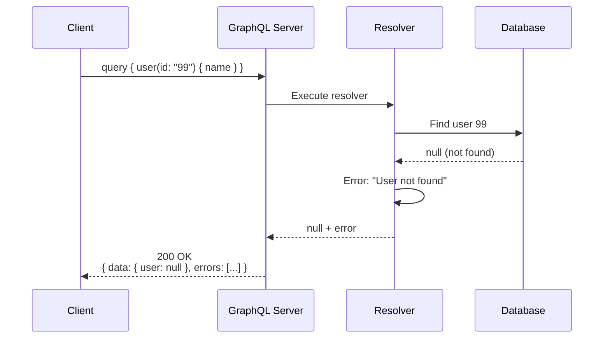
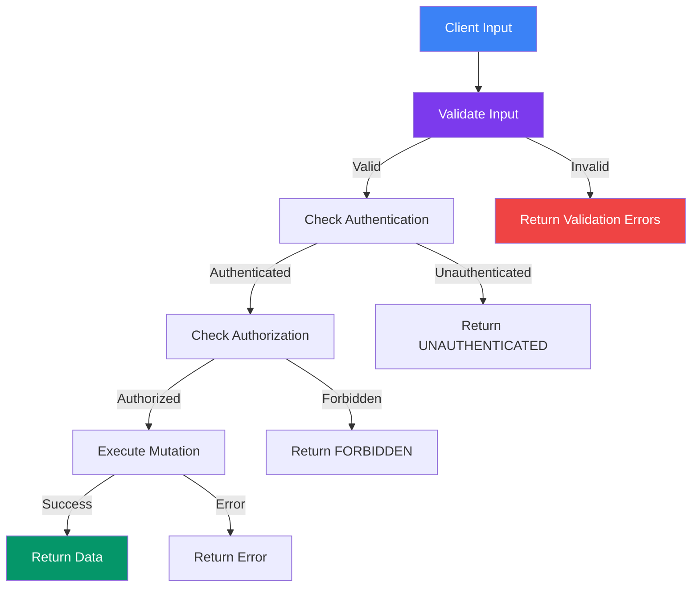

## Errors & Validation

GraphQL has a unique approach to errors. Unlike REST where a 4xx/5xx status means failure, GraphQL often returns **200 with partial data + error details**. Understanding this is key to building robust APIs.

> **Analogy:** In REST, if one dish in your order is unavailable, the whole order is cancelled. In GraphQL, you get the available dishes plus a note about the unavailable one.

---

### GraphQL Error Structure

```json
{
  "data": {
    "user": null,
    "users": [
      { "id": "1", "name": "Alice" },
      null
    ]
  },
  "errors": [
    {
      "message": "User not found",
      "locations": [{ "line": 3, "column": 5 }],
      "path": ["user"],
      "extensions": {
        "code": "NOT_FOUND",
        "userId": "999"
      }
    },
    {
      "message": "Database timeout for user 3",
      "path": ["users", 2],
      "extensions": {
        "code": "INTERNAL_ERROR"
      }
    }
  ]
}
```

**Key points:**
- `data` may contain **partial results** — some fields succeed, others fail
- `errors` array lists what went wrong
- Each error has `message`, `path`, and optional `extensions`
- **No HTTP error code** — GraphQL returns 200 even with errors (usually)

---

### Error Handling Flow



---

### Throwing Errors in Resolvers

```javascript
// Basic error
const resolvers = {
  Query: {
    user: async (_, { id }, { db }) => {
      const user = await db.user.findUnique({ where: { id } });
      if (!user) {
        throw new Error('User not found');
      }
      return user;
    },
  },
};
```

### Custom Error Codes (Apollo Server)

```javascript
import { GraphQLError } from 'graphql';

const resolvers = {
  Mutation: {
    createUser: async (_, { input }, { db }) => {
      // Validate input
      if (!input.email.includes('@')) {
        throw new GraphQLError('Invalid email format', {
          extensions: { code: 'BAD_USER_INPUT', field: 'email' },
        });
      }

      // Check for duplicates
      const existing = await db.user.findUnique({
        where: { email: input.email },
      });
      if (existing) {
        throw new GraphQLError('Email already in use', {
          extensions: { code: 'CONFLICT', field: 'email' },
        });
      }

      // Authorization check
      if (!context.user) {
        throw new GraphQLError('Not authenticated', {
          extensions: { code: 'UNAUTHENTICATED' },
        });
      }

      // Success
      return await db.user.create({ data: input });
    },
  },
};
```

---

### Common Error Codes

| Error Code | Meaning | Example |
|-----------|---------|---------|
| `BAD_USER_INPUT` | Invalid input | Wrong email format |
| `UNAUTHENTICATED` | Not logged in | Missing/expired token |
| `FORBIDDEN` | No permission | Viewer trying to edit admin data |
| `NOT_FOUND` | Resource missing | Query for non-existent ID |
| `CONFLICT` | Duplicate / conflict | Email already registered |
| `RATE_LIMITED` | Too many requests | Exceeded API quota |
| `INTERNAL_ERROR` | Server error | Database connection timeout |
| `VALIDATION_ERROR` | Field validation failed | Age must be > 0 |

---

### Input Validation

```javascript
// Schema with validation-friendly input types
input CreateUserInput {
  name: String!
  email: String!
  age: Int
}

// Resolver with validation
const resolvers = {
  Mutation: {
    createUser: async (_, { input }, { db }) => {
      const errors = [];

      // Field-level validation
      if (input.name.length < 2) {
        errors.push({
          field: 'name',
          message: 'Name must be at least 2 characters',
        });
      }
      if (input.age && (input.age < 13 || input.age > 150)) {
        errors.push({
          field: 'age',
          message: 'Age must be between 13 and 150',
        });
      }

      // Return all validation errors at once
      if (errors.length > 0) {
        throw new GraphQLError('Validation failed', {
          extensions: {
            code: 'VALIDATION_ERROR',
            errors,
          },
        });
      }

      return await db.user.create({ data: input });
    },
  },
};
```

---

### Client-Side Error Handling

```javascript
// Apollo Client
const { loading, error, data } = useQuery(GET_USERS);

if (error) {
  // error.graphQLErrors — errors from GraphQL server
  // error.networkError — network-level errors (offline, server down)
  
  error.graphQLErrors.forEach(({ message, extensions }) => {
    console.log(`[${extensions?.code}] ${message}`);
  });
}
```

```javascript
// With fetch
const response = await fetch('/graphql', { /* ... */ });
const result = await response.json();

if (result.errors) {
  result.errors.forEach(err => {
    console.error(`Error at ${err.path?.join('.')}: ${err.message}`);
  });
}

// Use partial data if available
if (result.data) {
  renderUI(result.data);
}
```

---

### Validation Patterns



---

### In Simple Words

- GraphQL returns **200 with errors** — not HTTP 4xx/5xx (usually)
- The response has **two parts**: `data` (what succeeded) and `errors` (what failed)
- Use **`GraphQLError`** with `extensions.code` for structured error handling
- Always **validate input** in resolvers and **group all errors** before returning
- On the client, check for **both** partial data and errors
- Follow the pattern: validate → authenticate → authorize → execute
