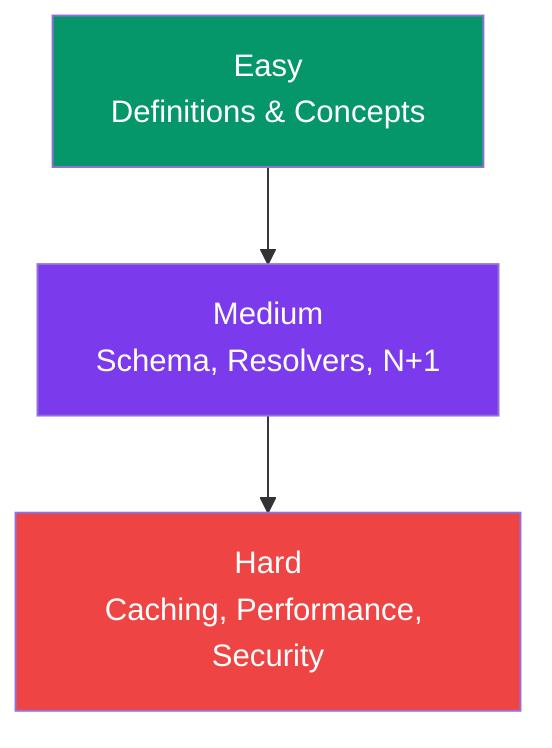

## GraphQL Interview Questions

This page covers the most common GraphQL interview questions — from **beginner** to **advanced**. Use these to prepare for your next interview.

---

### Quick Reference



---

### Easy Questions

**Q1: What is GraphQL and how does it differ from REST?**

GraphQL is a query language for APIs that lets clients request **exactly the data they need**. Unlike REST, which has multiple endpoints with fixed response shapes, GraphQL uses a **single endpoint** and a **strong type system** where the client specifies the response shape.

**Q2: What are the three operation types in GraphQL?**

- **Query** — Read data (like GET)
- **Mutation** — Write data (like POST/PUT/DELETE)
- **Subscription** — Real-time data (WebSocket)

**Q3: What is a resolver?**

A **resolver** is a function that returns data for a specific field in the schema. Every field can have a resolver. Resolvers form a chain — parent resolvers pass results to child resolvers.

**Q4: What is the `!` (exclamation mark) in GraphQL types?**

It means **non-null**. `String!` means the field will always return a string (never `null`). `[User!]!` means the array itself is non-null and each item in it is non-null.

**Q5: What is introspection?**

Introspection is GraphQL's ability to **query the schema itself**. It makes GraphQL self-documenting — tools like GraphiQL use introspection to show available types, fields, and operations.

---

### Medium Questions

**Q6: What is the N+1 problem in GraphQL? How do you solve it?**

The N+1 problem occurs when resolving nested fields causes **N additional database queries** for N parent items. Example: fetching 100 users and then fetching posts for each user separately (1 + 100 queries).

**Solution:** Use **DataLoader** which batches individual requests into a single query. DataLoader collects all `load()` calls within a single tick and executes one batched query.

**Q7: Explain the four arguments every resolver receives.**

| Argument | Description |
|----------|-------------|
| `parent` | The result from the parent resolver (used for nested fields) |
| `args` | Arguments passed to the field in the query |
| `context` | Shared object across all resolvers (DB, auth, loaders) |
| `info` | Query AST and metadata (rarely used) |

**Q8: What are fragments in GraphQL?**

**Fragments** are reusable field selections. They allow you to define a set of fields once and use them in multiple queries:

```graphql
fragment UserFields on User {
  id
  name
  email
  avatar
}

query {
  users { ...UserFields }
}
```

**Q9: How does pagination work in GraphQL?**

Two common approaches:

1. **Cursor-based** (Relay spec): Uses `first`, `after`, `edges`, `pageInfo` — more robust for real-time data
2. **Offset-based**: Uses `page`, `limit` — simpler but can miss items if data changes

**Q10: What is the difference between `Query` and `Mutation` in execution?**

- **Queries** can run **in parallel** (no side effects expected)
- **Mutations** run **sequentially** (one after another) to prevent race conditions

---

### Hard Questions

**Q11: How do you handle file uploads in GraphQL?**

GraphQL doesn't natively support file uploads. Common approaches:
1. **Base64 encoding** the file (simple but inefficient)
2. **Multipart request specification** (`graphql-upload` package)
3. **Separate upload endpoint** + pass the URL back in GraphQL (recommended)

**Q12: How does Apollo Client's cache work?**

Apollo Client uses a **normalized cache**. Each object is stored by its `__typename` and `id` (e.g., `User:1`). When a query returns data, Apollo:
1. Normalizes the response into individual cache entries
2. Automatically updates when the same object appears in another query
3. Supports **cache redirects**, **cache-only fetching**, and **optimistic updates**

**Q13: How would you implement rate limiting in a GraphQL API?**

Rate limiting is harder in GraphQL because all requests hit one endpoint:
1. **Query complexity scoring** — assign weights to fields, reject queries above a limit
2. **Depth limiting** — limit nesting depth (e.g., `graphql-depth-limit`)
3. **Per-user/API key tracking** — track query count by user, not by endpoint
4. **Persisted queries** — only allow pre-approved query strings

**Q14: Explain how you'd migrate a REST API to GraphQL.**

1. **Schema-first** — design your GraphQL schema before writing resolvers
2. **Wrap REST endpoints** — write resolvers that call existing REST APIs
3. **Gradual migration** — run GraphQL alongside REST, use a gateway to route
4. **Use DataLoader** to batch the N+1 REST calls
5. **Replace REST endpoints** one by one with direct database resolvers

**Q15: What are persisted queries and why use them?**

**Persisted queries** are pre-approved, hashed query strings stored on the server:

```javascript
// Client sends only the hash
fetch('/graphql', {
  method: 'POST',
  body: JSON.stringify({
    extensions: { persistedQuery: { sha256Hash: 'hash...' } },
    variables: { id: '1' },
  }),
});
```

**Benefits:** Smaller payloads, guaranteed non-malicious queries, better caching, no query parsing overhead.

**Q16: What are the trade-offs of using GraphQL subscriptions?**

| Pro | Con |
|-----|-----|
| Real-time updates | Persistent connection = more server resources |
| Same schema syntax | Complex state management on client |
| Type-safe | WebSocket infrastructure needed |
| Filtered subscriptions | Scaling WebSocket connections is harder |

**Q17: How do you test a GraphQL API?**

1. **Unit tests** — test individual resolvers with mock data
2. **Integration tests** — test full query execution against a test database
3. **Schema tests** — verify schema structure and backward compatibility
4. **Load tests** — measure performance with complex nested queries

```javascript
// Example integration test
import { createTestServer } from '../server';

test('returns user by ID', async () => {
  const server = await createTestServer();
  
  const result = await server.executeOperation({
    query: `query GetUser($id: ID!) {
      user(id: $id) { name email }
    }`,
    variables: { id: '1' },
  });

  expect(result.data.user.name).toBe('Alice');
  expect(result.errors).toBeUndefined();
});
```

---

### Quick Reference — Common Interview Topics

| Topic | Key Points |
|-------|------------|
| **Schema** | Contract between client and server, defines types and operations |
| **Resolvers** | Functions that return data for each field |
| **N+1** | Performance problem solved by DataLoader batching |
| **Subscriptions** | Real-time via WebSocket, pub/sub pattern |
| **Caching** | Apollo normalized cache, no built-in HTTP caching |
| **Security** | Depth limits, complexity limits, rate limiting, auth |
| **Fragments** | Reusable field selections, like macros |
| **Variables** | Dynamic query parameters, sent separately |

---

### In Simple Words

- GraphQL is a **client-driven API query language**
- Key concepts: **schema, resolvers, queries, mutations, subscriptions**
- Know the **N+1 problem** and **DataLoader** — this is the most common interview topic
- Understand **caching, pagination, and security** for architecting real apps
- Practice explaining **trade-offs** between GraphQL and REST
- Know **Apollo Client** basics if you work with React
