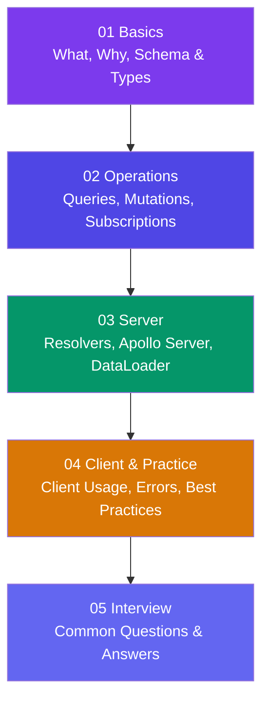

# GraphQL

**GraphQL** is a query language for APIs developed by Facebook in 2012 and released publicly in 2015. Unlike REST, where the server defines the shape of every response, GraphQL lets the **client ask for exactly what it needs** — nothing more, nothing less.

> **Analogy:** REST is like ordering a fixed-menu meal — you get what the chef decides. GraphQL is like a buffet — you pick exactly what you want on your plate.

---

## Learning Path

---

## Sections

| Section | What You'll Learn |
|---------|-------------------|
| **01 Basics** | What is GraphQL, how it differs from REST, schema & type system |
| **02 Operations** | Reading data (queries), writing data (mutations), real-time updates (subscriptions) |
| **03 Server** | Resolvers, building an Apollo Server, connecting databases & DataLoader |
| **04 Client & Practice** | Querying from frontend, error handling, security & best practices |
| **05 Interview** | Common GraphQL interview questions and answers |

---

## Why GraphQL?

| Problem | REST | GraphQL |
|---------|------|---------|
| **Over-fetching** | Server sends all fields, even unused ones | Client requests only needed fields |
| **Under-fetching** | Need multiple requests to get related data | One query fetches nested relations |
| **Multiple endpoints** | `/users`, `/users/:id/posts`, `/posts/:id/comments` | Single `/graphql` endpoint |
| **Versioning** | `/v1/users`, `/v2/users` | Evolve schema — no versioning needed |

---

## How This Track Works

- Each page starts with an **analogy** or plain-English explanation
- Concepts are followed by **small runnable code examples** (schema + query + resolver)
- Pages end with an **"In Simple Words"** summary
- **Mermaid diagrams** illustrate key concepts visually

Start with **[What is GraphQL?](./01-basics/what-is-graphql)** to begin your journey!
