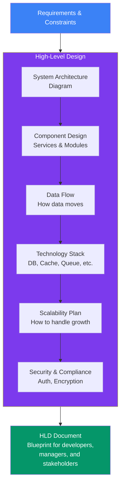
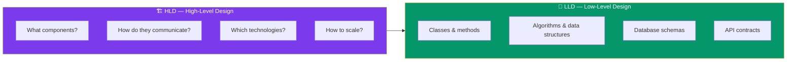
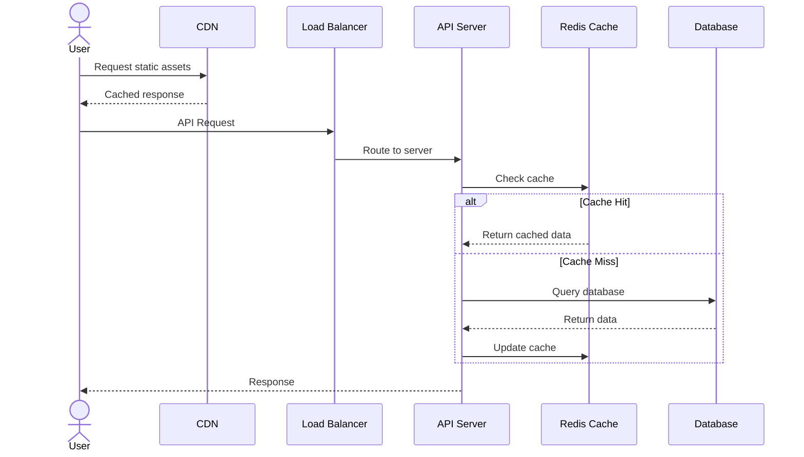

## 01 — Introduction to HLD

**High-Level Design (HLD)** is the architectural blueprint of a software system. It describes the overall system structure — components, modules, interfaces, data flow, technology choices, and how everything fits together — without diving into implementation details.

> **Analogy:** Building a house starts with an architectural blueprint showing room layouts, electrical routes, plumbing, and structural support. HLD is that blueprint. The detailed construction plans (LLD) come later.

---

### Problem Statement

Many developers can write code but struggle to **design systems**. Without HLD:
- Teams build components that don't integrate well
- Systems fail under load (no scalability planning)
- Security is an afterthought
- Maintenance becomes a nightmare
- Migrations and changes are costly

HLD solves these problems by forcing you to think about the **big picture** before building.

---

### Requirements

| Category | Examples |
|----------|----------|
| **Functional** | What the system must do (features, APIs, behaviors) |
| **Non-Functional** | Performance, scalability, availability, security, latency |
| **Constraints** | Budget, timeline, team size, legacy integration |
| **Future** | Expected growth, planned features, migration paths |

---

### Architecture Overview

---

### Components of HLD

| Component | Description |
|-----------|-------------|
| **System Architecture Diagram** | Visual overview of all components and their interactions |
| **Component Design** | Services, modules, their responsibilities and interfaces |
| **Data Flow** | How data moves between components (request/response, streams) |
| **Technology Stack** | Languages, frameworks, databases, message queues, caching |
| **Scalability Strategy** | How the system scales (horizontal/vertical), bottlenecks |
| **Security Architecture** | Authentication, authorization, encryption, compliance |
| **Deployment Architecture** | Environments, CI/CD, infrastructure as code |
| **Monitoring & Alerting** | Logs, metrics, traces, dashboards |

---

### HLD vs LLD

| Aspect | HLD | LLD |
|--------|-----|-----|
| **Audience** | Architects, managers, stakeholders | Developers |
| **Scope** | System-wide architecture | Component/module internals |
| **Detail level** | High-level, conceptual | Detailed, implementation-ready |
| **Diagrams** | Architecture flow, component diagrams | Class diagrams, sequence diagrams |
| **Output** | HLD document, architecture decision records | Design docs, API specs, DB schemas |

---

### Data Flow Example

---

### Trade-offs

| Choice | Pros | Cons |
|--------|------|------|
| **Over-engineering** | Handles future scale | Slower delivery, higher cost |
| **Under-engineering** | Fast to build | Expensive to refactor later |
| **Monolithic start** | Simple, fast development | Hard to scale teams |
| **Microservices start** | Scales teams, independent deploy | High complexity overhead |

---

### Scaling Strategies

| Strategy | Description | When to Use |
|----------|-------------|-------------|
| **Vertical Scaling** | Bigger machine | Simple apps, predictable growth |
| **Horizontal Scaling** | More machines | Unpredictable traffic, high availability |
| **Caching** | Store frequent results | Read-heavy workloads |
| **Database Sharding** | Split data across DBs | Data too large for single DB |
| **Read Replicas** | Copy DB for reads | Read-heavy, write-light workloads |
| **Queue-based decoupling** | Buffer between components | Spiky traffic, async processing |

---

### Interview Questions

1. **What is the difference between HLD and LLD?**
2. **What are the key components of an HLD document?**
3. **Walk me through designing the architecture for a new system.**
4. **What trade-offs do you consider when choosing between monolith and microservices?**
5. **How do you ensure your HLD accounts for future scalability?**

---

### Real-World Examples

| System | HLD Highlights |
|--------|----------------|
| **Twitter** | Timeline fanout service, tweet ingestion, search index |
| **Uber** | Ride matching service, geospatial index, real-time tracking |
| **Netflix** | Microservices, CDN, chaos engineering, recommendation engine |
| **Amazon** | SOA (Service-Oriented Architecture), eventual consistency for orders |

---

### In Simple Words

- **HLD** is the big-picture blueprint — what components, how they connect, which tech to use
- It comes **before** coding and guides the entire development process
- Good HLD prevents costly refactoring, scalability failures, and integration nightmares
- The key outputs: architecture diagrams, component design, data flow, tech stack, scaling plan
- Always consider **trade-offs** — there's no perfect architecture, only the right one for your constraints
