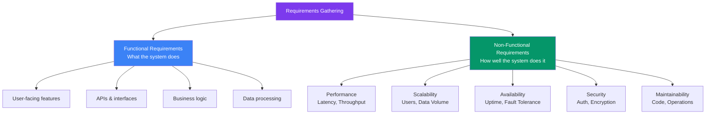
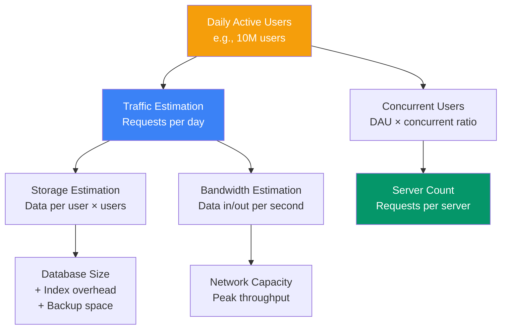

## 02 — Requirements Gathering

**Requirements gathering** is the foundation of every well-designed system. Before you draw a single architecture diagram, you must understand **what** the system should do and **how well** it should do it.

> **Analogy:** Requirements are like the recipe for a dish. If the recipe says "bake until golden," but doesn't specify temperature or time, the cake will fail. Requirements must be precise.

---

### Problem Statement

Teams often skip or rush requirements gathering, leading to:
- Building features nobody needs
- Systems that don't meet performance expectations
- Costly rework and architecture changes
- Unclear success criteria — "is it done?"

---

### Requirements Overview



---

### Functional Requirements

Functional requirements describe **what** the system must do. They are actions, behaviors, and features.

| Category | Examples |
|----------|----------|
| **User features** | Register, login, create post, search, follow |
| **APIs** | REST endpoints, GraphQL schema, event contracts |
| **Data processing** | Upload file, transcode video, generate report |
| **Admin features** | Analytics dashboard, user management, content moderation |
| **Background jobs** | Email notifications, data cleanup, feed generation |

**Template for documenting:**
```
Feature: User Registration
- As a: New visitor
- I want to: Create an account with email and password
- So that: I can access personalized features
- Acceptance: Email verification sent within 30 seconds
```

---

### Non-Functional Requirements (NFRs)

NFRs describe **how well** the system performs — the quality attributes.

| NFR | What It Means | Example Target |
|-----|---------------|----------------|
| **Latency** | Response time | P99 < 200ms for API |
| **Throughput** | Requests per second | Handle 10,000 RPS |
| **Availability** | Uptime percentage | 99.99% (four 9's) |
| **Scalability** | Growth capacity | Support 10x traffic spike |
| **Consistency** | Data freshness | Strong consistency for payments |
| **Durability** | Data persistence | 99.999999999% (S3 standard) |
| **Security** | Protection level | SOC 2, GDPR compliant |

---

### Capacity Estimation Flow



---

### Sample Requirements Template

| Requirement | Category | Detail |
|-------------|----------|--------|
| User can upload profile photo | Functional | Max 5MB, JPEG/PNG |
| List friends' posts in feed | Functional | Chronological, paginated |
| P99 API latency < 200ms | Non-Functional | Performance |
| Support 10M DAU | Non-Functional | Scalability |
| 99.99% uptime | Non-Functional | Availability |
| End-to-end encryption | Non-Functional | Security |

---

### Trade-offs

| Focus | Benefit | Cost |
|-------|---------|------|
| **High availability** | Always up | More infrastructure cost |
| **Low latency** | Fast responses | More caching, edge servers |
| **Strong consistency** | Accurate data | Slower writes, less availability |
| **High scalability** | Handles growth | More complex architecture |
| **Security** | Protected data | Development friction, slower |

---

### Scaling Considerations

| Requirement Type | Scaling Strategy |
|-----------------|------------------|
| **Traffic spikes** (e.g., flash sales) | Auto-scaling groups, queue-based load shedding |
| **Data growth** (e.g., user uploads) | Object storage (S3), sharding, archiving |
| **Global users** | Multi-region deployment, CDN, edge computing |
| **Feature velocity** | Microservices, feature flags, CI/CD |
| **Compliance needs** | Data locality, audit logs, encryption |

---

### Interview Questions

1. **What's the difference between functional and non-functional requirements?**
2. **How do you estimate the number of servers needed for 10M DAU?**
3. **What questions do you ask stakeholders during requirements gathering?**
4. **How do you prioritize conflicting requirements (e.g., low cost vs high availability)?**
5. **Give an example of a non-functional requirement that changed your architecture choice.**

---

### Real-World Examples

| System | Key Requirement That Shaped Architecture |
|--------|------------------------------------------|
| **Uber** | Real-time driver location → needed geospatial index & WebSocket |
| **Netflix** | Global video streaming → massive CDN, adaptive bitrate |
| **Slack** | Real-time messaging → persistent WebSocket connections |
| **Stripe** | Payment reliability → idempotency keys, transactional outbox |

---

### In Simple Words

- **Functional requirements** = what the system does (features, APIs)
- **Non-functional requirements** = how well it does it (speed, scale, reliability)
- Get requirements **in writing** before starting architecture — assumptions cause failures
- Capacity estimation converts requirements into concrete numbers (servers, storage, bandwidth)
- Always ask **"why"** — understand the goal, not just the feature request
- Prioritize: **Availability vs Consistency vs Cost vs Speed** — you can't have all four
