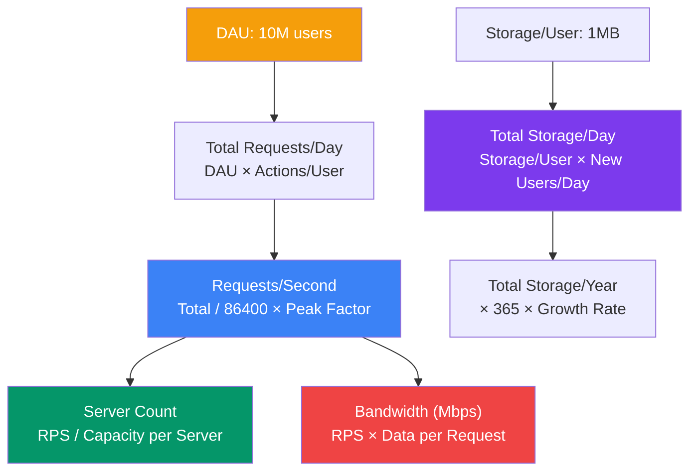
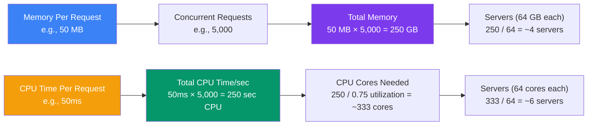

## 03 — Capacity Estimation

**Capacity estimation** is the process of calculating the resources your system will need — servers, storage, bandwidth, memory — based on expected usage. It ensures you design for the right scale from day one.

> **Analogy:** Estimating capacity is like planning a wedding. You need to know how many guests (traffic), how much food (storage), and how many waitstaff (servers) — book too few and it's a disaster, too many and you waste money.

---

### Problem Statement

Building a system without capacity estimation leads to:
- **Under-provisioning** — servers crash under load, users get timeouts
- **Over-provisioning** — wasting money on unused resources
- **Wrong architecture** — picking a database that can't scale to your data volume
- **Surprise costs** — unexpected bandwidth or storage bills

---

### Requirements

| Metric | Why It Matters |
|--------|----------------|
| **Daily Active Users (DAU)** | Base for all other estimates |
| **Requests per user per day** | Determines total traffic |
| **Read/Write ratio** | Shapes caching & DB strategy |
| **Data per request** | Storage & bandwidth requirements |
| **Peak traffic multiplier** | 5-10x average during peak hours |

---

### Architecture Overview

---

### Step 1: Traffic Estimation

**Formula:** `Requests per second (RPS) = (DAU × Actions per user per day) / 86400 × Peak factor`

| Variable | Example Value | How to Estimate |
|----------|---------------|-----------------|
| DAU | 10,000,000 | Product/marketing estimate |
| Actions/user/day | 50 | Avg tweets, likes, reads (Twitter: ~50) |
| Total actions/day | 500,000,000 | DAU × Actions/user |
| Avg RPS | ~5,800 | 500M / 86,400 seconds |
| Peak factor | 5x | Traffic spikes during events / business hours |
| **Peak RPS** | **~29,000** | Avg RPS × Peak factor |

---

### Step 2: Storage Estimation

**Formula:** `Storage per year = (Storage per user × New users per year) + (Data generated per action × Actions per year)`

| Data Type | Per Item | Annual Growth |
|-----------|----------|---------------|
| User profile | 10 KB | 10M new users → 100 GB |
| Tweet/text post | 500 bytes | 10B tweets → 5 TB |
| Image (compressed) | 200 KB | 1B images → 200 TB |
| Video (compressed) | 50 MB | 10M videos → 500 TB |
| Logs | 1 KB per request | 180B requests → 180 TB |
| Database indexes | 50% overhead | 30% of data size |
| Backups | 3x data | Full + differential |

---

### Step 3: Bandwidth Estimation

**Formula:** `Bandwidth (Mbps) = RPS × Average response size × 8 / 1,000,000`

| Component | Inbound (Mbps) | Outbound (Mbps) |
|-----------|---------------|-----------------|
| API requests | 500 | 2,000 |
| Image uploads | 1,000 | 200 (CDN serves) |
| Video uploads | 5,000 | 20,000 (CDN) |
| Logs | 100 | 50 |
| Database replication | — | 300 |
| **Total** | **~6,600 Mbps** | **~22,550 Mbps** |

---

### Step 4: Server Estimation

**Formula:** `Servers needed = Peak RPS / Capacity per server`

| Server Type | Capacity per Server | Servers Needed (29K RPS) |
|-------------|-------------------|--------------------------|
| Web server (small) | 1,000 RPS | ~30 |
| Web server (medium) | 5,000 RPS | ~6 |
| Web server (large) | 20,000 RPS | ~2 (but need more for HA) |
| Cache node | 50,000 QPS | ~2 (then redundancy) |
| DB (primary) | 10,000 QPS | ~3 (1 primary + 2 replicas) |

---

### Memory & CPU Estimation

---

### Quick Reference: Numbers to Know

| Unit | Equivalent |
|------|------------|
| 1 million requests/day | ~12 RPS average |
| DAU × 10% | Approximate concurrent users during peak |
| Peak traffic | 5-10x average hourly traffic |
| Database disk space | ~3x data size (data + indexes + logs) |
| Single web server | 1,000-10,000 RPS (depends on complexity) |
| Single DB server | 1,000-10,000 QPS (depends on query complexity) |
| 1 Gbps bandwidth | ~125 MB/s data transfer |

---

### Trade-offs

| Choice | Benefit | Cost |
|--------|---------|------|
| **Over-estimate** | Safe, handles spikes | Wasted resources, higher cost |
| **Under-estimate** | Lower initial cost | Performance issues, emergency scaling |
| **Start small, auto-scale** | Cost-efficient, flexible | Complexity of scaling infrastructure |
| **Build for peak** | Never slow | Idle resources during off-peak |

---

### Scaling Strategies

| Strategy | When |
|----------|------|
| **Vertical scaling** | Quick fix, simple apps, predictable growth |
| **Horizontal scaling** | Unpredictable traffic, HA requirements |
| **Auto-scaling** | Variable traffic patterns (social media, e-commerce) |
| **Reserved capacity** | Steady baseline traffic (always on) |
| **Spot/preemptible** | Batch processing, non-critical workloads |

---

### Interview Questions

1. **Estimate the storage needed for a Twitter-like app with 100M DAU.**
2. **How many servers do we need for a video streaming platform handling 1M concurrent viewers?**
3. **What's the bandwidth cost for serving 10GB/hour of video content to 100K users?**
4. **How do you estimate the cache size needed for a social media feed?**
5. **A system crashes at 10,000 RPS on 4 servers. How do you plan for 50,000 RPS?**

---

### Real-World Examples

| System | Capacity Challenge | Solution |
|--------|-------------------|----------|
| **Twitter** | 500M tweets/day, reads per second huge | Timeline fanout, heavy caching |
| **Netflix** | 200M+ users streaming simultaneously | CDN (Open Connect), adaptive bitrate |
| **WhatsApp** | 100B+ messages/day | Erlang-based custom server, minimal per-message storage |
| **Stripe** | Millions of API requests/day | Idempotency, horizontal scaling of API servers |

---

### In Simple Words

- **Start with DAU and actions per user** — everything else flows from these numbers
- **Peak traffic is 5-10x average** — design your architecture for the peak, not the average
- **Storage grows forever** — plan for data lifecycle (hot → warm → cold → delete)
- **Bandwidth costs money** — cache aggressively at CDN and application layers
- **One server handles 1K-10K RPS** — use this as your mental baseline for estimation
- **Always add a safety margin (1.5x-3x)** — estimates are guesses, not guarantees
