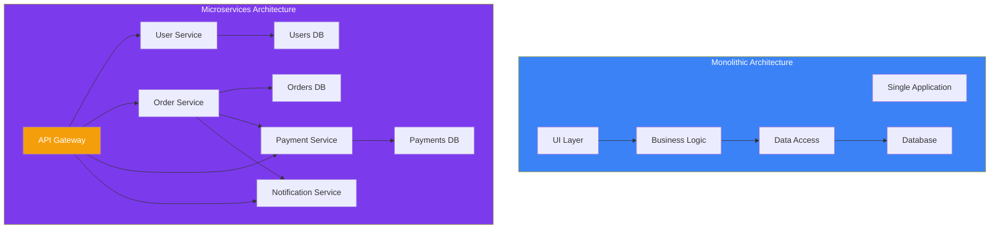
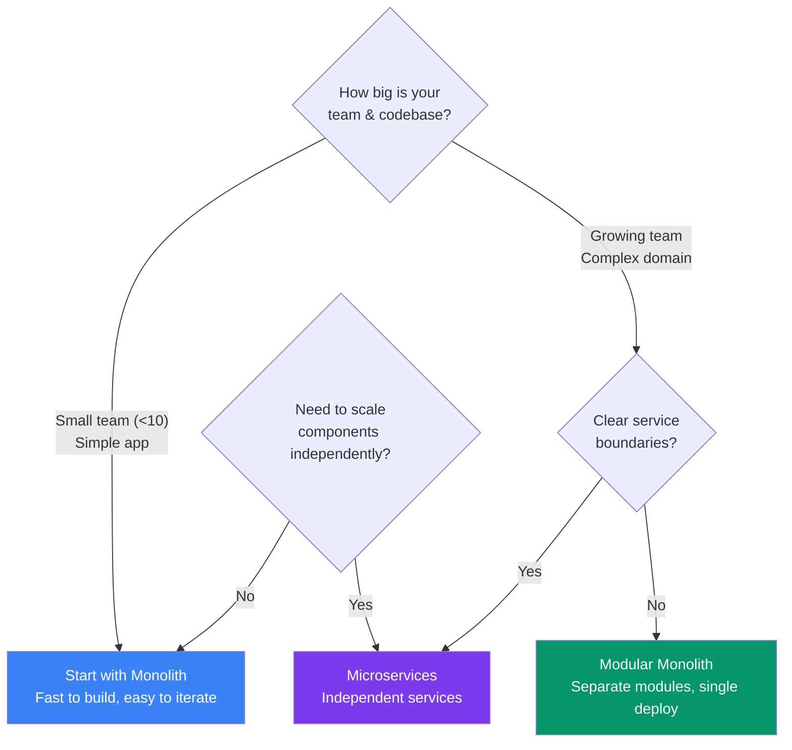
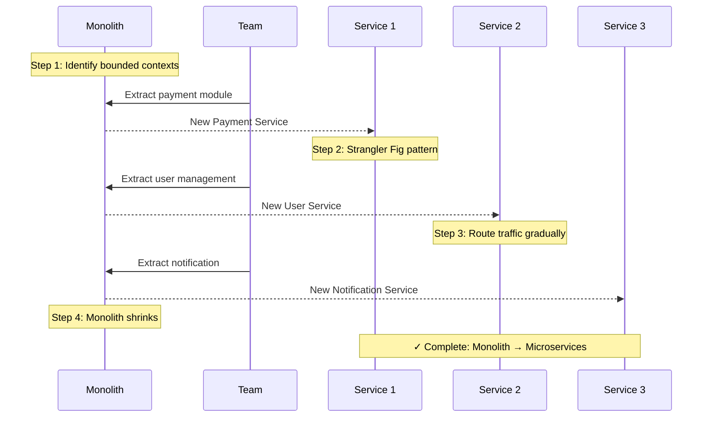
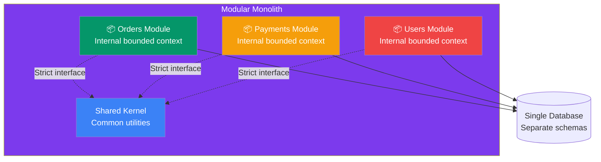

## 04 — Monolith vs Microservices

**Architecture style** defines how your system is structured. The two most common styles are **monolithic** (single deployable unit) and **microservices** (independent services communicating over a network).

> **Analogy:** A monolith is a food truck — one kitchen, one menu, one line. Microservices are a food court — multiple specialized stalls, each with its own kitchen, but diners can mix and match.

---

### Problem Statement

Choosing the wrong architecture:
- Monolith that's too large → "big ball of mud," hard to maintain, slow deployments
- Microservices too early → distributed monolith, debugging nightmare, operational overhead
- Wrong service boundaries → chatty services, data inconsistency, complex transactions

---

### Architecture Comparison

---

### Monolith — Pros & Cons

| Pros | Cons |
|------|------|
| Simple to develop and deploy | Becomes bloated over time |
| Single codebase, easy to navigate | Hard to understand for new devs |
| Low operational overhead | Any change requires full deploy |
| Easy testing (single process) | Can't scale components independently |
| Low latency (in-process calls) | Technology lock-in |
| Simple transaction management | Slows down large teams |

### Microservices — Pros & Cons

| Pros | Cons |
|------|------|
| Independent deployment per service | Complex networking & service discovery |
| Scale only what needs scaling | Distributed transaction complexity |
| Team autonomy (each team owns services) | Debugging across services is hard |
| Technology diversity (pick best tool) | Data consistency challenges |
| Fault isolation (one failure doesn't cascade) | Operational overhead (monitoring, logging) |
| Better for large, complex systems | Requires mature DevOps practices |

---

### When to Choose Which

---

### Monolith to Microservices Migration

| Migration Step | Description |
|----------------|-------------|
| **1. Identify boundaries** | Find natural service boundaries (bounded contexts) |
| **2. Extract one service** | Start with the most independent module |
| **3. Strangler Fig pattern** | Route new traffic to service, keep old path |
| **4. Repeat** | Extract another service once the first is stable |
| **5. Retire monolith** | When all modules are services, decommission |

---

### Modular Monolith (Best of Both?)

A **modular monolith** keeps a single deployment unit but enforces **module boundaries** in code.

---

### Trade-offs

| Decision | Pros | Cons |
|----------|------|------|
| **Start monolithic** | Fast development, simple ops | Need to refactor later |
| **Start microservices** | Scales from day one | Slow initial development |
| **Modular monolith** | Clean boundaries, simple deploy | Easy to break module boundaries |
| **Service mesh** | Advanced traffic management | Operational complexity |
| **Event-driven services** | Loose coupling | Eventual consistency challenges |

---

### Scaling Strategies

| Architecture | Scaling Approach |
|-------------|------------------|
| **Monolith** | Clone entire app (horizontal) |
| **Microservices** | Scale individual services by demand |
| **Modular monolith** | Clone entire app, optimize hot modules |
| **Hybrid** | Keep monolith core, extract hot services |

---

### Interview Questions

1. **When would you choose a monolith over microservices?**
2. **How do you decide service boundaries for microservices?**
3. **What is the strangler fig pattern?**
4. **How do microservices handle distributed transactions?**
5. **What is a modular monolith and when would you use it?**

---

### Real-World Examples

| Company | Started As | Evolved To | Why |
|---------|-----------|------------|-----|
| **Amazon** | Monolith (1990s) | Microservices (2000s) | Scale, team autonomy |
| **Netflix** | Monolith (DVD delivery) | Microservices (streaming) | Independent scaling, fault isolation |
| **Shopify** | Monolith | Modular monolith | Balance of simplicity and scale |
| **Uber** | Monolith (one city) | Microservices (global) | Geographic scaling, team growth |

---

### In Simple Words

- **Monolith** = one big app — simple to start, harder as you grow
- **Microservices** = many small apps — complex initially but scales well
- **Start monolithic** until you clearly understand your service boundaries
- Use the **strangler fig pattern** to migrate — extract one service at a time
- A **modular monolith** is a great middle ground — module boundaries with single deployment
- Don't do microservices just because they're trendy — they come with real operational costs
