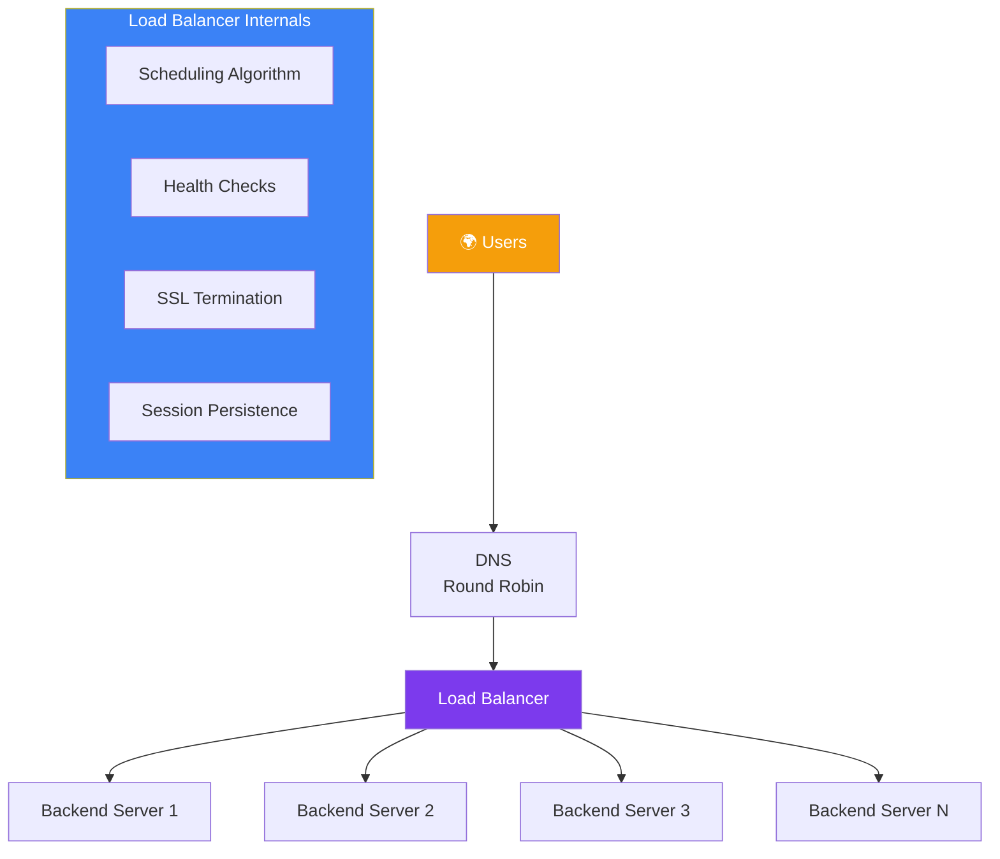
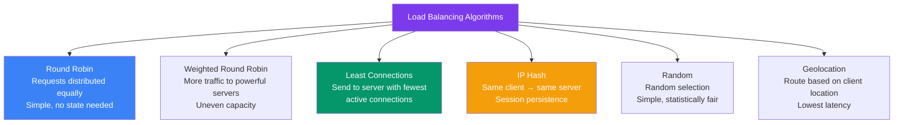
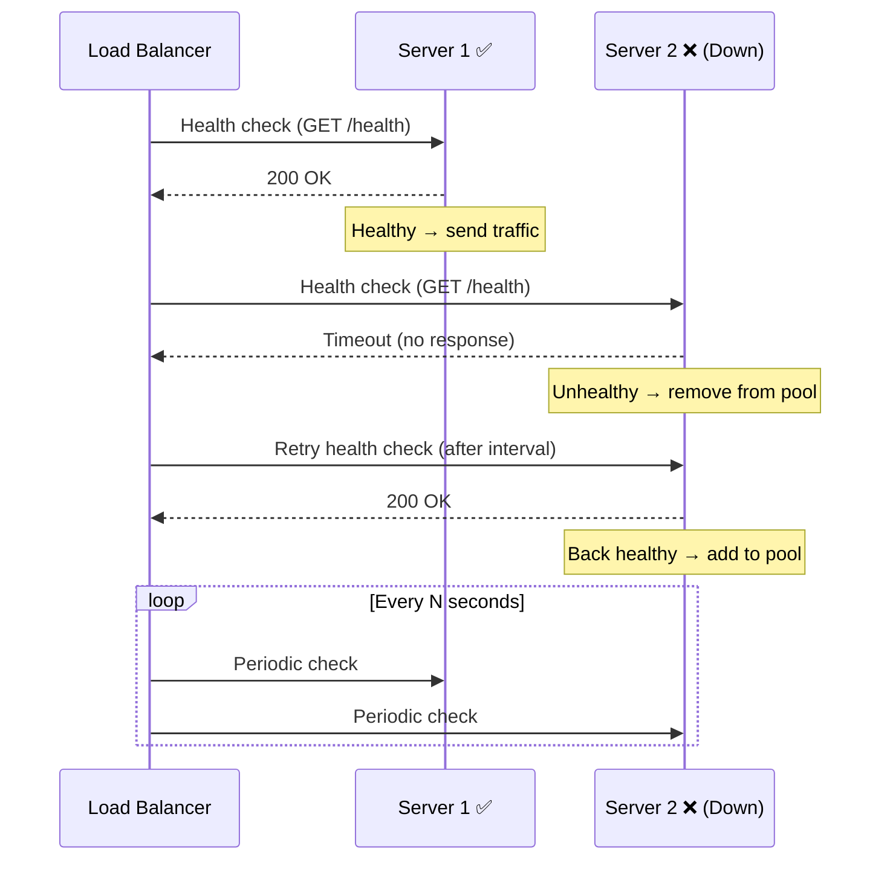
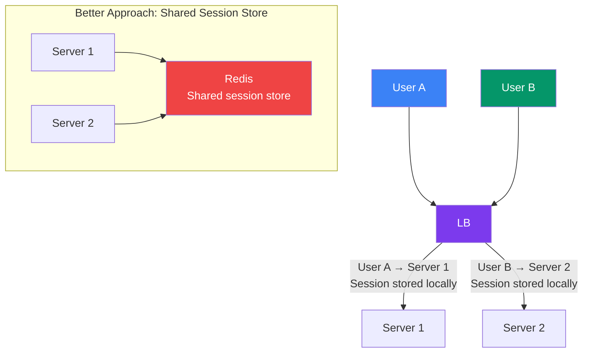

## 05 — Load Balancers

A **load balancer** distributes incoming network traffic across multiple backend servers. It's a critical component for scalability, high availability, and fault tolerance.

> **Analogy:** A load balancer is like a host at a restaurant — when customers arrive, the host directs them to the first available table, making sure no server is overwhelmed while another sits idle.

---

### Problem Statement

Without a load balancer:
- One server gets all traffic and crashes
- Users experience downtime when a server fails
- Cannot add or remove servers without downtime
- SSL termination and rate limiting must be handled by each server individually

---

### Architecture Overview

---

### Load Balancer Types

| Type | Layer | Description | Example |
|------|-------|-------------|---------|
| **ALB** (Application LB) | L7 | HTTP/HTTPS, path-based routing, host-based routing | AWS ALB |
| **NLB** (Network LB) | L4 | TCP/UDP, extreme performance, static IP | AWS NLB |
| **GLB** (Gateway LB) | L3 | IP packet-level, for appliances | AWS GLB |
| **Classic LB** | L4/L7 | Legacy, simple TCP/HTTP LB | AWS CLB (retired) |
| **HAProxy** | L4/L7 | Open-source, flexible, battle-tested | Self-managed |
| **NGINX** | L7 | Reverse proxy + LB, great for HTTP | Self-managed |

---

### Load Balancing Algorithms

| Algorithm | Best For | Pros | Cons |
|-----------|----------|------|------|
| **Round Robin** | Equal-capacity servers | Simple, fair | Doesn't consider load |
| **Least Connections** | Varying request durations | Better resource use | Slightly more complex |
| **IP Hash** | Sticky sessions | No extra config needed | Uneven distribution if clients from same IP |
| **Weighted** | Mixed server specs | Optimizes heterogeneous clusters | Manual weight tuning |

---

### Health Checks

| Health Check Type | What It Checks | Interval |
|-------------------|----------------|----------|
| **TCP** | Port is open (connection succeeds) | 5-30 seconds |
| **HTTP** | Endpoint returns 200 | 5-30 seconds |
| **HTTPS** | Secure endpoint returns 200 | 10-30 seconds |
| **Custom script** | Complex logic (e.g., DB connectivity) | 30-60 seconds |

---

### Session Persistence (Sticky Sessions)

**Sticky sessions** route the same client to the same server. Avoid when possible — use a **shared session store** (Redis) instead so any server can handle any request.

---

### Trade-offs

| Approach | Pros | Cons |
|----------|------|------|
| **ALB (L7)** | Smart routing, path-based | Slightly slower than NLB |
| **NLB (L4)** | Ultra-fast, static IP | No HTTP-level features |
| **Sticky sessions** | Simple session handling | Uneven load, server affinity issues |
| **Health checks** | Automatic failover | Adds complexity |
| **Multiple LBs** | High availability | Cost, management overhead |

---

### Scaling Strategies

| Strategy | How It Works |
|----------|-------------|
| **DNS Round Robin** | Multiple LB DNS entries, client picks one |
| **Multi-region LB** | Geo-routing to closest region's LB |
| **LB Auto Scaling** | Automatically register/deregister new servers |
| **Layer 7 Routing** | Route /api/* to API servers, /static/* to CDN |
| **Weighted routing** | Canary deployments (5% → 50% → 100%) |

---

### Interview Questions

1. **How does a load balancer improve availability?**
2. **What's the difference between L4 and L7 load balancing?**
3. **How do health checks work and what should they check?**
4. **What is the difference between sticky sessions and a shared session store?**
5. **How would you design load balancing for a global application?**

---

### Real-World Examples

| System | Load Balancer Strategy |
|--------|------------------------|
| **Amazon** | Multi-region Route53 + ALB per region + NLB for internal |
| **Netflix** | Zuul (gateway) + Ribbon (client-side LB) → migrated to Spring Cloud Gateway |
| **Cloudflare** | Global anycast + L4 LB at edge + L7 LB at origin |
| **Kubernetes** | Ingress Controller (L7) + Service (L4) — built-in LB abstraction |

---

### In Simple Words

- **Load balancers** distribute traffic across servers — essential for scaling and HA
- **L4 (NLB)** = fast, works for any TCP/UDP traffic
- **L7 (ALB)** = smarter, understands HTTP paths and headers
- **Health checks** automatically remove dead servers from the pool
- **Avoid sticky sessions** — use a shared cache (Redis) for session data instead
- **Multiple LB layers** = multiple layers of scale and redundancy
