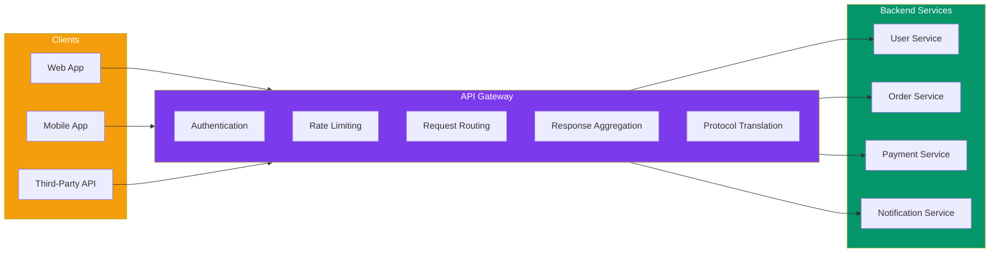
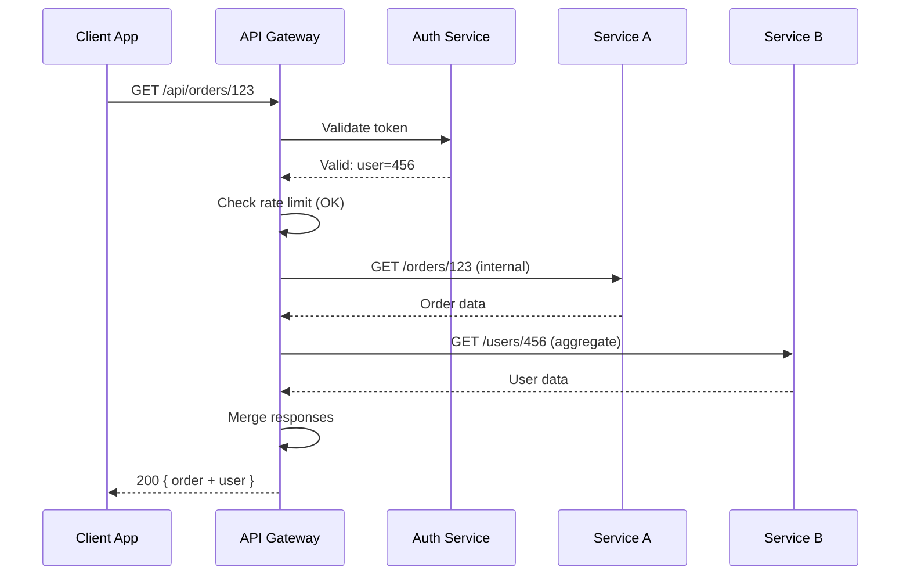
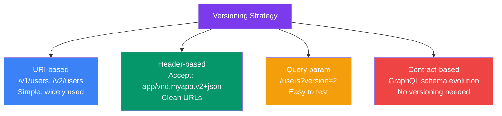

## 06 — API Gateway

An **API Gateway** is a single entry point for all client requests to a backend system. It handles cross-cutting concerns like authentication, rate limiting, routing, and aggregation — keeping backend services simple.

> **Analogy:** An API Gateway is like a reception desk at a large office building. Visitors don't wander through hallways looking for the right person — they go to the desk, get authenticated, and are directed to the correct office.

---

### Problem Statement

Without an API Gateway:
- Every client must know the location of every microservice
- Cross-cutting concerns (auth, logging, rate limiting) are duplicated across services
- Clients make multiple round-trips to gather related data
- Protocol translation (HTTP → gRPC → WebSocket) must be handled by each service
- Changing service URLs or splitting services breaks clients

---

### Architecture Overview

---

### API Gateway Responsibilities

| Responsibility | Description | Example |
|----------------|-------------|---------|
| **Request Routing** | Route to correct service | `/users/*` → User Service |
| **Authentication** | Verify identity | Validate JWT, OAuth tokens |
| **Rate Limiting** | Prevent abuse | 100 req/min per user |
| **Caching** | Cache frequent responses | Cache `/products/popular` |
| **Aggregation** | Combine multiple service responses | Get user + orders in one call |
| **Protocol Translation** | Convert between protocols | REST → gRPC, HTTP → WebSocket |
| **Request/Response Transformation** | Modify payloads | Add headers, rename fields |
| **Circuit Breaking** | Fail fast when downstream is down | Return cached/fallback response |
| **Logging & Monitoring** | Centralized observability | Log all API calls, metrics |
| **API Versioning** | Support multiple versions | `/v1/users`, `/v2/users` |

---

### Request Flow

---

### API Gateway Patterns

| Pattern | Description | Pros | Cons |
|---------|-------------|------|------|
| **Single Gateway** | One gateway for all clients | Simple, centralized | Single point of failure |
| **Multiple Gateways** | Separate gateways per client type (mobile, web, IoT) | Optimized per client | Duplicated logic |
| **BFF (Backend for Frontend)** | Each client has its own backend gateway | Tailored responses | Multiple gateways to maintain |
| **Gateway per Team** | Each team owns their gateway | Team autonomy | Inconsistent patterns |

---

### API Versioning Strategies

---

### Popular API Gateway Solutions

| Gateway | Type | Key Features |
|---------|------|--------------|
| **AWS API Gateway** | Managed | REST/HTTP/WebSocket, Lambda proxy, caching |
| **Kong** | Open-source | Plugin ecosystem, Lua-based, DB-backed |
| **NGINX Plus** | Reverse proxy | High performance, Lua scripting |
| **Traefik** | Cloud-native | Auto-service discovery, Let's Encrypt |
| **Apollo Gateway** | GraphQL | Federated GraphQL schema stitching |
| **Zuul (Spring Cloud)** | Java/JVM | Netflix OSS, filter-based |

---

### Trade-offs

| Decision | Pros | Cons |
|----------|------|------|
| **Single gateway** | Simple, single URL | SPOF, can become monolith |
| **BFF pattern** | Optimal per client experience | N gateways to maintain |
| **GraphQL gateway** | Client-driven queries | Complex caching, N+1 risks |
| **Edge gateway (CDN)** | Global low latency | Limited compute, cost |

---

### Scaling Strategies

| Strategy | Description |
|----------|-------------|
| **Horizontal scaling** | Stateless gateways behind a load balancer |
| **Regional deployment** | Gateway per region, route by latency |
| **Gateway federation** | Split gateway by domain (orders, users, payments) |
| **Edge deployment** | Deploy gateway logic at CDN edge (Cloudflare Workers) |
| **Circuit breaking** | Fail fast when services are down, don't block the gateway |

---

### Interview Questions

1. **What problems does an API Gateway solve?**
2. **What's the difference between a single gateway and BFF pattern?**
3. **How does an API Gateway handle authentication?**
4. **How would you design rate limiting at the gateway level?**
5. **What happens when the API Gateway goes down?**

---

### Real-World Examples

| System | Gateway Approach |
|--------|------------------|
| **Netflix** | Zuul gateway → Spring Cloud Gateway, BFF per device type |
| **Amazon** | Multiple internal gateways per domain team |
| **Shopify** | BFF pattern — separate graphql endpoints for storefront, admin, mobile |
| **GitHub** | Single public REST API gateway + GraphQL v4 gateway |

---

### In Simple Words

- **API Gateway** = single front door for all microservices — auth, routing, rate limiting in one place
- It **aggregates responses** so clients make one call instead of many
- **BFF pattern** = each client type (web, mobile, IoT) gets its own optimized gateway
- The gateway should be **stateless** — scale it horizontally like any other service
- Don't put business logic in the gateway — keep it to cross-cutting concerns only
- A **dead gateway takes down your whole system** — make it highly available
