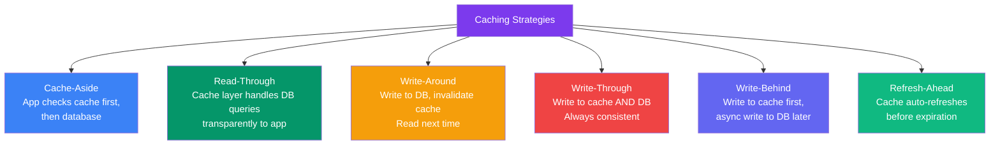
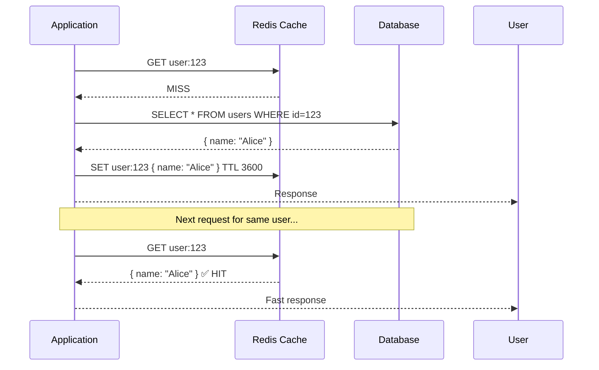
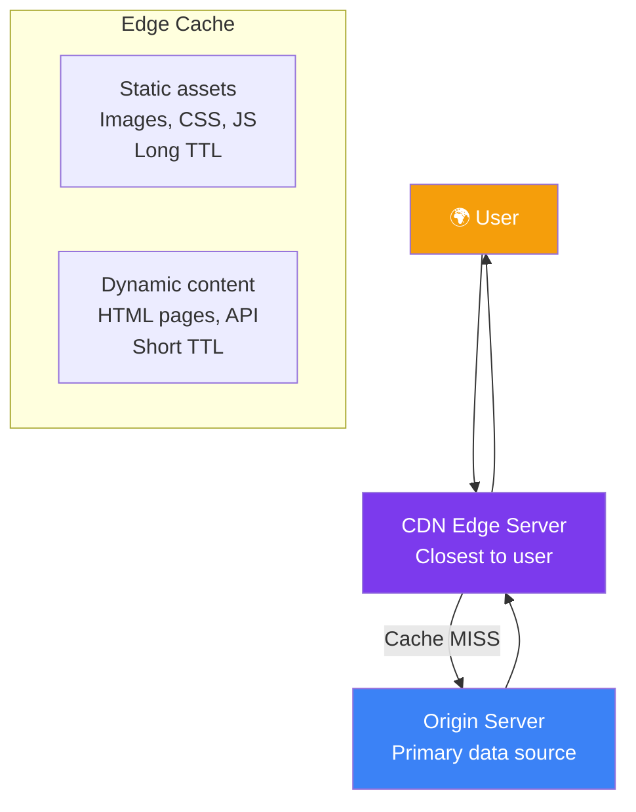

## 07 — Caching Strategies

**Caching** stores frequently accessed data in a fast, temporary storage layer so future requests can be served faster. It's one of the most effective ways to improve system performance and reduce database load.

> **Analogy:** Caching is like keeping your most-used tools on your workbench instead of walking to the tool shed every time. The workbench is fast (cache), the shed is slow (database).

---

### Problem Statement

Without caching:
- Every request hits the database, increasing latency and load
- Repeated queries for the same data waste resources
- Database becomes bottleneck under high traffic
- Response times degrade as data grows

---

### Architecture Overview

---

### Cache Types

| Cache Type | Storage | Speed | Persistence | Use Case |
|------------|---------|-------|-------------|----------|
| **In-Memory Cache** | RAM | Nanoseconds | No (volatile) | Redis, Memcached |
| **CDN Cache** | Edge servers | Milliseconds | Yes (distributed) | Static assets, media |
| **HTTP Cache** | Browser/CDN | Varies | Configurable | Browser caching headers |
| **Database Cache** | DB buffer pool | Milliseconds | Yes | Query results, indexes |
| **Application Cache** | App memory | Microseconds | No | Local hot data |

---

### Caching Strategies

| Strategy | Read Speed | Write Speed | Consistency | Complexity |
|----------|-----------|-------------|-------------|------------|
| **Cache-Aside** | Fast | Moderate | Eventual | Low |
| **Read-Through** | Fast | Same as DB | Eventual | Medium |
| **Write-Through** | Fast | Slower (write to both) | Strong | Low |
| **Write-Behind** | Fast | Very fast (async) | Eventual (risk of loss) | High |
| **Refresh-Ahead** | Fast | Same as strategy | Eventual | High |

---

### Cache Aside Pattern (Most Common)

---

### Eviction Policies

| Policy | Description | Best For |
|--------|-------------|----------|
| **LRU** (Least Recently Used) | Remove oldest accessed items | General purpose |
| **LFU** (Least Frequently Used) | Remove least accessed items | Stable access patterns |
| **FIFO** (First In First Out) | Remove oldest written items | Streaming, logs |
| **TTL** (Time To Live) | Remove after fixed time | Time-sensitive data |
| **Random** | Random eviction | Simple caching |
| **Maxmemory** | Evict when memory full | Always defined as fallback |

---

### Cache Invalidation

The hardest problem in caching — **when to update or remove cached data**.

| Approach | How It Works | Risk |
|----------|-------------|------|
| **TTL-based** | Expire after fixed time | Stale data until TTL expires |
| **Write-invalidate** | Delete cache when DB updates | Temporary extra DB load |
| **Write-update** | Update cache when DB updates | Cache and DB must be updated together |
| **Version-based** | Cache key includes version (e.g., `user:123:v2`) | Old cache lingers until TTL |

---

### CDN Caching

| CDN Cache Level | TTL | Example |
|-----------------|-----|---------|
| **Browser cache** | 1 year (versioned assets) | `Cache-Control: max-age=31536000` |
| **CDN edge cache** | 1 day (static) | CloudFront, Cloudflare |
| **CDN edge cache** | 60 seconds (dynamic) | API responses, HTML |
| **Origin cache** | Varies | Application cache layer |

---

### Trade-offs

| Decision | Pros | Cons |
|----------|------|------|
| **Cache everything** | Fastest possible responses | Stale data risk, memory cost |
| **Cache nothing** | Always fresh data | Slow, high DB load |
| **Long TTL** | High hit rate | Potentially stale |
| **Short TTL** | Fresher data | Higher cache miss rate |
| **Local cache (app memory)** | Fastest (no network) | Not shared across servers |

---

### Scaling Strategies

| Strategy | Description |
|----------|-------------|
| **Redis Cluster** | Distributed caching across nodes |
| **Multi-layer cache** | L1 (app memory) → L2 (Redis) → L3 (CDN) |
| **Cache warming** | Pre-populate cache on deploy or after invalidation |
| **Read replicas for cache misses** | Use read replicas for cache misses to reduce primary DB load |
| **Geo-distributed cache** | Regional Redis clusters for global apps |

---

### Interview Questions

1. **What's the difference between cache-aside and read-through caching?**
2. **How would you invalidate a cache when data is updated?**
3. **What eviction policy would you choose for a social media feed?**
4. **How do you handle cache stampede (thundering herd) when cache expires?**
5. **Design the caching strategy for a product catalog with millions of products.**

---

### Real-World Examples

| System | Caching Strategy |
|--------|------------------|
| **Twitter** | Redis for timeline, Memcached for user data, CDN for media |
| **Facebook** | TAO (graph cache), Memcached distributed across regions |
| **YouTube** | CDN-first (Google Global Cache), edge caching for popular videos |
| **Amazon** | Multi-layer: browser → CDN → ElastiCache → DB read replicas |

---

### In Simple Words

- **Cache** = store frequent data in fast memory — reduces latency by 10-100x
- **Cache-Aside** is the most common pattern — app checks cache first, falls back to DB
- **TTL** is your simplest invalidation strategy — data auto-expires after a fixed time
- **CDN** caches at the network edge — critical for fast global content delivery
- **Cache stampede** happens when many requests miss simultaneously — use locking or refresh-ahead
- **Don't cache everything** — cache data that's read frequently and written infrequently
