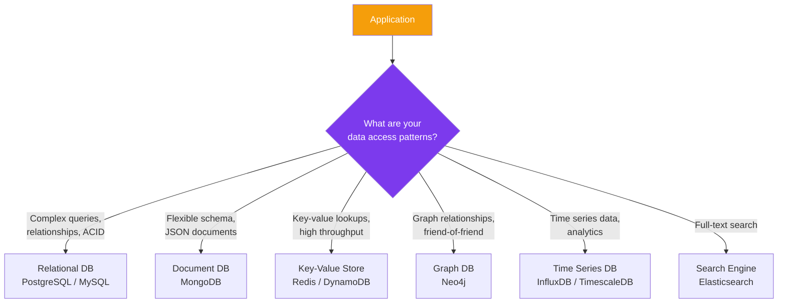
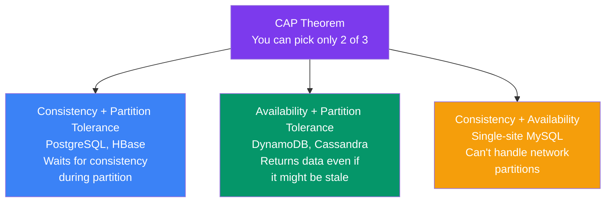
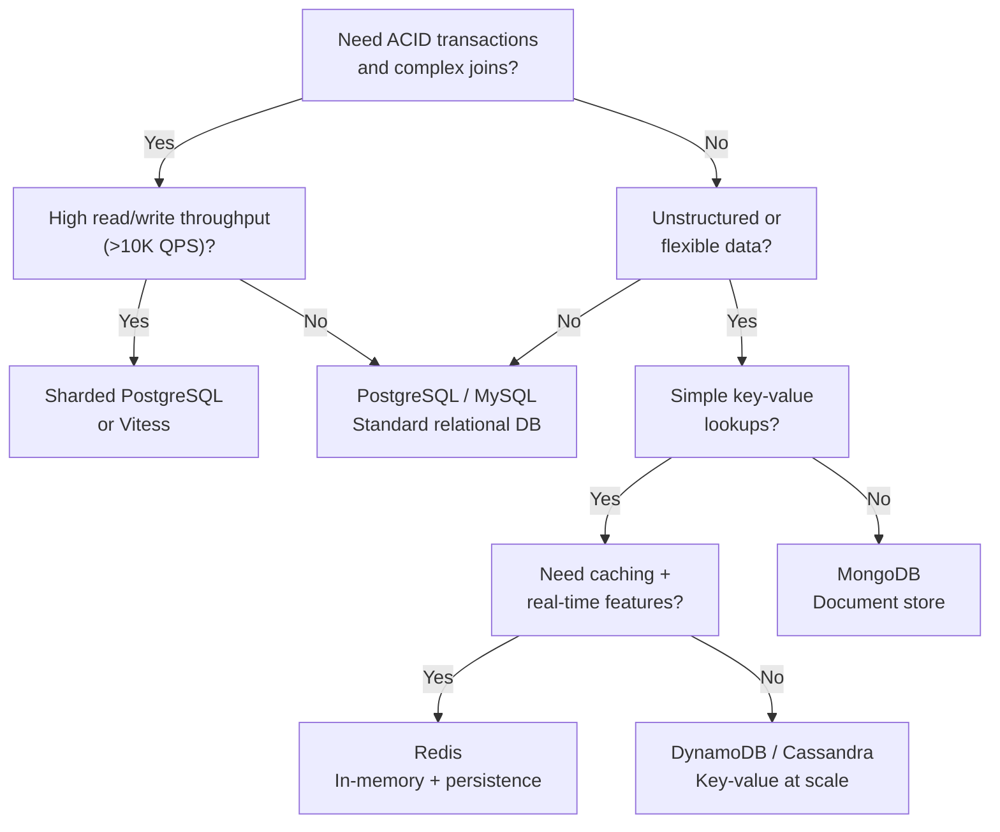
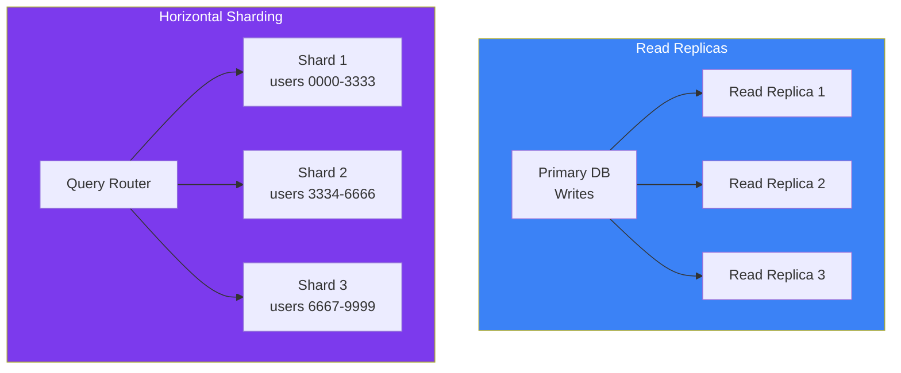

## 08 — Database Selection

Choosing the **right database** is one of the most critical architectural decisions. The wrong choice leads to performance problems, complex workarounds, and painful migrations.

> **Analogy:** Choosing a database is like choosing a vehicle. A sports car (Redis) is fast but can't carry much cargo. A truck (PostgreSQL) is reliable and versatile. A cargo ship (S3) carries enormous loads but is slow. Use the right vehicle for each job.

---

### Problem Statement

Common database mistakes:
- Using a relational DB for simple key-value data (overhead, schema rigidity)
- Using NoSQL when you need ACID transactions and complex joins
- Not planning for scale — picking a DB that can't shard
- Putting everything in one DB — no separation of concerns
- Ignoring access patterns when choosing the data model

---

### Architecture Overview

---

### SQL vs NoSQL

| Factor | SQL (PostgreSQL, MySQL) | NoSQL (MongoDB, DynamoDB) |
|--------|------------------------|---------------------------|
| **Schema** | Fixed, rigid | Flexible, dynamic |
| **ACID** | Full ACID support | BASE (eventual consistency) |
| **Joins** | Native, powerful | Not supported / app-level |
| **Scaling** | Vertical (primary), read replicas | Horizontal (native sharding) |
| **Query** | Complex queries, aggregations | Simple key lookups, limited queries |
| **Use Case** | Financial, enterprise, structured | Rapid prototyping, large scale, flexible data |

---

### CAP Theorem in Practice

**In real-world distributed systems, you choose between CP and AP** — network partitions will happen, and you must choose consistency or availability when they do.

---

### Database Selection Decision Tree

---

### Read Replicas & Sharding

| Strategy | Description | Use When |
|----------|-------------|----------|
| **Read Replicas** | Copy data to read-only instances | Read-heavy workloads (80/20 rule) |
| **Sharding** | Split data across databases | Data too large for single DB |
| **Partitioning** | Split tables within same DB | Large tables, data lifecycle |
| **Federation** | Different DBs for different domains | Microservices, team ownership |

---

### Common Database Architecture Patterns

| Pattern | Description | Example |
|---------|-------------|---------|
| **Single database** | One DB for everything | Simple apps, monoliths |
| **Database per service** | Each microservice owns its DB | Microservices architecture |
| **CQRS** | Separate read and write databases | High-throughput systems |
| **Event sourcing** | Store events, derive state | Audit trails, financial systems |
| **Polyglot persistence** | Use different DBs for different needs | Best tool for each job |

---

### Trade-offs

| Choice | Pros | Cons |
|--------|------|------|
| **Relational DB** | ACID, strong consistency | Hard to scale writes |
| **NoSQL** | Easy to scale, flexible | No joins, weaker consistency |
| **Single DB** | Simple, ACID | Doesn't scale, single point of failure |
| **DB per service** | Independent scaling | Data consistency across services |
| **Polyglot persistence** | Optimal for each use case | Operational complexity |

---

### Scaling Strategies

| Strategy | When | How |
|----------|------|-----|
| **Connection pooling** | Always | PgBouncer, HikariCP |
| **Read replicas** | Read-heavy apps | PostgreSQL streaming replication |
| **Vertical scaling** | Quick fix, moderate scale | Bigger instance (more CPU/RAM) |
| **Sharding** | Data > 1TB or writes > 10K QPS | Application-level or middleware |
| **Caching layer** | Read-heavy, repeated queries | Redis in front of DB |

---

### Interview Questions

1. **How do you choose between SQL and NoSQL for a new system?**
2. **Explain the CAP theorem and how it affects database choice.**
3. **How does sharding work and what are the challenges?**
4. **What's the difference between read replicas and sharding?**
5. **How would you handle database migration from MySQL to DynamoDB?**

---

### Real-World Examples

| System | Database Strategy |
|--------|-------------------|
| **Amazon** | DynamoDB (high-scale KV) + Aurora (relational) — polyglot |
| **Uber** | Schemaless (MySQL-based KV) → Docstore (custom) |
| **Twitter** | Manhattan (KV), MySQL (relational), FlockDB (graph) |
| **Netflix** | Cassandra (wide-column), EVCache (Redis), S3 (blobs) |

---

### In Simple Words

- **SQL** for complex queries, relationships, and ACID transactions
- **NoSQL** for flexible schemas, massive scale, and simple access patterns
- **CAP theorem**: In a distributed system, you choose between consistency and availability
- **Sharding** splits data across databases — needed when one DB isn't enough
- **Read replicas** offload read traffic — great for read-heavy apps
- **Polyglot persistence** = use multiple DB types — each for what it's best at
- The best database choice depends on your **access patterns**, not your data structure
