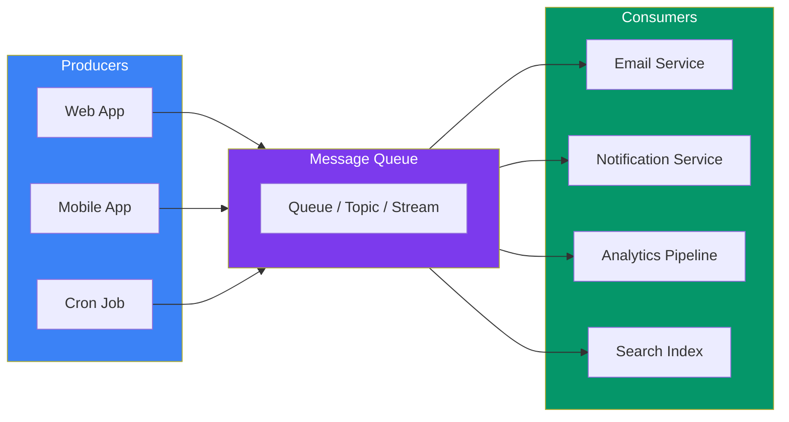
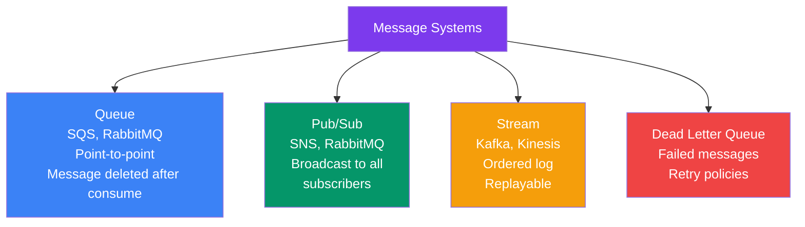
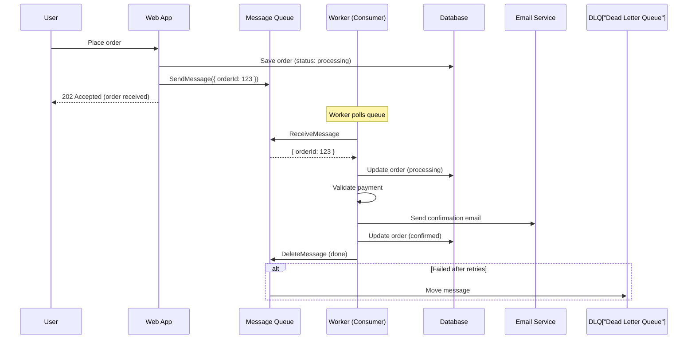
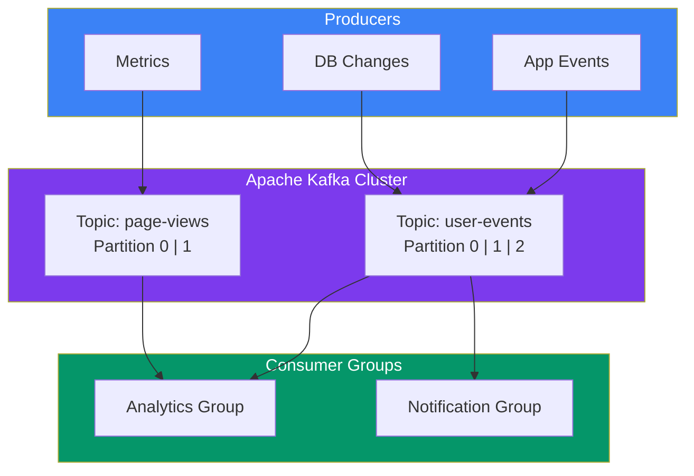

## 09 — Message Queues

**Message queues** enable asynchronous communication between services. A producer sends a message to a queue, and a consumer processes it when ready — decoupling the two services in time and space.

> **Analogy:** A message queue is like an email inbox. You send an email (produce a message), and the recipient reads and acts on it when they have time (consume). You don't need to wait on the phone for them to respond.

---

### Problem Statement

Without message queues:
- **Synchronous coupling** — a slow consumer blocks the producer
- **Traffic spikes** — burst traffic crashes downstream services
- **Retry complexity** — failed operations require complex retry logic
- **Fan-out** — sending the same data to multiple consumers is complex

---

### Architecture Overview

---

### Message Queue Models

| Model | Description | Example |
|-------|-------------|---------|
| **Point-to-Point** | One message → one consumer | SQS, RabbitMQ work queues |
| **Pub/Sub (Fan-out)** | One message → all subscribers | SNS, Kafka consumer groups |
| **Streaming** | Ordered log of events, replayable | Kafka, Kinesis |
| **Dead Letter Queue (DLQ)** | Failed messages after retries | All queue systems |

---

### Queue vs Stream vs Pub/Sub

---

### Async Processing Flow

---

### Popular Message Queue Technologies

| Technology | Type | Persistence | Ordering | Best For |
|------------|------|-------------|----------|----------|
| **Apache Kafka** | Stream | Disk (configurable) | Partition-order | Event streaming, logs, metrics |
| **RabbitMQ** | Queue | Disk or Memory | Optional | Task queues, pub/sub, RPC |
| **AWS SQS** | Queue | Disk (AWS) | Best-effort (Standard) | Decoupling microservices |
| **AWS SNS** | Pub/Sub | None (push) | N/A | Fan-out notifications |
| **Redis Streams** | Stream | Memory/Disk | Yes | Real-time, lightweight |
| **Google Pub/Sub** | Pub/Sub | Disk (GCP) | Yes (ordered) | Event-driven, serverless |

---

### Kafka Architecture (Streaming)

---

### Key Concepts

| Concept | Description |
|---------|-------------|
| **Producer** | Sends messages to a queue/topic |
| **Consumer** | Receives and processes messages |
| **Topic** | Named channel (Kafka, SNS) |
| **Partition** | Sub-division of a topic (parallelism in Kafka) |
| **Consumer Group** | Group of consumers sharing work (Kafka) |
| **Broker** | Server hosting queue/topic partitions |
| **Retry Policy** | How many times to retry failed messages |
| **DLQ (Dead Letter Queue)** | Final destination for messages that can't be processed |
| **Message TTL** | How long a message lives before auto-deletion |

---

### Message Processing Patterns

| Pattern | Description | Use Case |
|---------|-------------|----------|
| **Work Queue** | Multiple workers compete for messages | Image processing, email sending |
| **Pub/Sub** | Each subscriber gets every message | Notifications, audit logs |
| **Event Sourcing** | Store all events, rebuild state | Audit trails, financial systems |
| **Transactional Outbox** | DB transaction → message to queue | Reliable cross-service communication |
| **Saga** | Distributed transaction via messages | Microservice transactions |

---

### Trade-offs

| Choice | Pros | Cons |
|--------|------|------|
| **Synchronous** | Simple, consistent | Coupled, slower, no retry |
| **Async with queue** | Decoupled, resilient | Eventual consistency, complexity |
| **Kafka** | High throughput, replayable | Heavy operations, higher latency |
| **SQS** | Fully managed, simple | Limited ordering (Standard), vendor lock |
| **At-least-once delivery** | No message loss | Duplicate processing (idempotency needed) |
| **Exactly-once** | No duplicates | Lower throughput, complex |

---

### Scaling Strategies

| Strategy | Description |
|----------|-------------|
| **Increase partitions** | More parallelism (Kafka) |
| **More consumers** | Scale consumer count within group |
| **Batch processing** | Consume messages in batches |
| **Rate limiting** | Control how fast consumers process |
| **Priority queues** | Critical messages processed first |

---

### Interview Questions

1. **What's the difference between a queue and a pub/sub system?**
2. **How does Kafka achieve high throughput?**
3. **How do you handle duplicate messages in a queue?**
4. **What is the transactional outbox pattern?**
5. **How would you design a reliable notification system with message queues?**

---

### Real-World Examples

| System | Message Queue Usage |
|--------|---------------------|
| **Uber** | Kafka for ride events, trip tracking, analytics |
| **Netflix** | Kafka for event streaming (2M+ events/sec) |
| **LinkedIn** | Kafka invented at LinkedIn for activity streams |
| **Amazon** | SQS for order processing, inventory updates |

---

### In Simple Words

- **Message queues** decouple producers (senders) from consumers (processors)
- **SQS/RabbitMQ** = simple queues — one message consumed by one worker
- **Kafka** = event stream — ordered, replayable, high throughput
- **SNS/Pub-Sub** = one message broadcast to many subscribers
- **DLQ** (Dead Letter Queue) catches messages that failed after all retries
- **At-least-once delivery** is the default — design your consumers to be **idempotent**
- Use queues for **async processing, load smoothing, and decoupling** services
