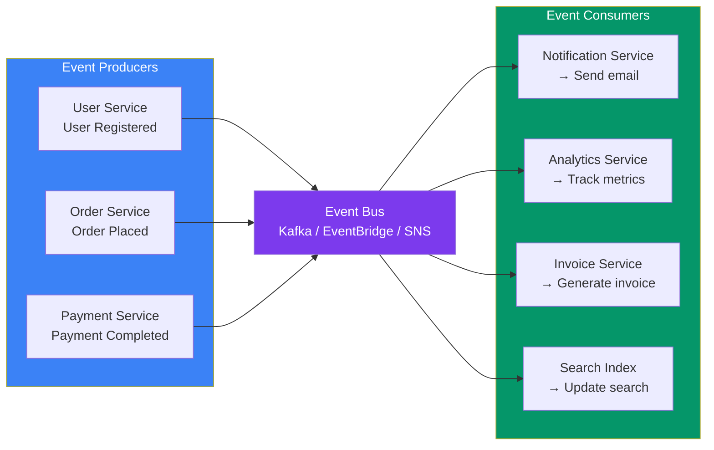
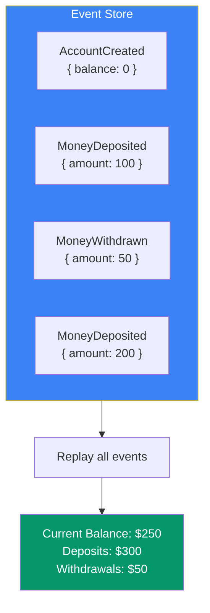
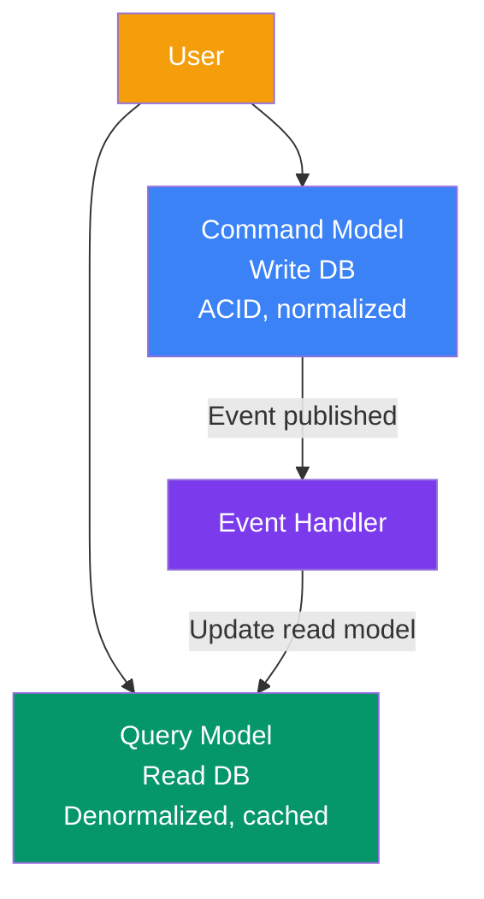
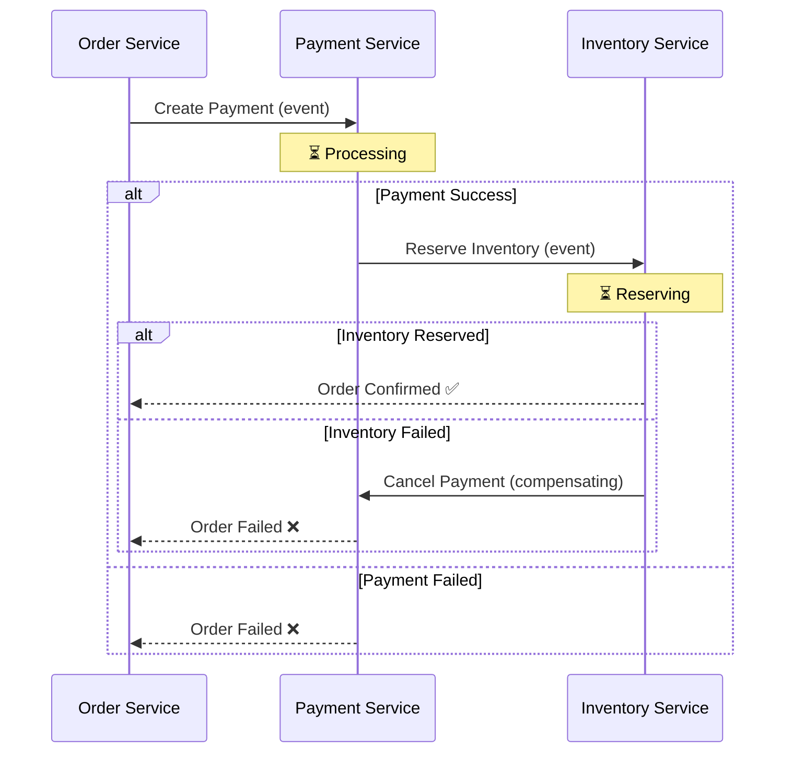

## 10 — Event-Driven Architecture

**Event-Driven Architecture (EDA)** is a design pattern where services communicate through **events** — something happened in one service that other services might care about. Services react to events asynchronously, without direct coupling.

> **Analogy:** EDA is like a busy marketplace. When a vendor runs out of stock, they ring a bell (event). Nearby suppliers hear the bell and decide whether to restock. The vendor doesn't call each supplier individually — they just announce the event.

---

### Problem Statement

Traditional request-response architectures struggle with:
- **Tight coupling** — changing one service breaks others
- **Scaling under load** — synchronous chains amplify failures
- **Cross-service workflows** — coordinating multiple services is complex
- **Audit and traceability** — hard to see what happened when

---

### Architecture Overview

---

### Event Types

| Event Type | Description | Example |
|------------|-------------|---------|
| **Domain Event** | Something that happened in the domain | `OrderPlaced`, `UserRegistered` |
| **Integration Event** | Event shared across service boundaries | `PaymentProcessed` |
| **Notification Event** | Signals a state change, no data payload | `OrderUpdated` |
| **Snapshot Event** | Full state of an entity | `UserState { id, name, email }` |

---

### Event Sourcing

Instead of storing the current state, **store every event** that led to the current state. The current state is derived by replaying all events.

| Aspect | Traditional | Event Sourcing |
|--------|-------------|----------------|
| **Storage** | Current state | Append-only event log |
| **Updates** | UPDATE query | INSERT event |
| **History** | Lost (unless audit logged) | Full history always available |
| **Debugging** | Hard (current state only) | Replay events to reproduce |
| **Complexity** | Low | Higher |

---

### CQRS (Command Query Responsibility Segregation)

**CQRS** separates read and write operations into different models — one for commands (writes) and one for queries (reads).

| Aspect | Command Side | Query Side |
|--------|-------------|------------|
| **Purpose** | Handle writes (Create, Update, Delete) | Handle reads |
| **Model** | Normalized, optimized for writes | Denormalized, optimized for reads |
| **Consistency** | Strong (ACID) | Eventual |
| **Schema** | Relational, normalized | Flat, aggregated |

---

### Saga Pattern (Distributed Transactions)

A **Saga** is a sequence of local transactions where each step publishes an event that triggers the next step. If a step fails, **compensating actions** undo the previous steps.

| Saga Type | How It Works | Pros | Cons |
|-----------|-------------|------|------|
| **Choreography** | Each service reacts to events and emits new ones | Simple, no coordinator | Hard to trace, circular events |
| **Orchestration** | Central coordinator tells services what to do | Easy to manage, monitor | Coordinator is a single point of failure |

---

### Event-Driven vs Request-Driven

| Aspect | Request-Driven (REST) | Event-Driven (EDA) |
|--------|----------------------|-------------------|
| **Coupling** | Tight (service knows other service's URL) | Loose (services only know event types) |
| **Timing** | Synchronous (wait for response) | Asynchronous (fire and forget) |
| **Resilience** | Fragile (call chain fails) | Resilient (downstream failure doesn't block) |
| **Traceability** | Request ID tracking | Event correlation ID |
| **When to use** | CRUD, real-time responses | Complex workflows, cross-service logic |

---

### Trade-offs

| Choice | Pros | Cons |
|--------|------|------|
| **Event-driven** | Loose coupling, scalable | Eventual consistency, debugging hard |
| **Event Sourcing** | Full audit trail, temporal queries | Event store migration, high storage |
| **CQRS** | Optimized reads and writes | Two models to maintain |
| **Saga (Choreography)** | Simple, no coordinator | Hard to track, cyclic events risk |
| **Saga (Orchestration)** | Central control, monitoring | Coordinator complexity, potential SPOF |

---

### Scaling Strategies

| Strategy | Description |
|----------|-------------|
| **Partition topics** | Split events by domain (orders, users, payments) |
| **Parallel consumers** | Multiple consumers in a group for throughput |
| **Event versioning** | Schema registry for evolving events |
| **Idempotent consumers** | Same event processed twice = same result |
| **Event retention** | How long to keep events (Kafka retention policy) |

---

### Interview Questions

1. **What is event-driven architecture and when would you use it?**
2. **How does event sourcing differ from storing current state?**
3. **What is CQRS and why would you separate reads from writes?**
4. **Explain the saga pattern and how it handles failures.**
5. **How do you maintain backward compatibility when event schemas evolve?**

---

### Real-World Examples

| System | EDA Approach |
|--------|--------------|
| **Amazon** | Event-driven order processing — SQS + SNS + Lambda |
| **Netflix** | CQRS for recommendations (separate read model from write) |
| **Uber** | Event sourcing for trip history, Kafka for real-time events |
| **GitHub** | Event-driven webhooks — 10M+ events/hour delivered to integrators |

---

### In Simple Words

- **EDA** = services communicate through events instead of direct API calls
- **Event Sourcing** = store everything that happened (event log), derive current state by replaying
- **CQRS** = separate the DB you write to from the DB you read from — each optimized for its purpose
- **Saga** = coordinate multi-step transactions across services with compensating actions for failures
- **Benefits**: loose coupling, scalability, audit trail, resilience
- **Challenges**: eventual consistency (data might be stale), harder debugging, event schema evolution
- Start with simple events before adopting event sourcing or CQRS — they add real complexity
