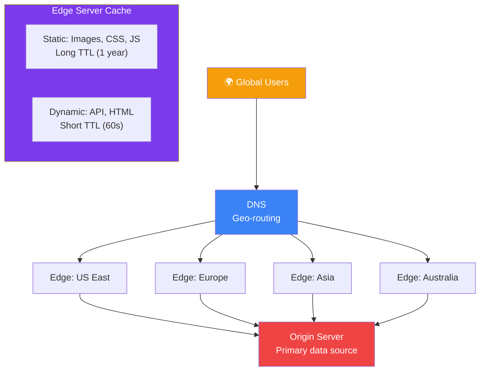
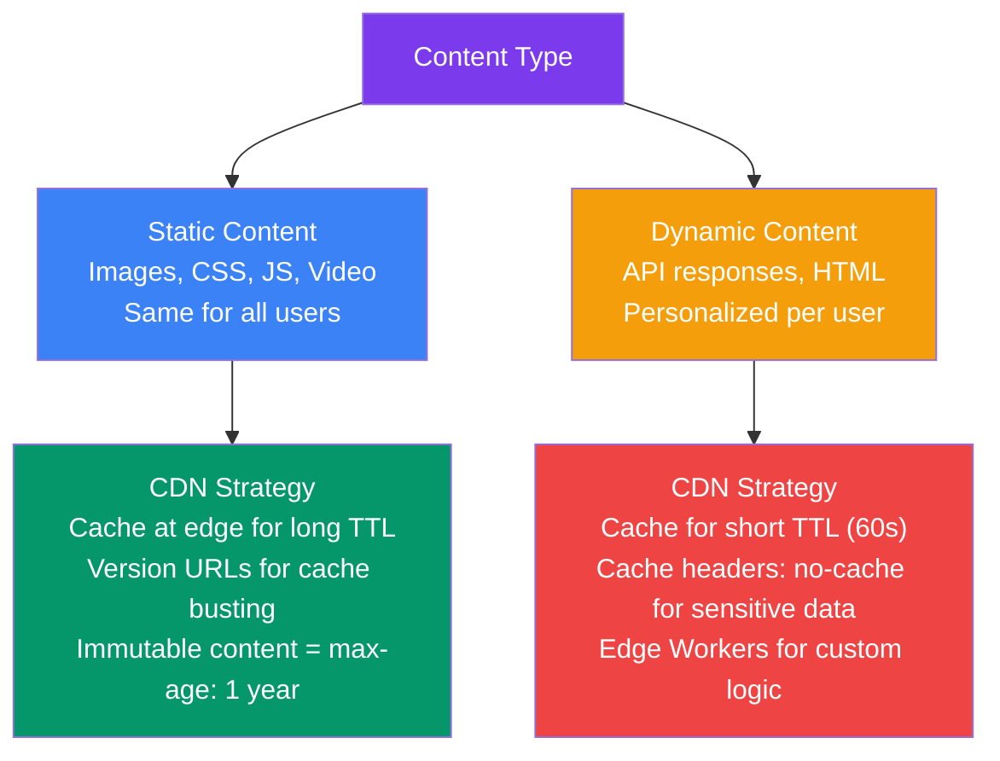
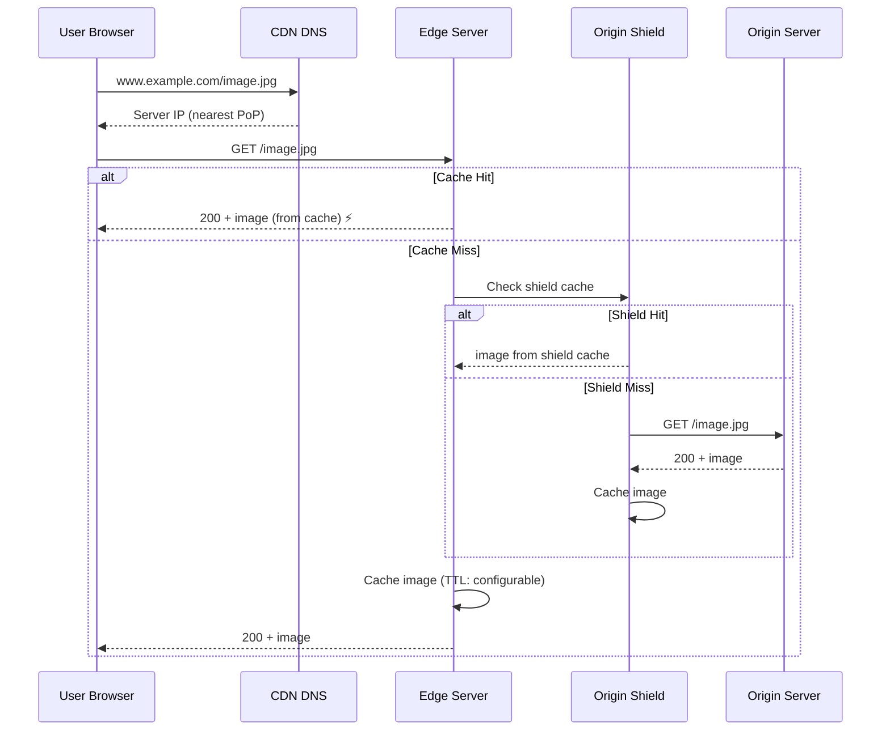

## 11 — CDN Design

A **Content Delivery Network (CDN)** is a geographically distributed network of proxy servers and data centers that delivers content to users from the nearest edge location. CDNs are essential for global applications with users around the world.

> **Analogy:** A CDN is like having local warehouses in every city instead of one central warehouse. When a customer orders a product, it ships from the nearest warehouse — arriving much faster than shipping from across the country.

---

### Problem Statement

Without a CDN:
- Users far from your server experience high latency
- Your origin server handles every request, limiting scale
- A single server location has no redundancy
- DDoS attacks hit your origin directly
- Bandwidth costs are higher (no edge caching)

---

### Architecture Overview

---

### CDN Components

| Component | Description |
|-----------|-------------|
| **Edge Server** | Server at a CDN point-of-presence (PoP) — caches and serves content |
| **Origin Server** | The primary source of truth for content |
| **PoP (Point of Presence)** | A data center location where CDN servers are deployed |
| **DNS Routing** | Routes users to the nearest PoP based on geolocation |
| **Origin Shield** | An intermediate caching layer that protects origin from edge storms |

---

### Static vs Dynamic Content

---

### CDN Request Flow

---

### CDN Cache Control Strategies

| Strategy | Cache Header | Use Case |
|----------|-------------|----------|
| **Versioned assets** | `Cache-Control: public, max-age=31536000, immutable` | JS/CSS bundles with hash in filename |
| **Non-versioned assets** | `Cache-Control: public, max-age=86400` | Images without versioning |
| **Dynamic HTML** | `Cache-Control: public, max-age=60` | News pages, blog posts |
| **User-specific** | `Cache-Control: private, max-age=0` | Account pages, dashboard |
| **No cache** | `Cache-Control: no-cache, no-store` | APIs with sensitive data |
| **Stale while revalidate** | `Cache-Control: public, max-age=60, stale-while-revalidate=3600` | Serve stale, async refresh |

---

### CDN Design Patterns

| Pattern | Description | Example |
|---------|-------------|---------|
| **Static Offload** | Serve images, CSS, JS from CDN | Most common pattern |
| **Dynamic Acceleration** | Optimize routing for dynamic content | Multi-region API with CloudFront |
| **Edge Computing** | Run code at CDN edge (Workers, Lambda@Edge) | A/B testing, header modification |
| **DDoS Protection** | CDN absorbs DDoS traffic before origin | Cloudflare, AWS Shield |
| **Geo-blocking** | Block/allow content by region | Licensing restrictions |
| **Origin Pull** | CDN pulls content from origin on miss | Standard CDN setup |
| **Push CDN** | Content pushed to CDN proactively | Large media files |

---

### Popular CDN Providers

| Provider | Key Features | Global PoPs |
|----------|-------------|-------------|
| **CloudFront (AWS)** | Deep AWS integration, Lambda@Edge | 450+ |
| **Cloudflare** | DDoS protection, Workers edge compute | 330+ |
| **Akamai** | Enterprise-grade, advanced routing | 4,100+ |
| **Fastly** | Instant Purge, VCL configuration | 100+ |
| **Google Cloud CDN** | Google network, GCP integration | 200+ |

---

### Trade-offs

| Decision | Pros | Cons |
|----------|------|------|
| **CDN for everything** | Fast globally, origin offload | Stale content risk, cost |
| **Short TTL** | Fresh content | More origin requests |
| **Long TTL + versioned URLs** | Maximum cache hit rate | Build process complexity |
| **Edge compute** | Logic at edge, less origin latency | Vendor lock-in, debugging hard |

---

### Scaling Strategies

| Strategy | Description |
|----------|-------------|
| **Multiple CDN providers** | Redundancy, better global coverage |
| **Origin Shield** | Single point of contact from CDN to origin (reduces origin load) |
| **Pre-fetch/pre-warm** | Push popular content to CDN before traffic hits |
| **Cache key optimization** | Include relevant headers only (not all cookies) |
| **Tiered cache** | Edge → Regional → Origin Shield |

---

### Interview Questions

1. **How does a CDN reduce latency for global users?**
2. **What's the difference between static and dynamic content caching?**
3. **How do you invalidate a CDN cache when content changes?**
4. **What is origin shielding and why is it important?**
5. **How would you design the caching strategy for a global video streaming platform?**

---

### Real-World Examples

| System | CDN Strategy |
|--------|--------------|
| **Netflix** | Open Connect CDN — custom appliances in ISP data centers |
| **YouTube** | Google Global Cache — edge nodes in 1,000+ locations |
| **Amazon** | CloudFront for e-commerce assets, dynamic content acceleration |
| **Facebook** | Custom CDN for images, videos — pre-caching popular content |

---

### In Simple Words

- **CDN** = your content copied to servers worldwide — users get it from the nearest one
- **Static content** (images, CSS, JS) = cache for a long time, use versioned URLs
- **Dynamic content** (API, HTML) = cache for short time or use edge workers
- **CDN offloads your origin server** — it serves most of the traffic, not your backend
- **Cache invalidation** is hard — versioned URLs are the safest approach
- **DDoS protection** is a major bonus — CDN absorbs attacks before they reach you
- Use **origin shield** to prevent traffic storms when many edges miss cache simultaneously
