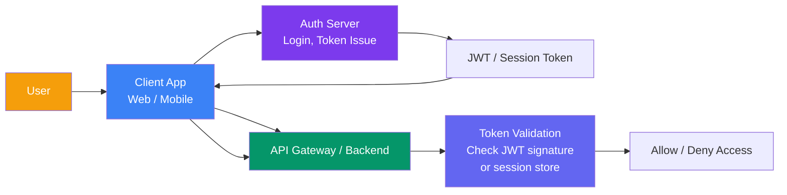
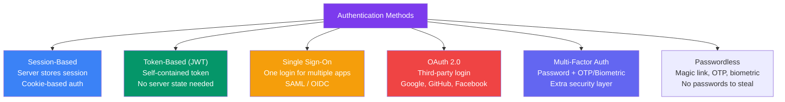
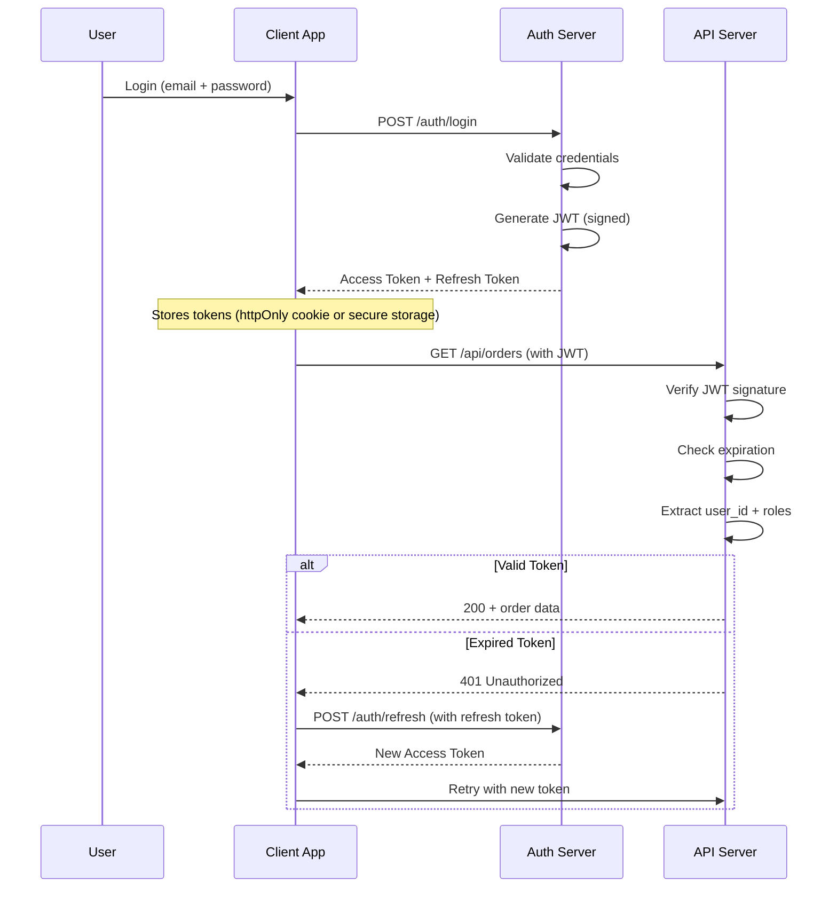
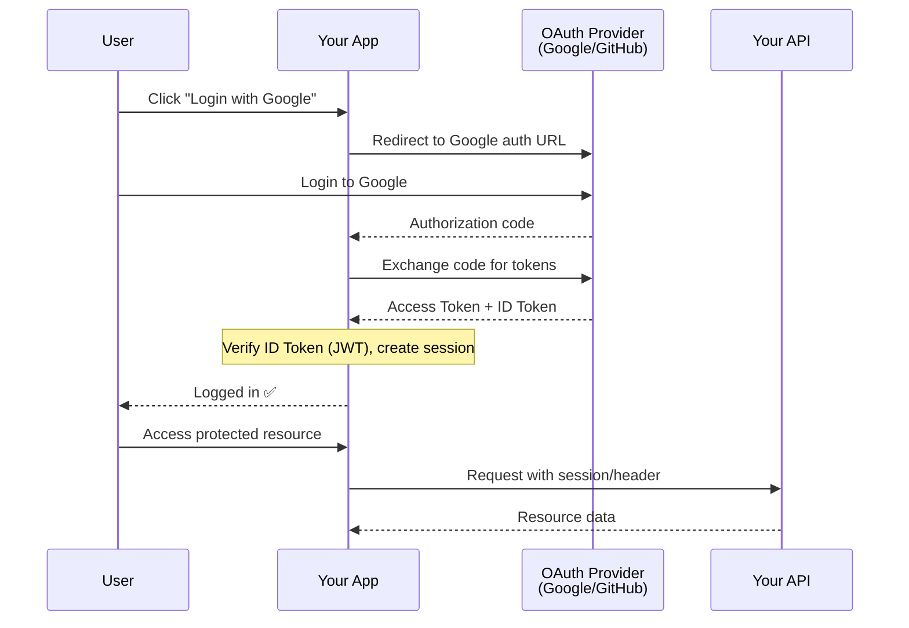
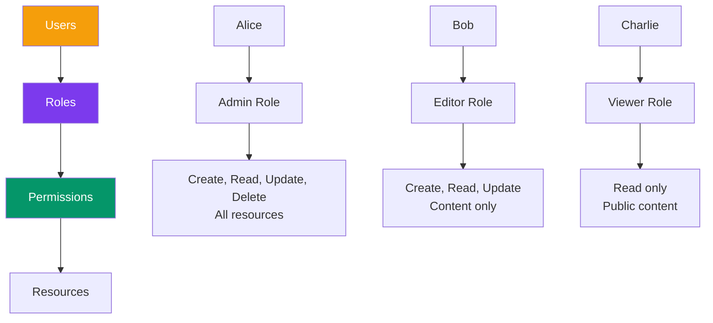

## 12 — Authentication Architecture

**Authentication** (who you are) and **authorization** (what you can do) are fundamental to every system. A well-designed auth architecture is secure, scalable, and doesn't add friction for legitimate users.

> **Analogy:** Authentication is like showing your ID at airport security. Authorization is like your boarding pass — it determines which gate you can access and which seat you can sit in.

---

### Problem Statement

Poor auth design leads to:
- Security breaches (stolen credentials, session hijacking)
- Poor user experience (repeated login prompts)
- Scalability issues (session data doesn't distribute across servers)
- Compliance failures (GDPR, SOC 2, PCI-DSS)

---

### Architecture Overview

---

### Authentication vs Authorization

| Aspect | Authentication | Authorization |
|--------|---------------|---------------|
| **Definition** | Who are you? | What can you do? |
| **Method** | Password, OTP, SSO, biometric | Roles, permissions, policies |
| **Example** | Login with email/password | Admin can delete users, user can't |
| **Protocol** | OAuth 2.0, SAML, OpenID Connect | RBAC, ABAC, ACLs |
| **Storage** | User credentials (hashed) | Role/permission mappings |

---

### Authentication Methods

---

### JWT (JSON Web Token) Flow

---

### Token Storage

| Storage Method | Security | UX | XSS Protection | Best For |
|---------------|----------|----|----------------|----------|
| **httpOnly Cookie** | ✅ Secure (not JS-accessible) | ⭐ Auto-sent | ✅ Yes | Web apps |
| **Local Storage** | ⚠️ Accessible to JS | Manual header attach | ❌ Vulnerable to XSS | SPA with CSRF protection |
| **Memory (JS variable)** | ✅ Not persisted | Lost on refresh | ✅ Yes | Very sensitive apps |
| **Secure Storage (Mobile)** | ✅ OS-protected | Native APIs | ✅ Yes | Mobile apps |

---

### OAuth 2.0 Flow

---

### RBAC (Role-Based Access Control)

---

### Session Scaling Strategies

| Strategy | How It Works | Pros | Cons |
|----------|-------------|------|------|
| **Sticky sessions** | Same server always handles same user | Simple | Uneven load, server affinity |
| **Shared session store** | Redis/Memcached for sessions | Stateless servers | Extra network hop |
| **JWT (stateless)** | No server-side session | Highly scalable | Token revocation is hard |
| **Hybrid** | JWT for auth, Redis for blacklist | Balance of scale and control | Two systems to manage |

---

### Trade-offs

| Decision | Pros | Cons |
|----------|------|------|
| **JWT** | Stateless, scalable, portable | Can't revoke easily, larger payloads |
| **Session** | Easy to revoke, simple to implement | Server state, horizontal scaling harder |
| **OAuth 2.0** | No password handling, popular | External dependency, redirect flow |
| **SSO** | One login for many services | Single point of failure |
| **MFA** | Much more secure | User friction, recovery flows |

---

### Scaling Strategies

| Strategy | Description |
|----------|-------------|
| **Auth service as dedicated microservice** | Separates auth concerns from business logic |
| **JWT with short TTL (15 min) + refresh tokens** | Balance of security and user experience |
| **Token blacklist (Redis)** | Revoke JWTs before expiration |
| **Rate limiting on auth endpoints** | Prevent brute force attacks |
| **Read replicas for auth** | Offload token verification reads |

---

### Interview Questions

1. **What's the difference between authentication and authorization?**
2. **How does JWT authentication work? What are its pros and cons?**
3. **Explain the OAuth 2.0 authorization code flow.**
4. **How would you handle session management across multiple servers?**
5. **How do you revoke a JWT token before it expires?**

---

### Real-World Examples

| System | Auth Approach |
|--------|---------------|
| **Google** | OAuth 2.0 + OpenID Connect for third-party apps |
| **GitHub** | Personal access tokens, OAuth apps, GitHub Apps |
| **Auth0** | Identity as a Service — handles all auth flows |
| **Amazon** | Federated SSO + IAM roles for internal services |

---

### In Simple Words

- **Authentication** = proving who you are; **Authorization** = what you're allowed to do
- **JWT** = self-contained token — no server session needed, but hard to revoke
- **Session** = server-stored state — easy to revoke, but harder to scale horizontally
- **OAuth 2.0** = let users log in with Google/GitHub — you never handle passwords
- **MFA** = the single most effective security measure (password + something you have)
- Store tokens in **httpOnly cookies** for web apps (XSS-safe)
- Always hash passwords with **bcrypt/argon2** — never store plaintext passwords
