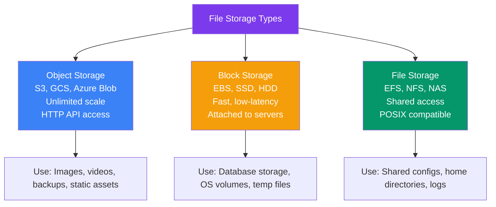
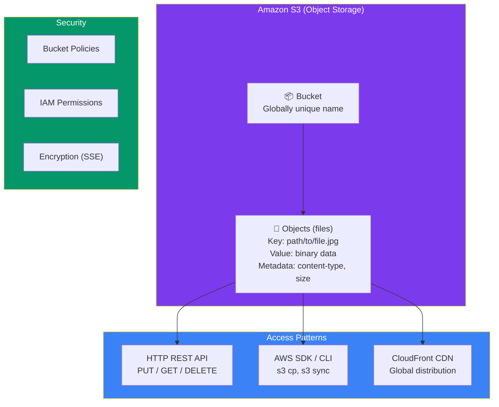
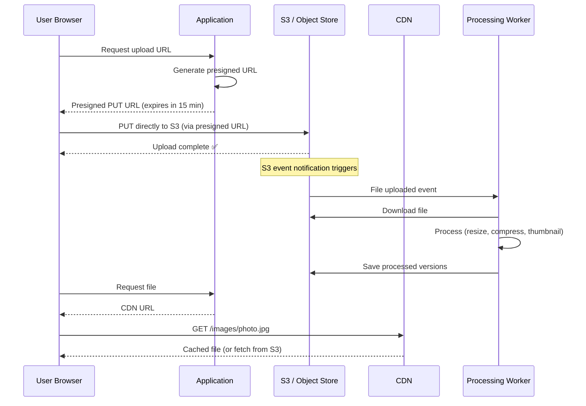
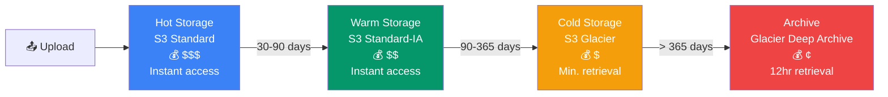
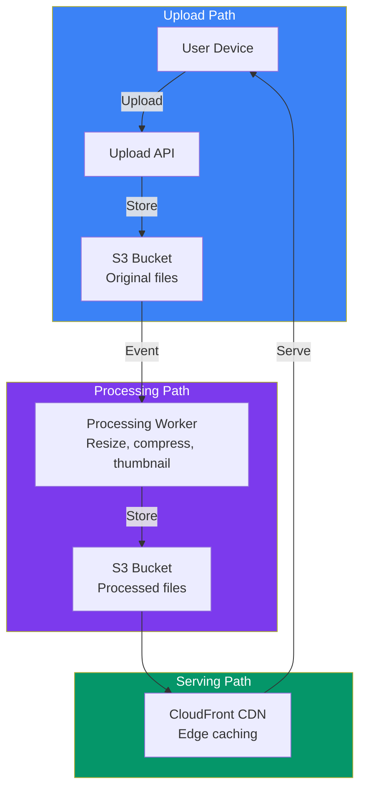

## 13 — File Storage Architecture

**File storage architecture** handles how files (images, videos, documents) are uploaded, stored, processed, and served. A well-designed storage system is scalable, cost-effective, and fast.

> **Analogy:** File storage is like a library. Object storage (S3) is the main bookshelves where books live. Block storage (EBS) is a book on your desk that you're actively editing. File storage (EFS) is a shared reading table where multiple people can access the same book.

---

### Problem Statement

Poor file storage design leads to:
- **Storage running out** — no capacity planning for growing data
- **Slow uploads/downloads** — single server bottleneck
- **Data loss** — no redundancy or backup strategy
- **High costs** — storing everything in expensive hot storage
- **CDN misses** — origin server overloaded serving files

---

### Storage Types Comparison

| Feature | Object Storage (S3) | Block Storage (EBS) | File Storage (EFS) |
|---------|-------------------|---------------------|---------------------|
| **API** | HTTP (REST) | Block device (mounted) | File system (NFS) |
| **Scale** | Virtually unlimited | Limited by volume size | Up to petabytes |
| **Speed** | Moderate (ms) | Very fast (μs) | Fast (ms) |
| **Access** | From anywhere | Single server | Multiple servers |
| **Cost** | Low per GB | Higher | Medium |
| **Use case** | Static assets, backups | DB storage, app data | Shared files, logs |

---

### S3 Architecture

---

### File Upload Architecture

---

### Storage Lifecycle

Data moves through storage tiers as it ages — **hot → warm → cold → archive**:

| Tier | S3 Class | Cost/GB/mo | Retrieval | Retention |
|------|----------|-----------|-----------|-----------|
| **Hot** | Standard | $0.023 | Instant | 0-30 days |
| **Warm** | Standard-IA | $0.0125 | Instant | 30-90 days |
| **Cold** | Glacier | $0.004 | 1-5 min | 90-365 days |
| **Archive** | Deep Archive | $0.001 | 12 hours | 1+ years |

---

### CDN + Storage Integration

---

### File Storage Design Patterns

| Pattern | Description | Use Case |
|---------|-------------|----------|
| **Direct Upload (Presigned URL)** | Client uploads directly to S3 | Scalable uploads, no server bottleneck |
| **Transcoding Pipeline** | Upload triggers processing workflow | Video/image processing |
| **CDN + Origin Shield** | CDN caches files, shield protects S3 | Global media delivery |
| **Multi-tier Storage** | Automatic lifecycle transitions | Cost optimization |
| **Versioned Storage** | Keep all file versions | Documents, collaborative editing |
| **Geo-redundant Storage** | Replicate across regions | Disaster recovery, global access |

---

### Trade-offs

| Decision | Pros | Cons |
|----------|------|------|
| **Object storage** | Scalable, cheap, global access | No POSIX, slower than block |
| **Direct upload** | No server bottleneck | More client-side complexity |
| **Server-side upload** | Full control, validation | Server bottleneck for large files |
| **All hot storage** | Fast, simple | Expensive |
| **Lifecycle policies** | Cost-optimized | Retrieval delays for old data |

---

### Scaling Strategies

| Strategy | Description |
|----------|-------------|
| **Presigned URLs** | Clients upload directly to S3 — servers don't handle file data |
| **S3 event notifications** | Trigger processing asynchronously on upload |
| **CDN with origin shield** | Reduce origin load, protect S3 from traffic storms |
| **Multipart upload** | Large files uploaded in parallel chunks |
| **Storage classes + lifecycle** | Auto-move old data to cheaper storage |
| **Replication across regions** | Disaster recovery, lower global latency |

---

### Interview Questions

1. **What's the difference between object, block, and file storage?**
2. **How does a presigned URL work and why is it useful?**
3. **How would you design a system that supports 1M file uploads per day?**
4. **How do you optimize storage costs for user-generated content?**
5. **What happens when you need to serve files to users worldwide?**

---

### Real-World Examples

| System | Storage Architecture |
|--------|---------------------|
| **Netflix** | S3 for master files, CloudFront CDN for streaming |
| **Google Drive** | Google File System (GFS) — distributed, replicated blocks |
| **Dropbox** | Custom block storage, deduplication, delta sync |
| **Instagram** | S3 for photos, CDN for serving, lifecycle to Glacier for old content |

---

### In Simple Words

- **Object storage (S3)** = store any files, any size — scalable, HTTP API, great for static assets
- **Block storage (EBS)** = fast drive attached to a server — for databases, app data
- **File storage (EFS)** = shared network drive — multiple servers access the same files
- **Presigned URLs** let clients upload directly to S3 — servers don't handle file data
- **CDN + storage** = files served globally from edge caches, origin storage protected
- Use **lifecycle policies** to move old data to cheaper storage automatically
- For video/images, use **transcoding pipelines** that process uploads asynchronously
