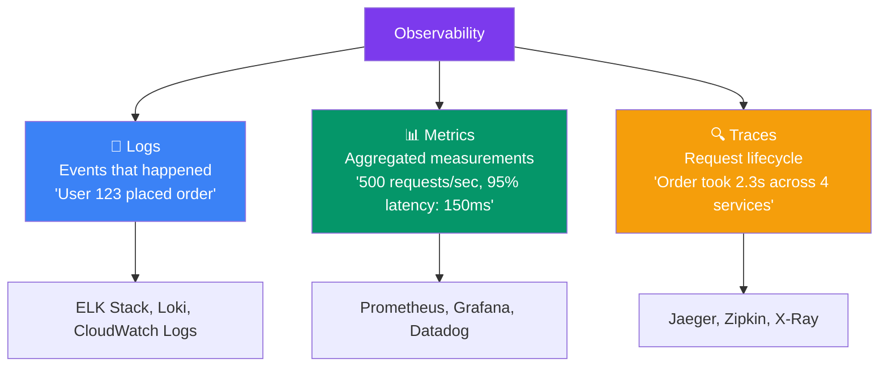
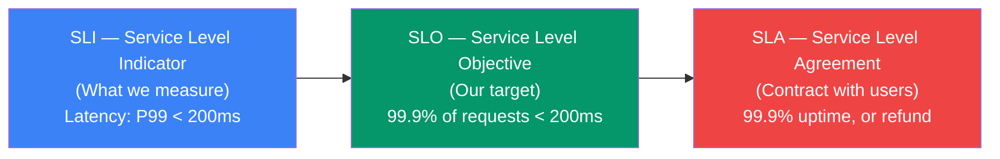
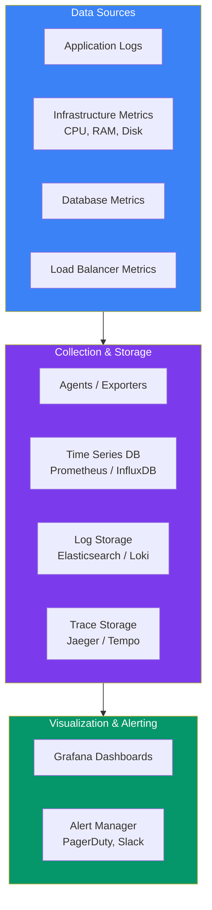
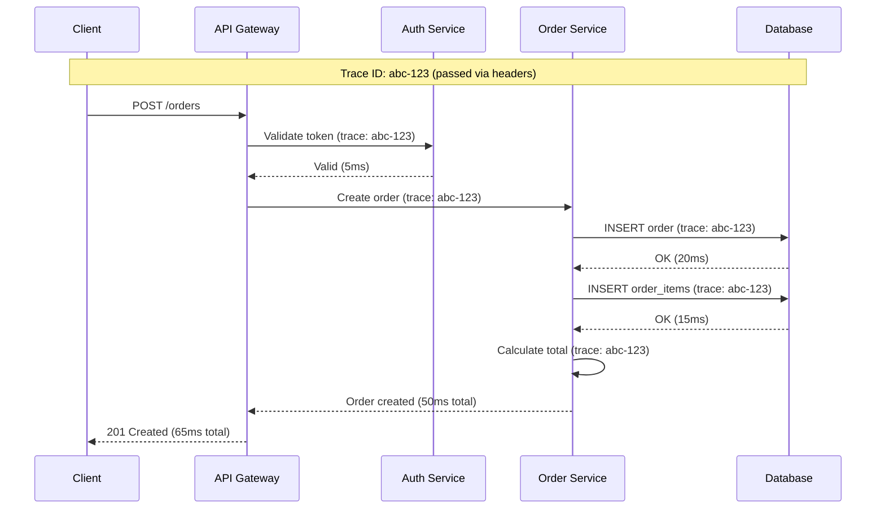

## 14 — Monitoring and Observability

**Monitoring** tells you when something is wrong. **Observability** lets you understand *why* it's wrong. Together, they form the foundation of reliable, debuggable systems.

> **Analogy:** Monitoring is like a car's dashboard warning lights — they tell you when the engine is overheating. Observability is the mechanic's diagnostic tools — they tell you *which* hose is leaking and *why*.

---

### Problem Statement

Without proper monitoring and observability:
- **Blind deployment** — no idea if the new version is working
- **Reactive debugging** — users report problems before you know about them
- **Long MTTR** — hours spent finding root causes
- **No performance baselines** — can't tell what's normal vs abnormal
- **Wasted resources** — no visibility into utilization

---

### The Three Pillars of Observability

---

### SLIs, SLOs, and SLAs

| Term | Definition | Example |
|------|------------|---------|
| **SLI** | A *measured* indicator of service performance | P99 latency, error rate, throughput |
| **SLO** | Your *target* for the SLI | 99.9% of requests succeed within 200ms |
| **SLA** | A *contractual* commitment to customers | 99.95% uptime, service credits if violated |
| **Error Budget** | How much failure is allowed before SLO violation | 0.1% errors/month = 43 min downtime |

---

### Monitoring Architecture

---

### The Four Golden Signals

Google's SRE book defines **four golden signals** of monitoring:

| Signal | What It Measures | What to Watch For |
|--------|-----------------|-------------------|
| **Latency** | Time to serve a request | Increasing P99 = performance issue |
| **Traffic** | How many requests | Spike = DDoS or viral event; Drop = routing issue |
| **Errors** | Rate of failed requests | HTTP 5xx, exceptions, timeouts |
| **Saturation** | How "full" the service is | CPU > 80%, memory > 80%, connections exhausted |

---

### Distributed Tracing

**Distributed tracing** tracks a request across multiple services. Each service adds its own span with timing. You can see exactly where time is spent.

---

### Logging Best Practices

| Practice | Why |
|----------|-----|
| **Structured JSON logs** | Machine-parseable, queryable in ELK/Loki |
| **Include request/correlation ID** | Trace across services |
| **Log levels: DEBUG, INFO, WARN, ERROR** | Filter by severity |
| **Don't log PII** | Passwords, credit cards, personal data |
| **Centralized log aggregation** | Single place to search all logs |
| **Log on entry and exit of critical paths** | Debugging complex flows |
| **Use sampling for high-volume logs** | Don't overload the logging system |

---

### Common Monitoring Metrics

| Layer | Key Metrics |
|-------|-------------|
| **Web/API** | RPS, latency (P50/P95/P99), error rate, active connections |
| **Application** | GC pauses, thread pool, queue depth, cache hit rate |
| **Database** | QPS, slow queries, connections, replication lag |
| **Infrastructure** | CPU, memory, disk, network I/O |
| **Business** | DAU, signups, orders, revenue |

---

### Trade-offs

| Decision | Pros | Cons |
|----------|------|------|
| **Log everything** | Full visibility | Expensive storage, noise |
| **Sample traces** | Low overhead | Missing rare issues |
| **High-precision metrics** | Accurate data | Higher storage cost |
| **Self-hosted (Prometheus+Grafana)** | Full control, no vendor lock | Ops overhead |
| **Managed (Datadog, New Relic)** | Easy setup, great UX | Cost scales with data volume |

---

### Scaling Strategies

| Strategy | Description |
|----------|-------------|
| **Sampling** | Record a percentage of requests (1-10% at scale) |
| **Aggregation** | Pre-aggregate metrics (not every data point) |
| **Log retention tiers** | Hot (7 days) → Warm (30 days) → Cold (1 year) |
| **Structured logging** | JSON logs → easier to query and analyze |
| **Sidecar pattern** | Log/metrics agent per pod (Kubernetes) |

---

### Interview Questions

1. **What's the difference between monitoring and observability?**
2. **What are the three pillars of observability?**
3. **Explain SLI, SLO, and SLA with examples.**
4. **How does distributed tracing work?**
5. **What would you monitor for a payment processing system?**

---

### Real-World Examples

| System | Observability Approach |
|--------|----------------------|
| **Google** | Built Borgmon (predecessor to Prometheus), SRE golden signals |
| **Netflix** | Atlas (metrics), Spinnaker (alerting), custom distributed tracing |
| **Uber** | M3 (metrics), Jaeger (tracing), ELK (logs) |
| **Datadog** | SaaS observability — traces, metrics, logs unified |

---

### In Simple Words

- **Monitoring** = dashboards, alerts, knowing when something is wrong
- **Observability** = being able to answer *why* by looking at logs, metrics, and traces
- **Three pillars**: Logs (events), Metrics (aggregated numbers), Traces (request flow)
- **SLI/SLO/SLA** = what you measure / your target / your contract with users
- **Four golden signals**: Latency, Traffic, Errors, Saturation
- **Distributed tracing** tracks a request across all services it touches
- Start simple — monitor the **four golden signals** before adding complex tooling
