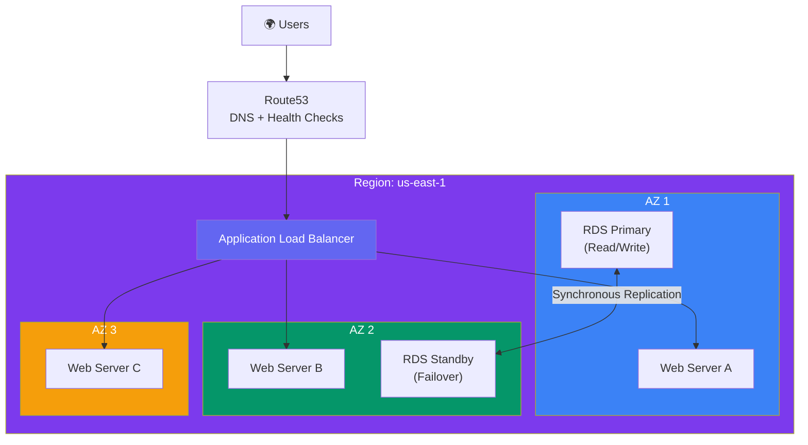
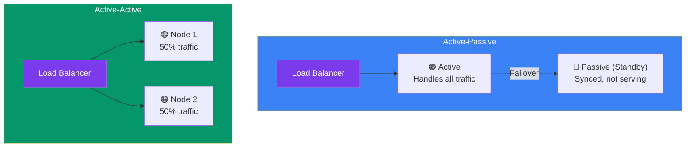
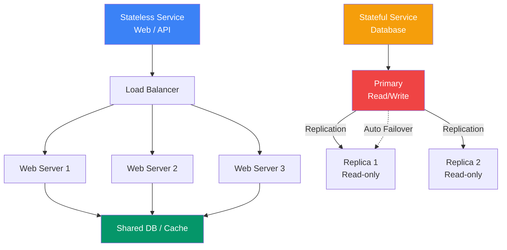
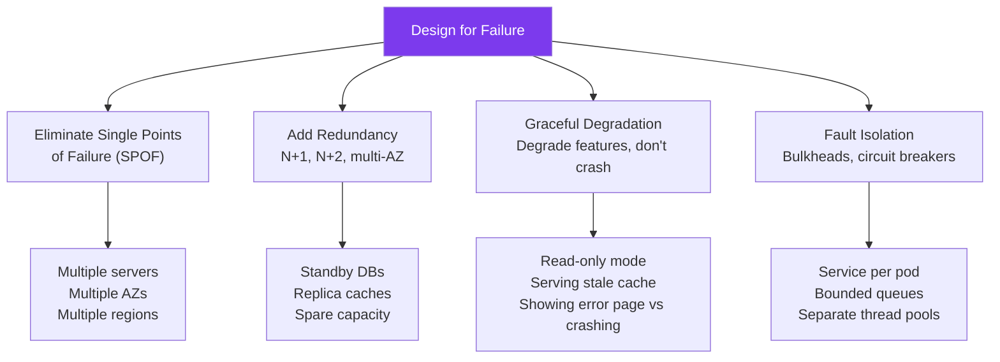
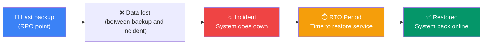

## 15 — High Availability

**High Availability (HA)** means your system continues to operate even when components fail. It's measured by **uptime percentage** — the proportion of time the system is functioning.

> **Analogy:** A high-availability system is like a plane with multiple engines. If one engine fails, the plane doesn't fall — it keeps flying on the remaining engines. A single-engine plane (no HA) must land immediately if the engine fails.

---

### Problem Statement

Without high availability:
- **Single point of failure (SPOF)** — one server goes down, whole system is down
- **Planned downtime** — deployments, maintenance require taking the system offline
- **Low SLA** — can't meet 99.9%+ uptime commitments
- **User trust erosion** — frequent outages drive users to competitors

---

### Availability Tiers (The Nines)

| Uptime % | Downtime/Year | Downtime/Month | Example |
|----------|---------------|----------------|---------|
| 99% (two 9s) | 3.65 days | 7.2 hours | Dev environments |
| 99.9% (three 9s) | 8.76 hours | 43.8 min | Internal tools |
| 99.99% (four 9s) | 52.56 min | 4.38 min | Production apps |
| 99.999% (five 9s) | 5.26 min | 25.9 sec | Critical infrastructure |
| 99.9999% (six 9s) | 31.56 sec | 2.59 sec | Telecom, emergency |

---

### Architecture Overview

---

### High Availability Patterns

| Pattern | Description | RTO | RPO |
|---------|-------------|-----|-----|
| **Active-Passive** | One server active, one standby (cold or warm) | Minutes | Minutes |
| **Active-Active** | Both servers active, traffic split between them | Seconds | Seconds |
| **Multi-AZ** | Deploy across multiple availability zones | Minutes | Seconds |
| **Multi-Region** | Deploy across geographic regions | Minutes to hours | Minutes to hours |
| **N+1 Redundancy** | One extra instance beyond what's needed | Seconds | None |
| **Leader Election** | Cluster nodes elect a leader | Seconds | None |

---

### Active-Passive vs Active-Active

| Aspect | Active-Passive | Active-Active |
|--------|---------------|---------------|
| **Resource utilization** | 50% (passive server idle) | 100% (both servers active) |
| **Failover time** | 30 sec - 5 min | Instant (other node handles traffic) |
| **Complexity** | Low | Higher (data consistency, session mgmt) |
| **Cost** | Same as active-active | Same hardware, better ROI |
| **Best for** | Databases, stateful systems | Stateless web/app servers |

---

### Stateless vs Stateful HA

**Stateless services** (web servers, APIs) are easy to make HA — just add more instances behind a load balancer.

**Stateful services** (databases, caches) require careful HA design:

---

### Designing for Failure

---

### RTO and RPO

| Term | Definition | Example |
|------|------------|---------|
| **RTO** (Recovery Time Objective) | How long to recover after failure | System must be back within 1 hour |
| **RPO** (Recovery Point Objective) | How much data loss is acceptable | Lose at most 5 minutes of data |

---

### Trade-offs

| Decision | Pros | Cons |
|----------|------|------|
| **Multi-AZ** | Resilience to AZ failures | Cross-AZ data transfer costs |
| **Multi-Region** | Region failure resilience | Complexity, data sync challenges |
| **Active-Passive** | Simple failover | 50% resource waste |
| **Active-Active** | Full resource utilization | Complexity, conflict resolution |
| **5 nines HA** | Almost never down | 10x cost for last 0.09% |
| **Auto-scaling** | Cost-efficient HA | Cold start latency |

---

### Scaling Strategies

| Strategy | Description |
|----------|-------------|
| **N+1 redundancy** | Always one more instance than needed |
| **Auto-healing** | Automatically replace failed instances |
| **Graceful degradation** | Disable non-critical features during load |
| **Load shedding** | Drop low-priority requests under extreme load |
| **Chaos engineering** | Deliberately inject failures to test HA |

---

### Interview Questions

1. **What is the difference between active-passive and active-active HA?**
2. **How do you eliminate single points of failure in a web application?**
3. **Explain RTO and RPO — what's the difference?**
4. **How do you make a database highly available?**
5. **What does "design for failure" mean in practice?**

---

### Real-World Examples

| System | HA Strategy |
|--------|-------------|
| **Amazon** | Multi-AZ for all services, active-active across regions |
| **Netflix** | Multi-region active-active, Chaos Monkey tests HA |
| **Google Search** | 3+ replicas of everything, instant failover |
| **Cloudflare** | Anycast routing — traffic reroutes automatically if PoP fails |

---

### In Simple Words

- **High Availability** = system keeps working when components fail
- **Redundancy** is the key — multiple servers, AZs, regions
- **Active-Passive** = one server works, one waits (simple but wasteful)
- **Active-Active** = all servers work (efficient but complex)
- **RTO** = time to recover; **RPO** = data loss tolerance
- **SPOF** (single point of failure) is the enemy — eliminate them everywhere
- **"The nines"** — 99.99% = ~1 hour downtime/year, 99.999% = ~5 minutes/year
- HA costs money — the last 0.09% (99.9% → 99.99%) costs as much as the first 99.9%
- Design for **graceful degradation** — degrade features before crashing entirely
