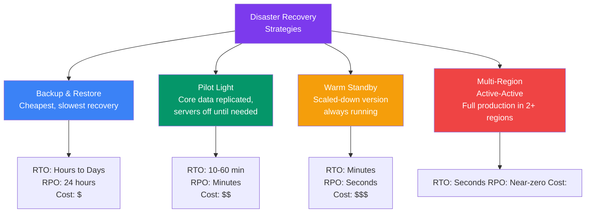
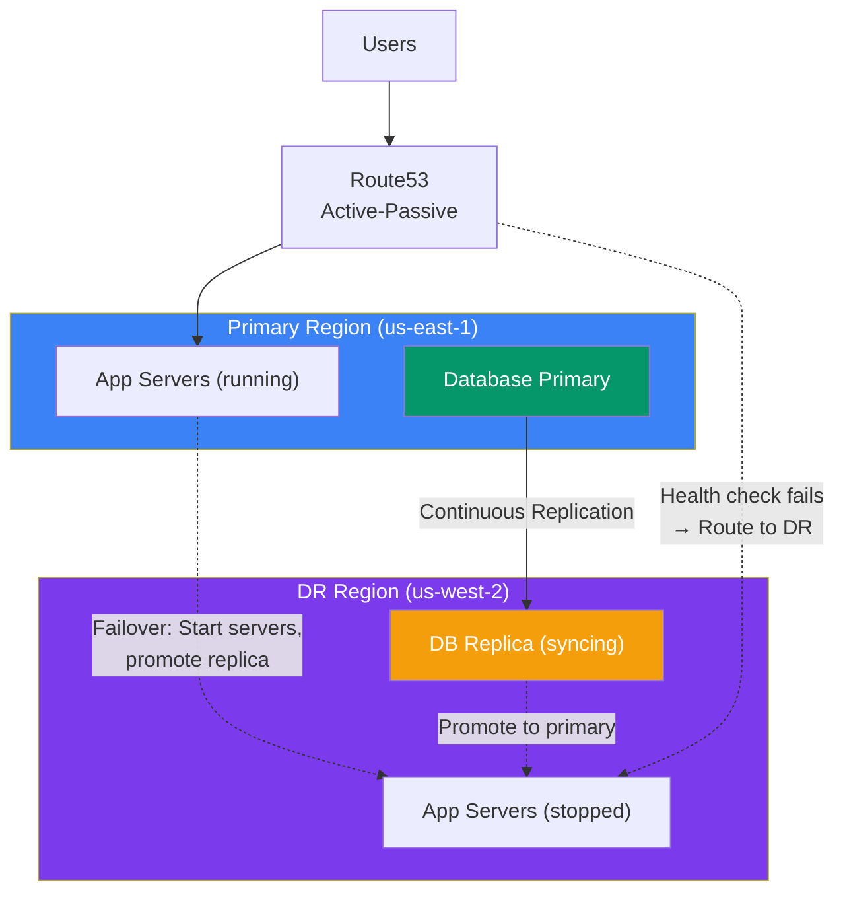
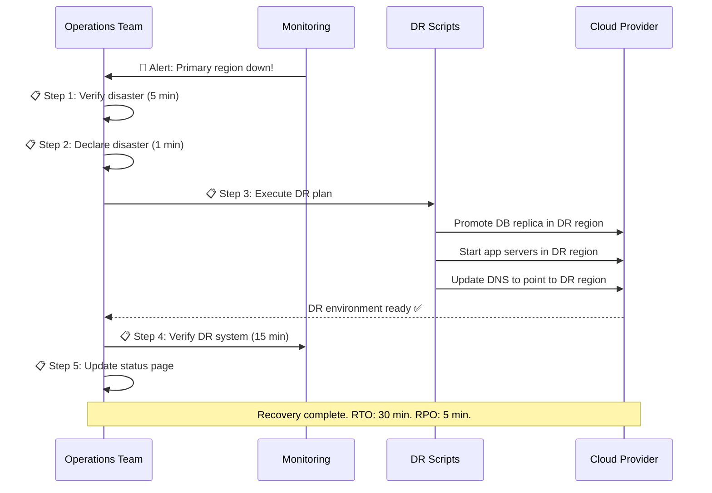
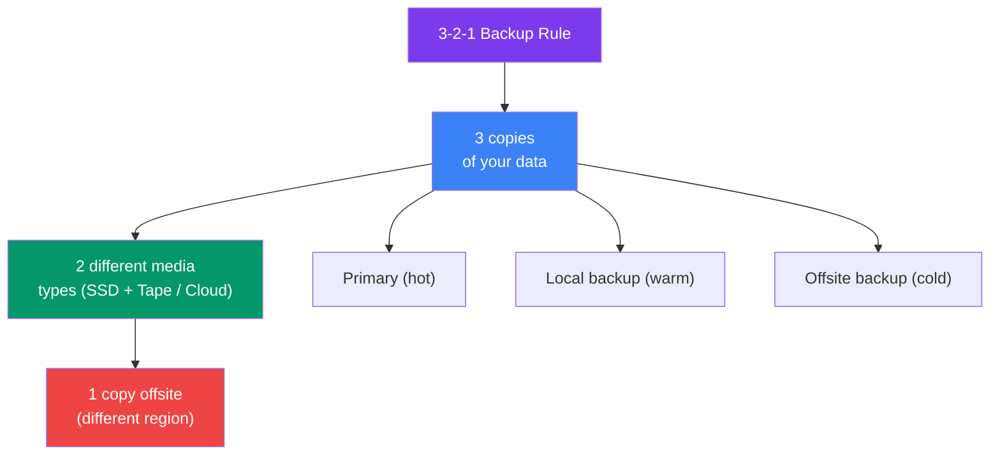

## 16 — Disaster Recovery

**Disaster Recovery (DR)** is the process of restoring IT infrastructure and systems after a catastrophic failure — natural disaster, cyber attack, data center outage, or region-wide failure.

> **Analogy:** DR is like having an emergency plan for your home. If there's a fire, you've practiced the escape route, have backups of important documents in a safe deposit box, and know where to regroup. You hope you never need it, but you're ready if you do.

---

### Problem Statement

Without a DR plan:
- **Data loss** — no backups = lost forever
- **Extended downtime** — days or weeks to recover
- **Panic decisions** — no plan means chaotic response
- **Regulatory fines** — HIPAA, GDPR, PCI-DSS require DR plans
- **Reputation damage** — long outages destroy customer trust

---

### DR Strategies

---

### DR Strategies Comparison

| Strategy | RTO | RPO | Cost | Complexity |
|----------|-----|-----|------|------------|
| **Backup & Restore** | Hours to days | 24 hours | $ | Low |
| **Pilot Light** | 10-60 min | Minutes | $$ | Medium |
| **Warm Standby** | Minutes | Seconds | $$$ | Medium |
| **Multi-Region Active-Active** | Seconds | Near-zero | $$$$ | High |
| **Data replication only** | Depends on app | Seconds | $$ | Medium |

---

### Pilot Light Pattern

The **pilot light** strategy keeps core data (database, S3) replicated to a DR region. Compute resources (EC2, Lambda) are provisioned only when needed for failover.

---

### DR Runbook (What to Do During a Disaster)

---

### Backup Strategies

| Data Type | Backup Method | Frequency | Retention |
|-----------|--------------|-----------|-----------|
| **Database** | Automated snapshots | Daily + transaction logs (continuous) | 30-90 days |
| **Application config** | Version control (Git) | Per deployment | Forever |
| **User uploads** | Replication / versioning | Continuous | Regional replication |
| **Logs** | Export to S3/Glacier | Real-time | 1-7 years (compliance) |
| **Infrastructure** | IaC templates (CloudFormation, Terraform) | Per change | Version history |

---

### 3-2-1 Backup Rule

---

### Disaster Recovery Testing

| Test Type | Description | Frequency |
|-----------|-------------|-----------|
| **Tabletop exercise** | Walk through DR plan verbally | Quarterly |
| **Backup restore test** | Actually restore from backups | Monthly |
| **Partial failover** | Fail over non-critical components | Quarterly |
| **Full DR drill** | Complete failover to DR region | Annually |
| **Chaos engineering** | Deliberately inject failures | Ongoing |

---

### Trade-offs

| Decision | Pros | Cons |
|----------|------|------|
| **Backup & Restore** | Cheap, simple | Slow recovery, potential data loss |
| **Pilot Light** | Good balance of cost and speed | Manual steps during failover |
| **Warm Standby** | Fast recovery | Run cost even when not needed |
| **Multi-Region** | Instant availability | Highest cost, complex data sync |

---

### Scaling Strategies

| Strategy | Description |
|----------|-------------|
| **Automated DR runbook** | Script everything — no manual steps during disaster |
| **Infrastructure as Code** | Reproduce entire environment from templates |
| **Data replication** | Continuous replication for databases (async or sync) |
| **DNS-based failover** | Route53 health checks + automatic DNS switching |
| **Immutable infrastructure** | No manual server configs — rebuild not repair |

---

### Interview Questions

1. **What's the difference between pilot light and warm standby?**
2. **Explain RTO and RPO — what's the difference?**
3. **What is the 3-2-1 backup rule?**
4. **How would you design a disaster recovery plan for a multi-region web app?**
5. **How often should you test your disaster recovery plan?**

---

### Real-World Examples

| System | DR Strategy |
|--------|-------------|
| **AWS** | 3 copies of all S3 objects, Geo-redundant across regions |
| **Netflix** | Multi-region active-active (Simian Army tests DR) |
| **GitHub** | MySQL replication + S3 backups, DR drills every quarter |
| **Google** | Redundant data centers globally, minutes to failover |

---

### In Simple Words

- **Disaster Recovery** = plan to restore service after a catastrophic failure
- **RTO** (Recovery Time Objective) = how fast you recover; **RPO** = how much data you lose
- **Four strategies** from cheapest/slowest to expensive/fastest: Backup → Pilot Light → Warm Standby → Multi-Region
- **Pilot Light** = keep DB running in DR region, start app servers on failover — good balance
- **3-2-1 Rule**: 3 copies, 2 media types, 1 offsite
- **Test your DR plan!** An untested plan is just a wish
- **Automate everything** in the DR runbook — panic leads to mistakes
