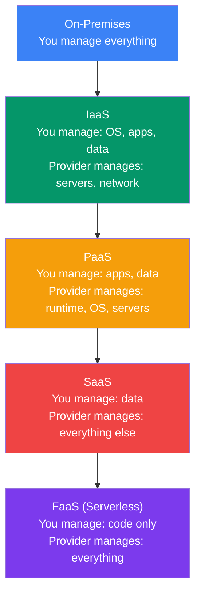
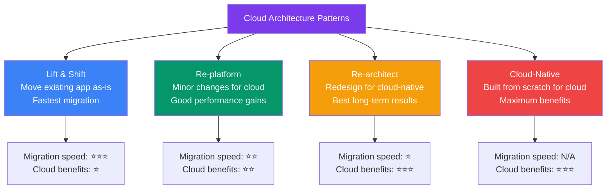
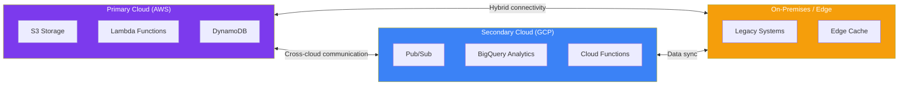
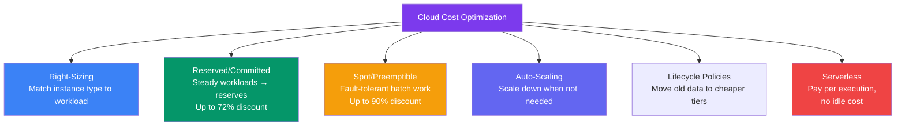

## 17 — Cloud Architecture

**Cloud architecture** is the practice of designing systems that leverage cloud computing benefits — elasticity, pay-as-you-go, managed services, global infrastructure, and high availability — while avoiding vendor lock-in and runaway costs.

> **Analogy:** On-premises IT is like owning a house — you buy everything, maintain everything, and pay whether you're using it or not. Cloud architecture is like a hotel — you pay for exactly the room and services you need, only when you need them.

---

### Problem Statement

Poor cloud architecture leads to:
- **High costs** — over-provisioned resources, idle capacity
- **Vendor lock-in** — tightly coupled to one provider's services
- **Performance issues** — wrong region, wrong service, wrong tier
- **Security gaps** — misconfigured S3 buckets, open security groups
- **Complex migration** — lift-and-shift without refactoring

---

### Cloud Service Models

---

### Well-Architected Framework (AWS)

Six pillars of a well-architected cloud system:

| Pillar | What It Means | Key Practices |
|--------|---------------|---------------|
| **Operational Excellence** | Run and monitor systems | IaC, automation, observability |
| **Security** | Protect data and systems | IAM, encryption, least privilege |
| **Reliability** | Recover from failures | HA, DR, auto-scaling |
| **Performance Efficiency** | Use resources effectively | Right-sizing, serverless, caching |
| **Cost Optimization** | Minimize costs | Reserved instances, lifecycle policies |
| **Sustainability** | Minimize environmental impact | Efficient code, region selection |

---

### Cloud Architecture Patterns

---

### Multi-Cloud Architecture

| Cloud Strategy | Pros | Cons |
|----------------|------|------|
| **Single Cloud** | Deep integration, simpler ops | Vendor lock-in |
| **Multi-Cloud** | Best-of-breed services, no lock-in | Higher complexity, cross-cloud networking |
| **Hybrid Cloud** | Keep sensitive data on-prem, burst to cloud | Network complexity, consistent management |
| **Cloud-Native** | Full benefits of cloud | Requires redesign, new skills |

---

### Cost Optimization

---

### Cloud Design Principles

| Principle | Description |
|-----------|-------------|
| **Design for failure** | Assume everything fails — build redundancy |
| **Build loosely coupled** | Services don't depend on each other's internals |
| **Implement elasticity** | Scale up AND down — don't pay for idle resources |
| **Think parallel** | Distribute work across many small resources |
| **Automate everything** | No manual configuration — use IaC |
| **Use managed services** | Let the cloud provider handle operations |
| **Cache aggressively** | Reduce load, improve latency |
| **Secure by default** | Least privilege, encryption everywhere |

---

### Trade-offs

| Decision | Pros | Cons |
|----------|------|------|
| **Managed services** | Less ops work | Vendor lock-in, higher per-unit cost |
| **Serverless** | No idle cost, auto-scale | Cold starts, max execution time |
| **Multi-cloud** | No lock-in, best services | Cross-cloud latency, complexity |
| **Reserved instances** | Major discount | Commitment, less flexibility |
| **All-in on one provider** | Deep integration, simpler | Hard to migrate away |

---

### Scaling Strategies

| Strategy | Cloud Implementation |
|----------|---------------------|
| **Horizontal scaling** | Auto Scaling Groups, serverless (auto-scale by default) |
| **Global distribution** | CDN (CloudFront), multi-region deployment |
| **Elastic storage** | S3 (unlimited scale), DynamoDB (auto-scaling throughput) |
| **Queue-based decoupling** | SQS / SNS / EventBridge between services |
| **Infrastructure as Code** | CloudFormation, Terraform, CDK |

---

### Interview Questions

1. **What are the six pillars of the AWS Well-Architected Framework?**
2. **When would you choose a single cloud vs multi-cloud strategy?**
3. **How do you optimize cloud costs without sacrificing performance?**
4. **What's the difference between lift-and-shift and cloud-native?**
5. **How do you choose between EC2, Lambda, and ECS for a workload?**

---

### Real-World Examples

| System | Cloud Architecture |
|--------|-------------------|
| **Netflix** | AWS-native (cloud-native), microservices, Chaos Monkey |
| **Airbnb** | AWS with multi-region (US East + Europe), cloud-optimized |
| **Spotify** | GCP-native, migrated from on-prem to cloud |
| **Capital One** | Full AWS migration from on-prem — all-in on a single cloud |

---

### In Simple Words

- **Cloud architecture** = designing systems to maximize cloud benefits (elasticity, managed services, global reach)
- **Six pillars**: Operational Excellence, Security, Reliability, Performance, Cost, Sustainability
- **Lift & shift** is fastest but gets least cloud benefit — **cloud-native** is hardest but best
- **Multi-cloud** = best tools, no lock-in — but adds complexity
- **Hybrid cloud** = keep sensitive data on-prem, use cloud for burst
- **Cost optimization** = right-size + reserved/spot + auto-scale + serverless + lifecycle policies
- **Design for failure, automate everything, use managed services** — the three cloud mantras
