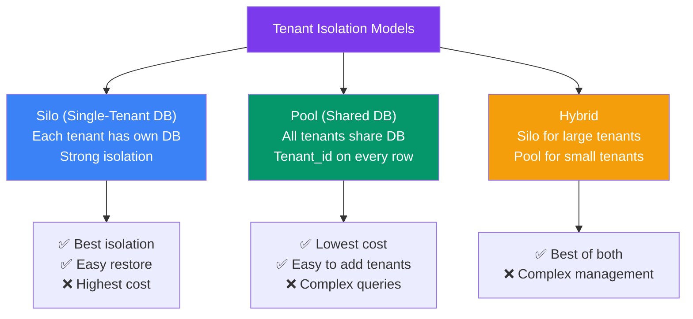
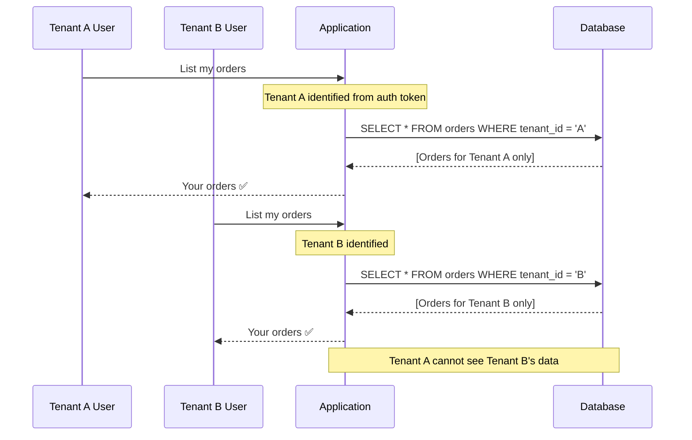
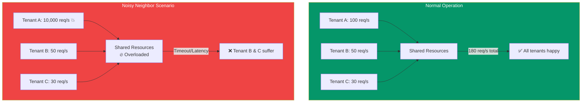
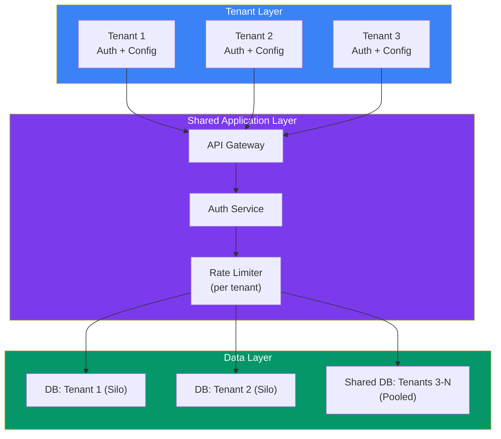

## 18 — Multi-Tenant Systems

**Multi-tenancy** means a single instance of software serves multiple customers (tenants). Each tenant's data is isolated from others, but they share the same infrastructure.

> **Analogy:** Multi-tenancy is like an apartment building. The building (system) has shared infrastructure — elevators, lobby, utilities — but each apartment (tenant) is private and separate. Tenants have keys to their own apartment, not their neighbors'.

---

### Problem Statement

Building multi-tenant systems is hard because:
- **Data isolation** — one tenant must never see another tenant's data
- **Noisy neighbors** — one tenant's heavy usage degrades service for others
- **Configuration per tenant** — features, limits, branding differ per tenant
- **Scaling** — how do you scale when tenants grow unevenly?
- **Cost attribution** — who's using how many resources?

---

### Tenant Isolation Models

| Model | Isolation | Cost | Complexity | Best For |
|-------|-----------|------|------------|----------|
| **Silo (per-tenant DB)** | Strongest | Highest | Low | Enterprise, compliance-heavy |
| **Pool (shared DB)** | Moderate (row-level) | Lowest | Medium | Small tenants, low-cost SaaS |
| **Hybrid (silo + pool)** | Configurable | Medium | High | SaaS with mixed tenant sizes |
| **Schema per tenant** | Strong (schema-level) | Medium | Medium | Regional or vertical SaaS |

---

### Tenant Data Access Patterns

---

### Noisy Neighbor Problem

When one tenant consumes more resources than expected, impacting others:

**Solutions:**
| Solution | How It Works |
|----------|-------------|
| **Rate limiting per tenant** | Each tenant has a max request limit |
| **Resource quotas** | CPU/memory limits per tenant (container cgroups) |
| **Provisioned capacity** | Each tenant gets a guaranteed minimum |
| **Auto-isolation** | Move noisy tenants to isolated resources |

---

### Multi-Tenant Architecture

---

### Multi-Tenant Database Strategies

| Strategy | How It Works | When to Use |
|----------|-------------|-------------|
| **Row-level tenant_id** | Single DB, all rows have `tenant_id` | Simple multi-tenant apps |
| **Schema per tenant** | Same DB, separate schema per tenant | Regional SaaS, moderate isolation |
| **Database per tenant** | Separate DB per tenant | Enterprise, compliance, large tenants |
| **Sharded per tenant group** | Group tenants into shards | Scaling pool model at high volume |

---

### Tenant Configuration Management

| Configuration Type | Examples | Storage |
|-------------------|----------|---------|
| **Feature flags** | Enable/disable features per tenant | Database or config service |
| **Rate limits** | API rate limits, concurrency caps | Per-tenant config in DB |
| **Custom branding** | Logo, colors, domain per tenant | Config file or DB |
| **Integration settings** | API keys, webhook URLs per tenant | Encrypted DB columns |
| **Billing plan** | Tier limits, pricing per tenant | Billing service |

---

### Trade-offs

| Decision | Pros | Cons |
|----------|------|------|
| **Pool (shared DB)** | Lowest cost, easy tenant creation | Complex queries, row leaks risk |
| **Silo (per-tenant DB)** | Strong isolation, easy restore | Higher cost, harder migrations |
| **Per-tenant rate limits** | Fair resource distribution | Configuration overhead |
| **No per-tenant limits** | Simple to implement | Noisy neighbor problem |

---

### Scaling Strategies

| Strategy | Description |
|----------|-------------|
| **Auto-isolation** | Auto-move high-usage tenants to dedicated resources |
| **Hierarchical rate limiting** | Per-tenant cap + account-level cap |
| **Read replicas per tenant** | Isolate read traffic for large tenants |
| **Shard by tenant group** | Group tenants into clusters of N tenants each |
| **Caching per tenant** | Separate cache keys/namespaces per tenant |

---

### Interview Questions

1. **What are the pros and cons of silo vs pool multi-tenant architecture?**
2. **How do you prevent one tenant from accessing another tenant's data?**
3. **How would you handle a "noisy neighbor" that's degrading service for others?**
4. **How do you implement per-tenant configuration and feature flags?**
5. **When would you choose a hybrid multi-tenant approach?**

---

### Real-World Examples

| System | Multi-Tenant Approach |
|--------|----------------------|
| **Salesforce** | Hybrid — pool for small orgs, silo for enterprise |
| **Slack** | Pool with strong row-level isolation |
| **Shopify** | Per-tenant database (silo) — each store is separate |
| **AWS** | Accounts are natural silos — each AWS account = one tenant |

---

### In Simple Words

- **Multi-tenancy** = one system serving multiple customers with data isolation
- **Silo** (per-tenant DB) = strongest isolation, highest cost — best for enterprise
- **Pool** (shared DB) = lowest cost, moderate isolation — best for small tenants
- **Hybrid** = silo for big tenants, pool for small — best for mixed customer sizes
- **Noisy neighbor** = one tenant using too many resources — fix with rate limits or isolation
- Always include `tenant_id` in every query — a missing filter is a data leak
- **Choose isolation level based on compliance needs, tenant size, and cost constraints**
