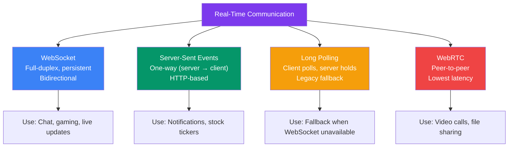
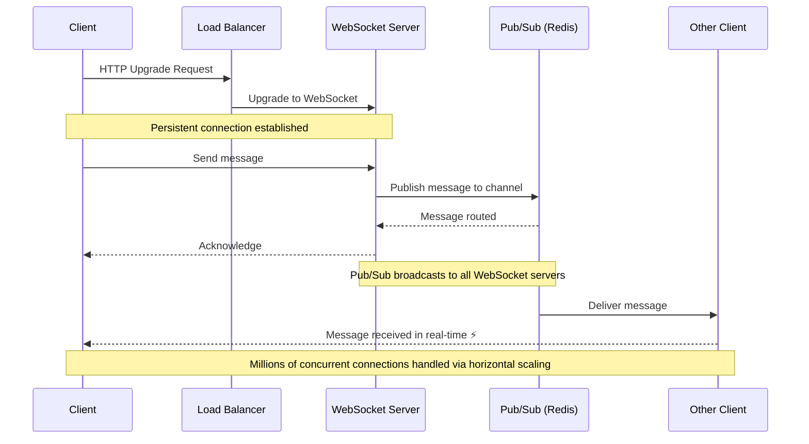
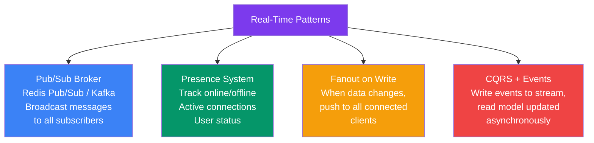
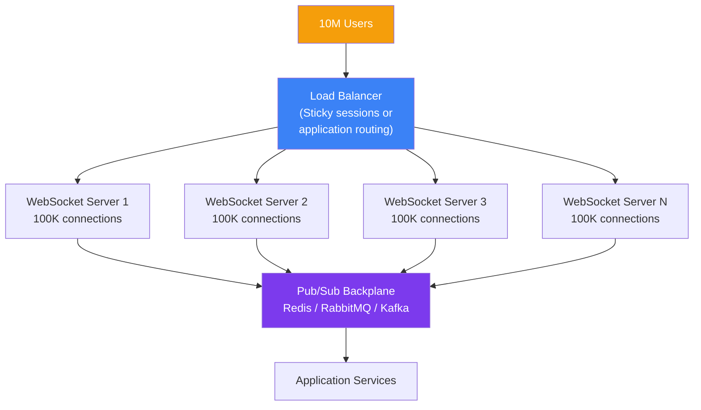
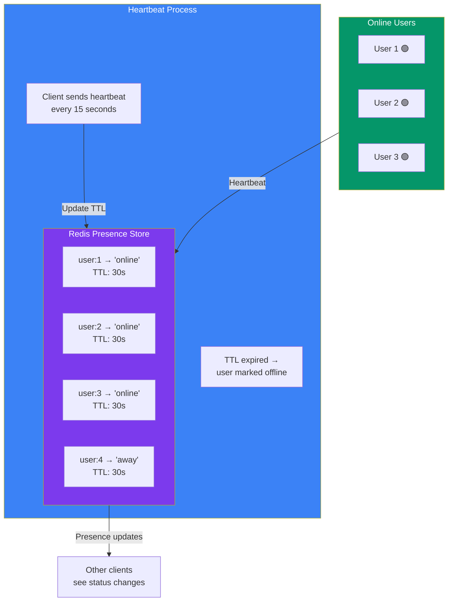

## 19 — Real-Time Systems

**Real-time systems** process and deliver data with minimal delay — typically milliseconds to seconds. They power chat apps, live notifications, collaborative editing, gaming, and live dashboards.

> **Analogy:** A real-time system is like a live conversation vs email. Email (batch) has minutes to hours of delay. A conversation (real-time) has milliseconds of delay — you hear the words almost as soon as they're spoken.

---

### Problem Statement

Building real-time systems is challenging:
- **Low latency requirement** — messages must arrive in < 100ms
- **Connection management** — millions of persistent connections
- **State synchronization** — all clients must see the same state
- **At-least-once delivery** — no message loss
- **Scaling** — WebSocket connections don't scale like HTTP

---

### Real-Time Communication Protocols

| Protocol | Direction | Latency | Browser Support | Use Case |
|----------|-----------|---------|-----------------|----------|
| **WebSocket** | Bidirectional | < 50ms | ✅ Excellent | Chat, gaming, live apps |
| **SSE** | Server → Client | < 100ms | ✅ Good (no IE) | Notifications, feeds |
| **Long Polling** | Half-duplex | 200ms-5s | ✅ Universal | Fallback |
| **WebRTC** | Peer-to-peer | < 20ms | ✅ Good | Video/audio calls |

---

### WebSocket Architecture

---

### Real-Time Architecture Patterns

---

### Scaling WebSocket Connections

A single server can handle ~10K-100K concurrent WebSocket connections. To scale beyond that:

| Challenge | Solution |
|-----------|----------|
| **Server affinity** | Client always connects to same WebSocket server (sticky routing) |
| **Cross-server broadcast** | Pub/sub backplane (Redis Pub/Sub or Kafka) between WebSocket servers |
| **Connection state** | Store session state in Redis — not in WebSocket server memory |
| **Graceful close** | Send drain signal, let clients reconnect to other servers |

---

### Presence System Design

| Presence Strategy | How It Works | Pros | Cons |
|-------------------|-------------|------|------|
| **Heartbeat** | Client sends "I'm alive" every N seconds | Simple | False offline if heartbeat delayed |
| **WebSocket disconnect** | Detect connection close | Accurate | No heartbeat = may miss timeout |
| **Hybrid** | Heartbeat + connection state | Most reliable | Most complex |

---

### Trade-offs

| Decision | Pros | Cons |
|----------|------|------|
| **WebSocket** | Bidirectional, low latency | Connection management complexity |
| **SSE** | Simpler (HTTP), auto-reconnect | Server → client only |
| **Polling** | Simple to implement | Lots of wasted requests |
| **Pub/sub backplane** | Scales WebSocket horizontally | Extra infrastructure (Redis/Kafka) |
| **In-memory state** | Fastest, simplest | Lost on server restart, can't scale |

---

### Scaling Strategies

| Strategy | Description |
|----------|-------------|
| **Horizontal WebSocket servers** | Multiple servers behind sticky load balancer |
| **Pub/sub backplane** | Redis Pub/Sub or Kafka for cross-server communication |
| **Connection pooling** | Reduce overhead of creating new connections |
| **Binary protocols** | Use Protocol Buffers, MessagePack instead of JSON |
| **Backpressure** | Slow down producers when consumers can't keep up |
| **Edge delivery** | Deploy WebSocket servers at edge (Cloudflare Workers, AWS@Edge) |

---

### Interview Questions

1. **What's the difference between WebSockets and Server-Sent Events?**
2. **How do you scale WebSocket connections to millions of users?**
3. **How would you design a real-time chat system?**
4. **How does a presence system (online/offline) work?**
5. **What is a pub/sub backplane and why is it needed for real-time systems?**

---

### Real-World Examples

| System | Real-Time Approach |
|--------|-------------------|
| **WhatsApp** | Custom WebSocket implementation, Erlang-based servers |
| **Slack** | WebSocket for real-time messages, presence via heartbeat |
| **Figma** | WebSocket + CRDT for collaborative editing |
| **Twitter/X** | WebSocket-based streaming API for real-time tweets |

---

### In Simple Words

- **Real-time** = data delivered within milliseconds — users see changes instantly
- **WebSocket** = persistent bidirectional connection — best for chat, gaming, live apps
- **SSE** = server pushes to client — simpler, good for notifications, feeds
- **Scaling WebSockets** needs sticky routing + pub/sub backplane (Redis/Kafka)
- **Presence** = knowing who's online — implemented via heartbeats with TTL in Redis
- **Pub/sub backplane** is the key to scaling — it relays messages between WebSocket servers
- Always handle **reconnection** gracefully — networks fail, clients move between servers
