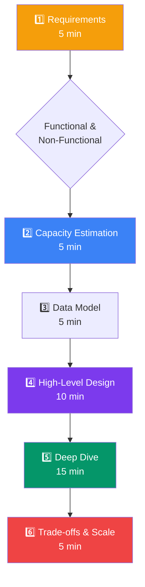
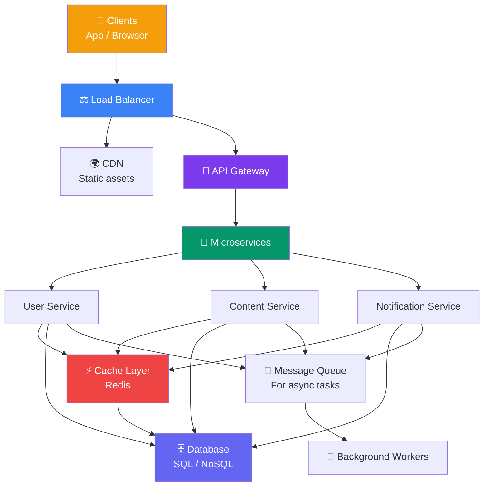

## 20 — System Design Interviews

**System design interviews** assess your ability to design large-scale systems. Unlike coding interviews, there's no single correct answer — interviewers evaluate your **thought process, trade-offs, and communication**.

> **Analogy:** A system design interview is like being an architect asked to design a stadium. The interviewer doesn't expect you to know every beam and bolt. They want to see how you gather requirements, think about capacity, make trade-offs, and communicate your design.

---

### Interview Framework

---

### Step-by-Step Framework

**1. Requirements (5 minutes)** — Understand the problem before designing

| Ask About | Example Questions |
|-----------|------------------|
| **Functional** | What features does the system need? Who are the users? |
| **Non-Functional** | How many users? Expected latency? Availability requirements? |
| **Constraints** | Budget? Timeline? Must integrate with existing systems? |
| **Scale** | DAU? Read/write ratio? Data size? |

**2. Capacity Estimation (5 minutes)** — Rough calculations

- DAU → Requests per second → Storage → Bandwidth → Servers
- Use round numbers (1M DAU, 10K RPS, 10TB storage)

**3. Data Model (5 minutes)** — Define the core entities

- Tables/collections, key fields, relationships
- Choose database type (SQL vs NoSQL) based on access patterns

**4. High-Level Design (10 minutes)** — Draw the architecture

- Start with a simple diagram: Client → LB → Server → DB → Cache
- Add components as needed (CDN, queue, search, analytics)

**5. Deep Dive (15 minutes)** — Focus on one area

- The interviewer will ask you to go deeper on a specific component
- Discuss algorithms, data structures, trade-offs

**6. Wrap-up (5 minutes)** — Trade-offs and scaling

- What would you do differently with more time?
- How would you scale to 10x users?

---

### Architecture Template

---

### Common Design Questions

| Question | Key Concepts | Difficulty |
|----------|--------------|------------|
| Design URL Shortener | Key generation, redirection, analytics | Easy |
| Design Chat System | WebSockets, presence, scaling | Medium |
| Design News Feed | Fanout, timeline, caching | Medium |
| Design Video Streaming | CDN, transcoding, adaptive bitrate | Medium |
| Design Uber/Lyft | Real-time location, matching, geospatial | Hard |
| Design WhatsApp | Real-time messaging, multi-device sync | Hard |
| Design Google Drive | File sync, conflict resolution, versioning | Hard |
| Design YouTube | Video upload, transcoding, recommendation | Hard |
| Design Instagram | Feed, stories, media storage | Medium |
| Design Twitter | Timeline, trending, search | Medium-Hard |

---

### Trade-offs to Discuss

| Trade-off | What to Say |
|-----------|-------------|
| **SQL vs NoSQL** | "I'll use SQL for strong consistency (payments), NoSQL for scale (feeds)" |
| **Monolith vs Microservices** | "Start monolithic, extract to services when boundaries are clear" |
| **Consistency vs Availability** | "CAP theorem — prefer availability, use eventual consistency for feeds" |
| **Sync vs Async** | "Sync for real-time reads, async for background processing" |
| **Cache vs Freshness** | "Cache reads, invalidate on writes, accept eventual consistency" |

---

### Common Mistakes

| Mistake | Why It's Bad | Better Approach |
|---------|--------------|-----------------|
| **Jumping to solution** | Underspecified design | Gather requirements first |
| **Over-engineering** | Adding complexity not needed | Start simple, mention improvements |
| **No capacity estimation** | Can't prove scale | Do rough math (DAU → RPS → servers) |
| **Single point of failure** | No redundancy | Add load balancer, replicas |
| **Ignoring data storage** | Where does data live? | Always discuss DB, cache, storage |
| **No trade-offs** | Everything has trade-offs | "I chose X because... at the cost of Y" |
| **Silence** | Interviewer can't follow your thinking | Think out loud, narrate your reasoning |

---

### Important Numbers to Memorize

| Metric | Value |
|--------|-------|
| Requests per second for 10M DAU | ~10,000 (rough estimate) |
| Average web server capacity | ~5,000-10,000 RPS |
| Memory per WebSocket connection | ~10-50 KB |
| Read/write ratio for social apps | ~100:1 |
| Cache hit ratio (good) | > 95% |
| CDN cache hit ratio (static) | > 90% |
| P99 latency target | < 200ms |
| Single DB server max connections | ~5,000 |
| Storage per user (social app) | ~1-10 GB |
| Bandwidth per streaming user (HD) | ~5-10 Mbps |

---

### Resources for Practice

| Resource | Type | Best For |
|----------|------|----------|
| **System Design Interview (book)** | Book | Comprehensive frameworks |
| **Grokking the System Design Interview** | Course | Structured learning |
| **YouTube channels** (Gaurav Sen, Jordan has no life) | Video | Visual explanations |
| **High Scalability blog** | Articles | Real-world system breakdowns |
| **Mock interviews with peers** | Practice | Building confidence |

---

### Interview Questions (for this section)

1. **Walk through your approach to designing a system from scratch.**
2. **How do you handle the trade-off between consistency and availability?**
3. **What numbers do you memorize for capacity estimation?**
4. **How do you decide when to use a cache vs a database?**
5. **What's the most important non-functional requirement in system design?**

---

### Real-World Examples

| Company | Interview Focus |
|---------|----------------|
| **Google** | Design YouTube, Google Drive, Search — focus on scale |
| **Amazon** | Design e-commerce platform — focus on data consistency, transactions |
| **Facebook/Meta** | Design News Feed, Messenger, Instagram — focus on social graph |
| **Uber** | Design ride matching, pricing — focus on real-time, geolocation |

---

### In Simple Words

- **Requirements first** — ask what the system should do before designing
- **Draw the architecture** — start simple (LB → Server → DB → Cache)
- **Do rough math** — DAU → RPS → servers → storage
- **Discuss trade-offs** — every design choice has pros and cons
- **Deep dive** where the interviewer asks — they'll guide you to interesting areas
- **Communicate** — think out loud, explain your reasoning, ask clarifying questions
- **There's no perfect design** — interviewers want to see your thought process, not a single answer
- Practice with **mock interviews** — system design is a skill that improves with practice
