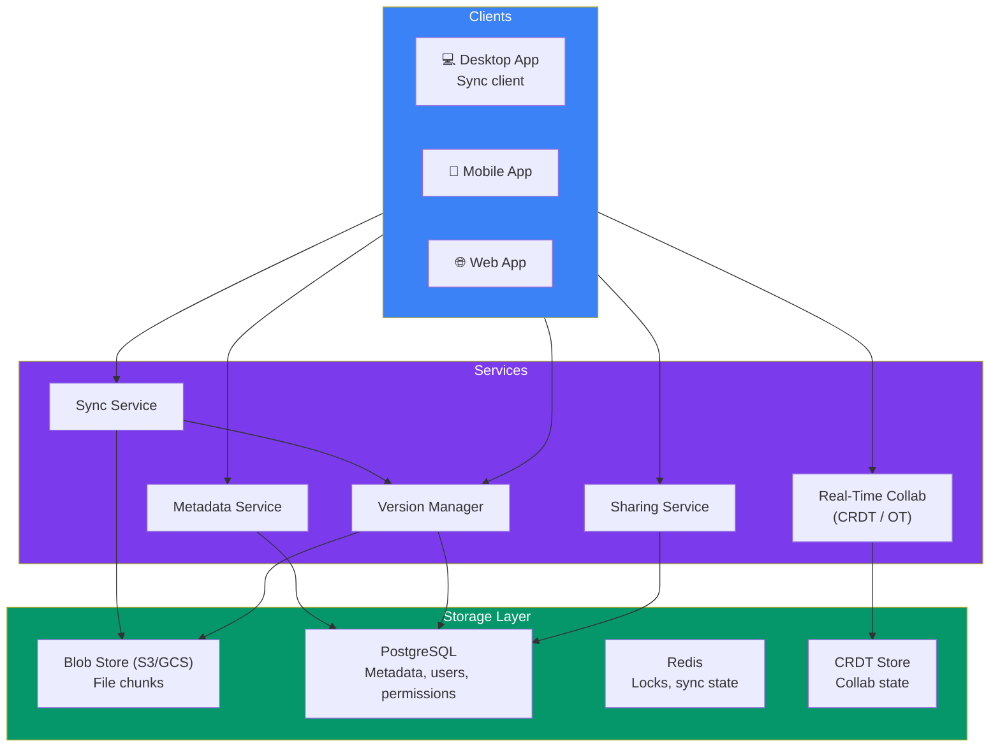
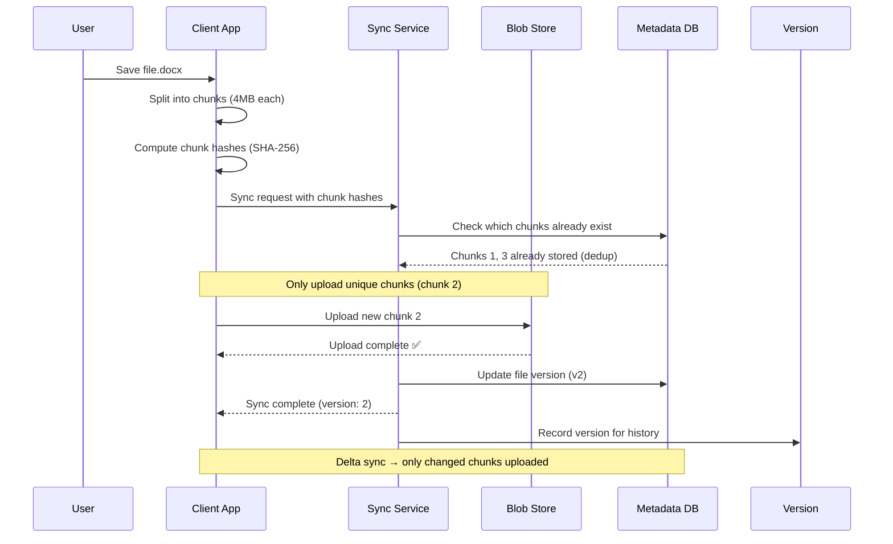

## Case Study 7 — Design Google Drive

**Problem:** Design a cloud file storage and synchronization service like Google Drive or Dropbox — upload, sync, share, versioning, and real-time collaboration.

---

### Requirements

| Type | Requirement |
|------|-------------|
| **Functional** | Upload/download files, folder organization, sync across devices, file versioning, sharing with permissions, real-time collaboration (docs) |
| **Non-Functional** | < 2s sync delay, 99.99% durability, 1B+ users, support any file type/size, delta sync for large files |

---

### Architecture Overview

---

### File Sync Flow

---

### Key Design Decisions

| Decision | Approach | Why |
|----------|----------|-----|
| **File chunking** | Split files into 4MB chunks | Efficient delta sync, dedup at chunk level |
| **Deduplication** | Content-addressed storage (hash as key) | Same file across users/chunks → stored once |
| **Delta sync** | Only upload changed chunks | Huge bandwidth savings for large files |
| **Versioning** | Immutable file versions | Full history, easy rollback |
| **Conflict resolution** | LWW (Last Writer Wins) + manual merge | Two users edit same file simultaneously |

---

### In Simple Words

- Files split into **4MB chunks** — only changed chunks are synced
- **Content-addressed storage** — chunk hash = chunk key (dedup across users)
- **Delta sync** saves bandwidth — editing 1 page of a 100-page doc only uploads the changed chunk
- **Version history** stores immutable snapshots — you can roll back to any version
- **Conflict resolution** = Last Writer Wins for simple conflicts, manual merge for complex ones
- **Real-time collaboration** uses CRDTs (Conflict-Free Replicated Data Types) for Google Docs
- **Encryption** at rest and in transit — files encrypted with user's key
