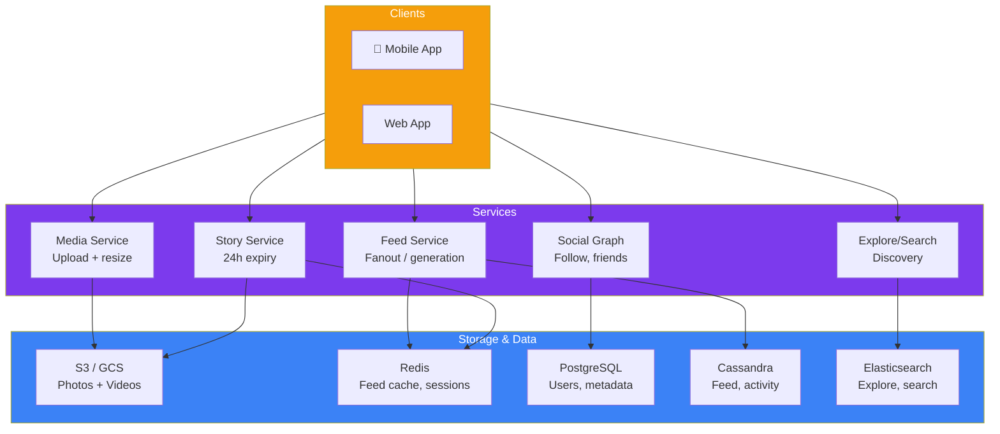
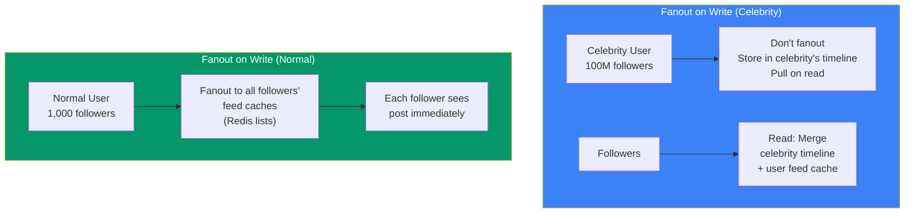

## Case Study 6 — Design Instagram

**Problem:** Design a photo/video sharing social network like Instagram supporting 1B+ users with feed, stories, explore, reels, and direct messaging.

---

### Requirements

| Type | Requirement |
|------|-------------|
| **Functional** | Upload media, feed (chronological + algorithmic), stories (24h), explore/search, likes/comments, follow, reels |
| **Non-Functional** | < 200ms feed load, 99.9%+ availability, 1B+ users, 100M+ daily uploads |

---

### Architecture Overview

---

### Feed Generation — Fanout on Write

| Approach | Used For | How It Works |
|----------|----------|-------------|
| **Fanout on write** | Normal users (< 10K followers) | Push post to all followers' feed caches immediately |
| **Fanout on read** | Celebrities (> 10K followers) | Store in timeline, pull + merge on read |

---

### Key Design Decisions

**1. Feed Generation**

Instagram uses a **hybrid approach**:
- Regular users: fanout on write (push to ~1K followers' feed caches)
- Celebrities: fanout on read (pull from timeline when follower loads feed)

**2. Media Processing Pipeline**

Upload → Resize (multiple resolutions) → Apply filters → Store in CDN → Done.

**3. Stories (Ephemeral Content)**

Stories expire after 24 hours. Stored as individual frames, compiled on client side. Viewed in order, auto-advance.

---

### In Simple Words

- **Feed** uses hybrid fanout — push for regular users, pull for celebrities
- **Media** stored in blob storage, served via CDN
- **Social graph** (follows) is a directed graph in PostgreSQL
- **Stories** = temporary content (24h TTL), viewed as slideshow
- **Explore/Search** uses Elasticsearch for content discovery
- **Reels** = short-form video, similar to TikTok — heavy on recommendation ML
