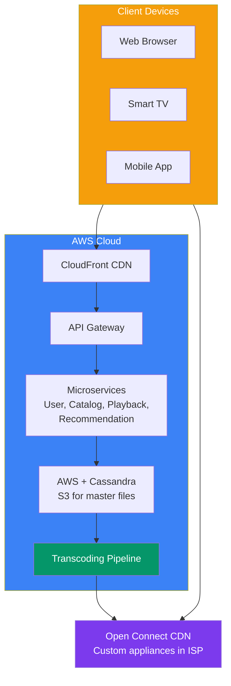
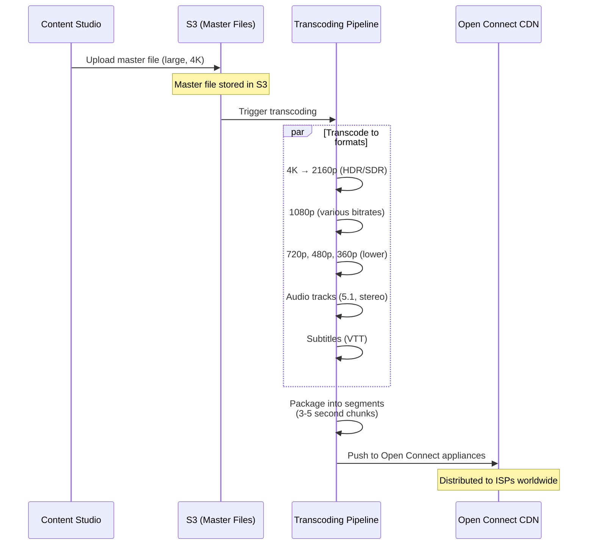

## Case Study 3 — Design Netflix

**Problem:** Design a video streaming service like Netflix supporting 250M+ subscribers, streaming movies/TV shows globally with adaptive bitrate, personalization, and high availability.

---

### Requirements

| Type | Requirement |
|------|-------------|
| **Functional** | Browse catalog, search, play video (adaptive quality), resume from last position, personalized recommendations |
| **Non-Functional** | < 2s startup time, 99.99% availability, 250M+ users, global distribution, 100+ Tbps peak bandwidth |

---

### Architecture Overview

---

### Video Upload & Transcoding Flow

---

### Key Design Decisions

**1. Open Connect CDN**

Netflix's custom CDN — dedicated caching appliances deployed inside ISP data centers. This handles > 95% of traffic, reducing AWS bandwidth costs dramatically.

**2. Adaptive Bitrate Streaming**

| Quality | Resolution | Bitrate | When Used |
|---------|-----------|---------|-----------|
| **4K UHD** | 3840×2160 | 15-25 Mbps | Fast connection, big screen |
| **1080p** | 1920×1080 | 5-8 Mbps | Standard HD |
| **720p** | 1280×720 | 2-4 Mbps | Medium connection |
| **480p** | 854×480 | 1-2 Mbps | Mobile, slow connection |
| **360p** | 640×360 | 400-800 kbps | Poor connection |

Client requests video in chunks (~3-5 seconds). Each chunk can be at a different quality level — the player switches automatically based on network conditions.

**3. Recommendation Engine**

| Component | Technology |
|-----------|------------|
| **Collaborative filtering** | Matrix factorization (user-item) |
| **Content-based filtering** | Tag/feature similarity |
| **Deep learning** | Neural networks for feature extraction |
| **A/B testing** | Online experimentation platform |

---

### Scaling & Trade-offs

| Aspect | Approach | Trade-off |
|--------|----------|-----------|
| **CDN** | Custom Open Connect appliances | Capital expenditure, ISP partnerships |
| **Microservices** | 700+ microservices | Coordination, deployment complexity |
| **Data storage** | Cassandra for viewing history, S3 for masters | Multi-region data sync |
| **Chaos engineering** | Simian Army (Chaos Monkey) | Accepts that failures will happen |

---

### In Simple Words

- **CDN** is everything — Netflix built its own (Open Connect) to serve 95%+ of traffic
- **Adaptive bitrate** = video split into 3-second chunks at multiple qualities, client chooses per chunk
- **Transcoding pipeline** converts one master file into hundreds of format/quality/audio combinations
- **Recommendation** drives 80%+ of content discovery — it's the core of the product
- **Microservices** architecture with 700+ services managed via chaos engineering
- Global users get content from **local ISP caches** — not from a central server
