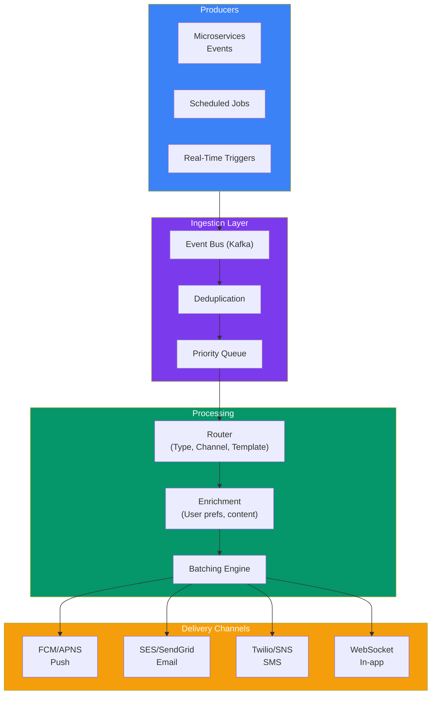
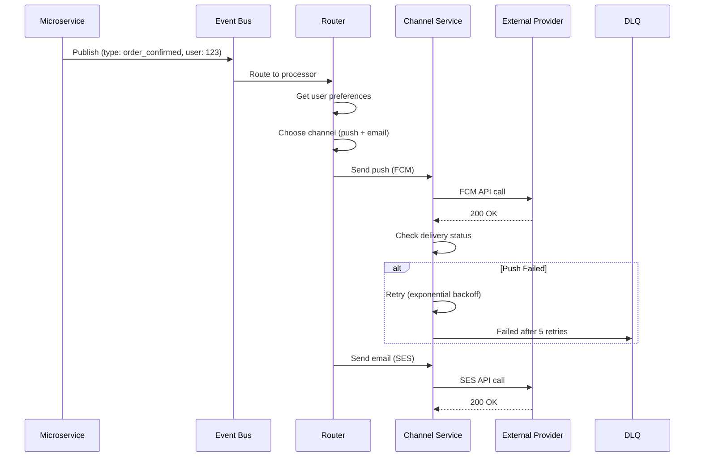

## Case Study 8 — Design Notification System

**Problem:** Design a notification system that sends push notifications, emails, and SMS to millions of users reliably and at scale.

---

### Requirements

| Type | Requirement |
|------|-------------|
| **Functional** | Send push (mobile/web), email, SMS; notification preferences; templates; scheduling; read/unread tracking |
| **Non-Functional** | < 1s delivery for push, < 5min for email, 99.9% delivery rate, support 10+ billion notifications/day |

---

### Architecture Overview

---

### Key Design Decisions

| Decision | Approach | Why |
|----------|----------|-----|
| **Deduplication** | Dedup window (5 min), event ID | Same event fired multiple times |
| **Priority queue** | Critical (security alerts) → Normal → Bulk (marketing) | Don't block urgent notifications |
| **Batch sending** | Batch emails (200/req), push (1,000/req) | Higher throughput, rate limits |
| **Templating** | Server-side render templates | Consistent formatting, dynamic content |
| **Retry** | Exponential backoff + DLQ after 5 retries | Transient failures |
| **Preference filtering** | Check user opt-in preferences before sending | Compliance (GDPR, CAN-SPAM) |

---

### Delivery Flow

---

### In Simple Words

- **Decoupled architecture** — producers publish events, consumers send notifications
- **Kafka** ingests all notification events — durable, replayable
- **Deduplication** prevents sending the same notification twice
- **Priority queues** ensure critical notifications aren't delayed by bulk ones
- **Template service** renders notification content from templates + variables
- **Channel services** (push, email, SMS) handle provider-specific logic and rate limits
- **Retry with DLQ** — transient failures retry, persistent failures go to dead letter queue
- **User preference filtering** ensures you only send via channels users have opted into
