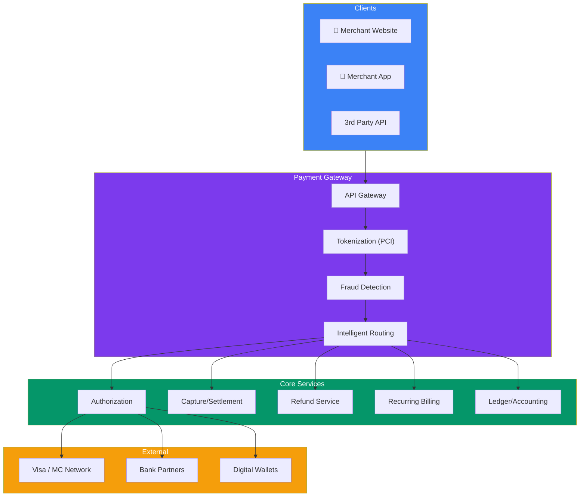
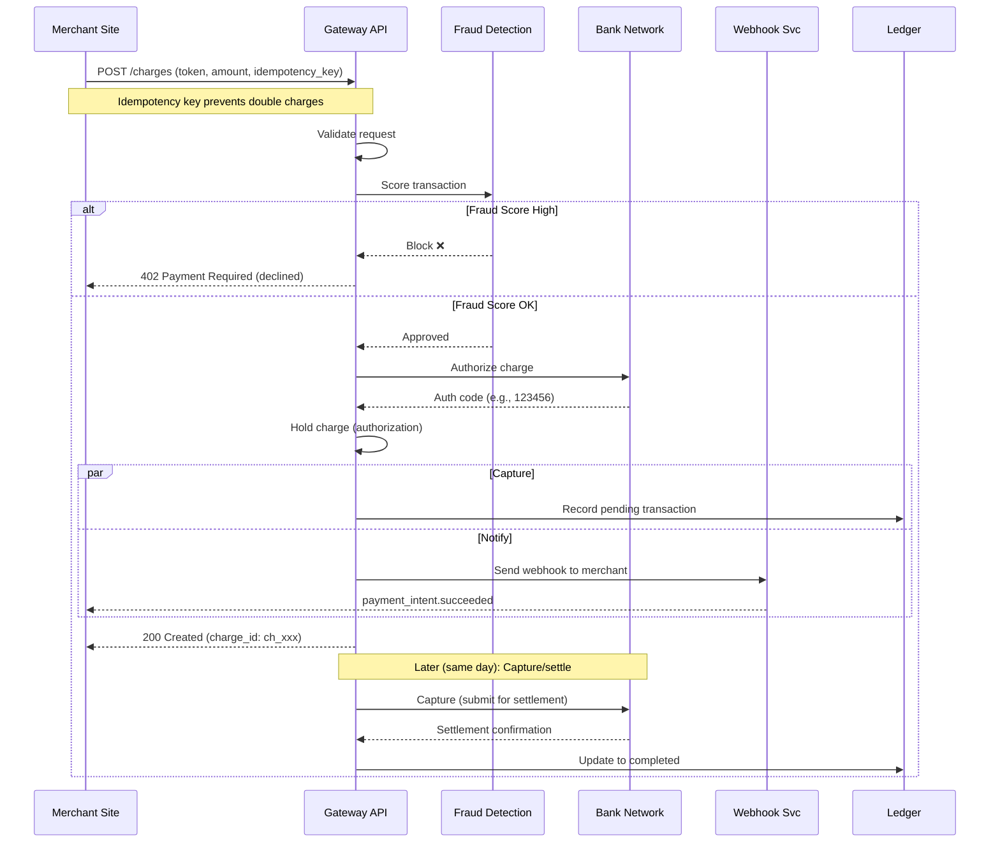

## Case Study 9 — Design Payment Gateway

**Problem:** Design a payment processing system like Stripe or PayPal that handles millions of transactions daily with high reliability, security, and fraud detection.

---

### Requirements

| Type | Requirement |
|------|-------------|
| **Functional** | Process payments (credit card, wallet, bank), refunds, recurring billing, payout to merchants, webhook notifications, fraud detection |
| **Non-Functional** | < 2s payment processing (P99), 99.999% accuracy (no double charges), PCI-DSS compliance, support 10M+ transactions/day |

---

### Architecture Overview

---

### Payment Flow

---

### Key Design Decisions

| Decision | Approach | Why |
|----------|----------|-----|
| **Idempotency** | Idempotency key on all write requests | Retry safely — no double charges |
| **Tokenization** | Replace PAN with tokens | PCI scope reduction (don't store raw card numbers) |
| **Authorization vs Capture** | Auth (hold), Capture (settle later) | Verify funds before shipping, settle on fulfillment |
| **Ledger** | Double-entry accounting | Every debit has matching credit — audit trail |
| **Reconciliation** | Batch settlement files from banks | Match bank records to internal transactions |

---

### In Simple Words

- **Idempotency** is the most critical feature — safe retries without double charging
- **Tokenization** replaces sensitive card data with tokens — reduces PCI compliance scope
- **Authorization** = hold funds; **Capture** = complete the transaction (can be separate)
- **Fraud detection** scores each transaction in real-time before processing
- **Ledger** uses double-entry accounting — every transaction is recorded with matching credits/debits
- **Reconciliation** matches bank settlement files with internal records nightly
- **Webhooks** notify merchants of payment status changes asynchronously
- **PCI-DSS compliance** drives all security decisions — encryption, access control, audit logging
