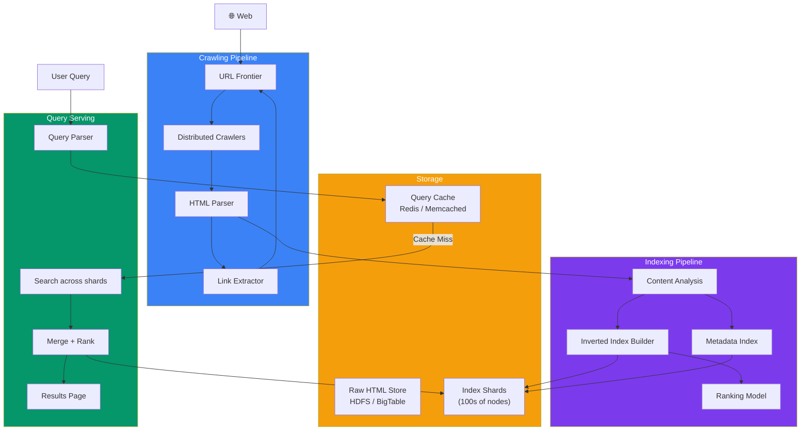
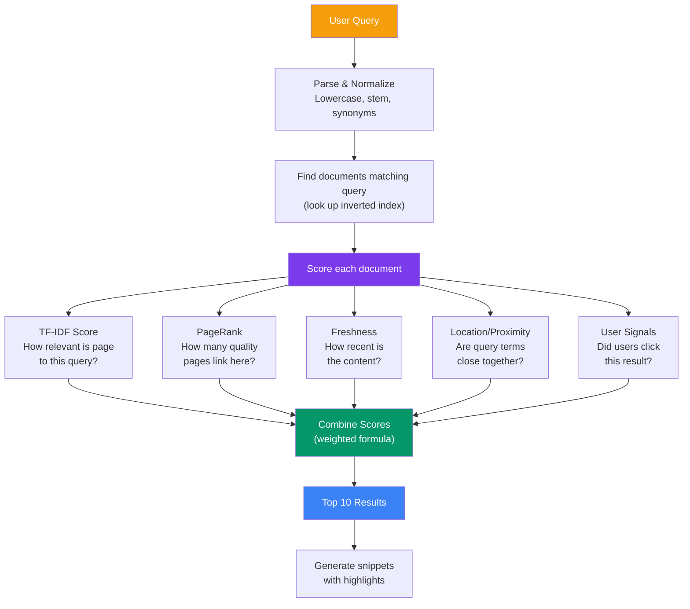

## Case Study 10 — Design Search Engine

**Problem:** Design a web search engine like Google that crawls billions of web pages, indexes them, and returns relevant results in milliseconds.

---

### Requirements

| Type | Requirement |
|------|-------------|
| **Functional** | Crawl web pages, build search index, rank results by relevance, handle user queries, handle typos/stemming/synonyms |
| **Non-Functional** | < 200ms query latency (P99), index 100B+ pages, handle 100K+ queries/sec, 99.99% availability |

---

### Architecture Overview



---

### Crawling Flow

```mermaid
sequenceDiagram
    participant Frontier as URL Frontier
    participant Crawler as Crawler
    participant Parser as Parser
    participant Store as Raw HTML Store
    participant Index as Indexer

    Frontier->>Crawler: Next URL batch (100 URLs)
    Crawler->>Crawler: Check robots.txt (politeness)
    Crawler->>Web: Fetch page
    Web-->>Crawler: HTML response
    
    Crawler->>Parser: Send HTML for parsing
    Parser->>Parser: Extract title, text, meta
    
    Parser->>Link: Extract links
    Link->>Link: Normalize URLs
    Link->>Frontier: Add to frontier (prioritized)

    Parser->>Store: Save raw HTML (for re-crawl)
    Parser->>Index: Send parsed content for indexing
    
    Note over Crawler,Crawler: Respect crawl-delay,<br/>deduplicate URLs,<br/>handle errors gracefully
```

---

### How Search Ranking Works (PageRank Simplified)



---

### Key Design Decisions

| Decision | Approach | Why |
|----------|----------|-----|
| **Inverted Index** | Map term → list of doc IDs with positions | Fast full-text search — O(1) per term |
| **Index Sharding** | Shard by keyword range (document-based) | Parallel search across shards |
| **PageRank** | Link analysis algorithm | Measures page importance by incoming links |
| **Query Cache** | Cache frequent query results | Skewed queries — top 10% of queries = 90% of traffic |
| **Spell correction** | Bloom filter + edit distance | Handle typos gracefully |

---

### In Simple Words

- **Crawling** = systematically fetching web pages, respecting politeness (robots.txt, crawl-delay)
- **URL Frontier** prioritizes which pages to crawl next (fresh important pages first)
- **Inverted Index** = the core data structure — maps every word to the list of documents containing it
- **PageRank** = a page is important if many important pages link to it (link analysis)
- **Ranking** combines many signals: TF-IDF, PageRank, freshness, proximity, user engagement
- **Sharding** the index across hundreds of machines for parallel search
- **Query caching** serves 90% of traffic from cache (highly skewed query distribution)
- **Google processes** billions of queries per day in < 200ms — a marvel of distributed systems
