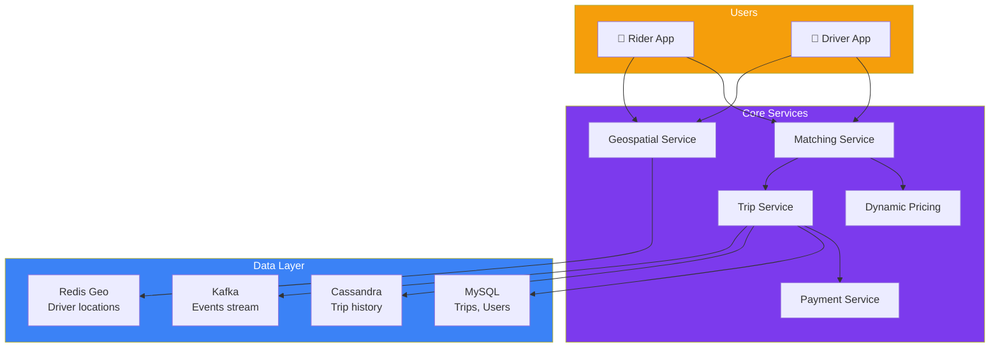
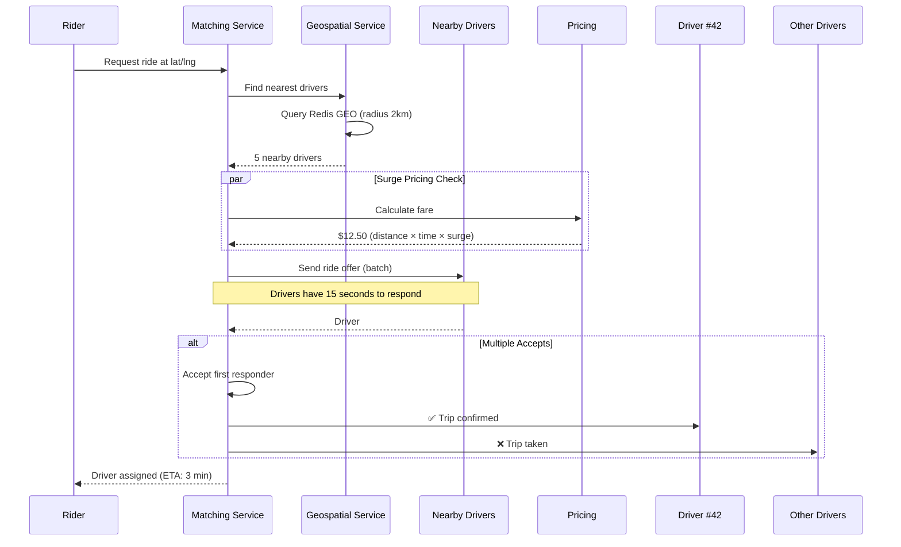
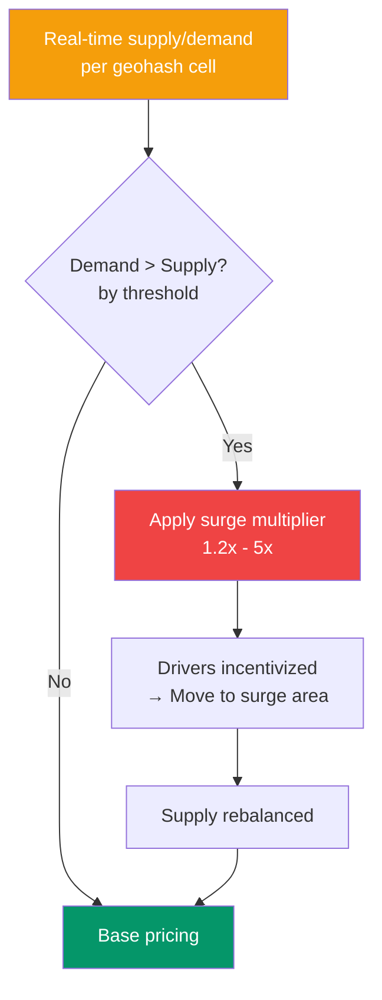

## Case Study 5 — Design Uber

**Problem:** Design a ride-sharing platform like Uber connecting riders with drivers in real-time, with location tracking, pricing, and payment processing.

---

### Requirements

| Type | Requirement |
|------|-------------|
| **Functional** | Rider request ride, driver accept, real-time location tracking, fare calculation, payment, ratings |
| **Non-Functional** | < 1s ride match time, < 5s ETA updates, 99.99% uptime, support 25M+ trips/day, global coverage |

---

### Architecture Overview

---

### Ride Matching Flow

---

### Key Design Decisions

**1. Geospatial Indexing**

Uber uses **H3** (hierarchical hexagonal grid) for geospatial indexing — divide the world into hexagons at different resolutions.

| System | How It Works | Pros | Cons |
|--------|-------------|------|------|
| **Redis GEO** | Geohash-based, radius query | Simple, fast | Single-threaded at high QPS |
| **H3** | Hexagonal grid, pre-computed | Highly scalable, consistent | Complex setup |
| **Elasticsearch geo** | Geo-distance query | Full-text + geo | Slower for high write volume |

**2. Dynamic Pricing (Surge)**

---

### Scaling & Trade-offs

| Aspect | Approach | Trade-off |
|--------|----------|-----------|
| **Location updates** | Driver app sends GPS every 4 seconds | High write throughput to Kafka |
| **Ride matching** | H3 hex grid, pre-filter by cell | Grid boundary edge cases |
| **Real-time tracking** | WebSocket + Kafka stream | Connection management at scale |
| **Payment** | Separate payment service, async | Settlement delay |

---

### In Simple Words

- **Ride matching** = find nearest driver using **geospatial index** (H3 hex grid)
- **Real-time location** = drivers stream GPS to Kafka, riders subscribe via WebSocket
- **Dynamic pricing** adjusts fares based on real-time supply/demand per area
- **Trip service** tracks the entire trip lifecycle: request → match → pick up → drop off → payment
- **Kafka** is the backbone — events flow between all microservices
- **Consistency** is eventual — it's okay if driver location lags by 2-3 seconds
