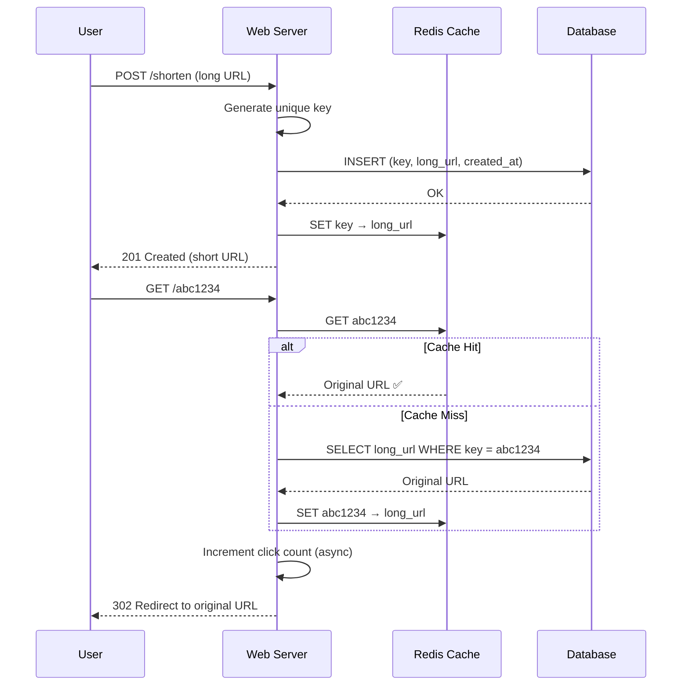

import StagedArchitectureDiagram from '../../../../components/system-design/StagedArchitectureDiagram.jsx';
import urlShortenerData from '../../../../data/system-design/diagrams/url-shortener.json';

## Case Study 1 — Design URL Shortener

**Problem:** Design a URL shortening service like TinyURL or bit.ly that converts long URLs into short, shareable links and redirects users to the original URL.

---

### Requirements

| Type | Requirement |
|------|-------------|
| **Functional** | Generate short URL, redirect to original URL, optional custom alias, analytics (click count) |
| **Non-Functional** | < 10ms redirect latency, 99.99% availability, support 100M+ URLs, handle 10K writes/sec, 100K reads/sec |
| **Constraints** | Short URL must be as short as possible (6-8 characters), URLs never expire |

---

### Capacity Estimation

| Metric | Calculation | Result |
|--------|-------------|--------|
| **New URLs per day** | 10M | ~115 URLs/sec |
| **Redirects per day** | 1B | ~11,000 redirects/sec |
| **Storage (10 years)** | 10M × 365 × 10 | ~36.5B URLs |
| **Storage per URL** | Entry: 500 bytes (short + long + metadata) | ~18 TB total |
| **Read/Write ratio** | 100:1 | Cache-friendly |

---

### Staged Architecture Walkthrough

Interact with the stages below to see how the system design scales from a single server to serving millions of users.

<div className="not-prose" style={{ margin: '2rem 0' }}>
  <StagedArchitectureDiagram client:only="react" diagramData={urlShortenerData} />
</div>

---

### Key Design Decisions

**1. Key Generation**

| Approach | Pros | Cons |
|----------|------|------|
| **Base-62 encoding of ID** | Short keys (7 chars), predictable | Sequential keys can be guessed |
| **MD5/SHA-1 hash** | Random-looking | Collision handling, fixed length |
| **Snowflake-style ID** | Unique, ordered, distributed | Complex |
| **Pre-generated keys** | Fast (no computation at write time) | Need key DB, cache |

**Chosen:** Base-62 encoding of a unique 64-bit ID → 7 character short URL. 62^7 = 3.5 trillion combinations.

**2. Redirection — HTTP 301 vs 302**

| Status | Browser Behavior | Use Case |
|--------|-----------------|----------|
| **301 (Permanent)** | Cached by browser, no subsequent request to our service | URLs that never change |
| **302 (Temporary)** | Browser asks our service every time | Need analytics (count clicks) |

**Chosen:** 302 redirect for analytics; 301 for custom URLs guaranteed permanent.

---

### Data Flow



---

### Database Schema

```sql
CREATE TABLE url_mappings (
    id BIGINT PRIMARY KEY AUTO_INCREMENT,
    short_key VARCHAR(10) UNIQUE NOT NULL,
    original_url TEXT NOT NULL,
    user_id BIGINT,
    created_at TIMESTAMP DEFAULT CURRENT_TIMESTAMP,
    expires_at TIMESTAMP NULL,
    INDEX idx_short_key (short_key),
    INDEX idx_user_id (user_id)
);

CREATE TABLE click_events (
    id BIGINT PRIMARY KEY AUTO_INCREMENT,
    short_key VARCHAR(10) NOT NULL,
    clicked_at TIMESTAMP DEFAULT CURRENT_TIMESTAMP,
    user_agent TEXT,
    ip_address VARCHAR(45),
    country VARCHAR(100),
    INDEX idx_short_key (short_key),
    INDEX idx_clicked_at (clicked_at)
);
```

---

### Scaling & Trade-offs

| Aspect | Approach | Trade-off |
|--------|----------|-----------|
| **Database** | Shard by key hash | Complex queries across shards |
| **Cache** | Redis cluster, LRU eviction | Cache misses for cold URLs |
| **Analytics** | Click events in separate DB, batch to warehouse | Eventual consistency for stats |
| **Key generation** | Pre-generate keys in batch, keep buffer | Warm pool of pre-generated keys |
| **Rate limiting** | Per-user and per-IP limits on creation | Added complexity |

---

### In Simple Words

- URL shortener is a simple read-heavy **key-value store**: short key → long URL
- **Base-62 encoding** of a numeric ID gives short, unique keys
- **302 redirect** for analytics, **301** for permanent URLs
- Heavy **caching** (Redis) for redirects (100:1 read/write ratio)
- **Asynchronous logging of click events** — don't block the redirect
- Scale by **sharding the database** and **adding cache nodes**
