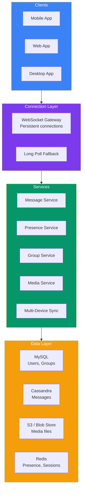
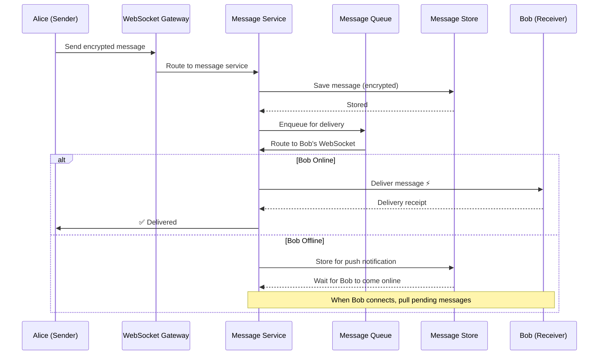

## Case Study 2 — Design WhatsApp

**Problem:** Design a real-time messaging application like WhatsApp supporting 2B+ users with text, images, videos, voice messages, group chats, and end-to-end encryption.

---

### Requirements

| Type | Requirement |
|------|-------------|
| **Functional** | 1:1 messaging, group chats (up to 256 users), media sharing, voice messages, read receipts, online/last-seen, multi-device |
| **Non-Functional** | < 100ms delivery latency (median), 99.99% availability, 100B+ messages/day, support 2B+ users, end-to-end encryption |
| **Constraints** | Message delivery must be at-least-once, messages stored for 30 days on server |

---

### Capacity Estimation

| Metric | Value |
|--------|-------|
| **Users** | 2B+ |
| **Daily messages** | 100B+ (~1M/sec) |
| **Storage per message** | ~100 bytes (text), 100KB-10MB (media) |
| **Monthly storage** | ~300TB (text) + petabytes (media) |
| **Peak throughput** | ~2M messages/sec |

---

### Architecture Overview

---

### Message Delivery Flow

---

### Key Design Decisions

| Decision | Approach | Why |
|----------|----------|-----|
| **Real-time transport** | Custom WebSocket protocol | Low latency, bidirectional |
| **Message cache** | Last 100 messages in-memory per user | Fast sync when device comes online |
| **Media storage** | Encrypted Blob store + CDN | Scalable storage, fast global delivery |
| **End-to-end encryption** | Signal Protocol (X3DH + Double Ratchet) | Messages encrypted before leaving device |
| **Multi-device** | Merkle tree sync protocol | Each client has independent key bundle |

---

### Scaling & Trade-offs

| Aspect | Approach | Trade-off |
|--------|----------|-----------|
| **Message ordering** | Server-assigned timestamp per conversation | Clock skew between devices |
| **Delivery guarantee** | At-least-once + dedup | Duplicate detection adds complexity |
| **Group messaging** | Server fanout for groups < 256 | Higher server load for large groups |
| **Media expiration** | 30-day auto-delete | User may lose media after 30 days |

---

### In Simple Words

- **WebSocket** persistent connections for real-time delivery (< 100ms)
- **End-to-end encryption** using Signal Protocol — server can't read messages
- **Message store** in Cassandra for horizontal scalability
- **Offline messages** stored and delivered when user reconnects
- **Presence system** via heartbeats stored in Redis
- **Multi-device** uses Merkle trees to sync conversation state
- Scale with **more WebSocket servers** + **pub/sub backplane**
