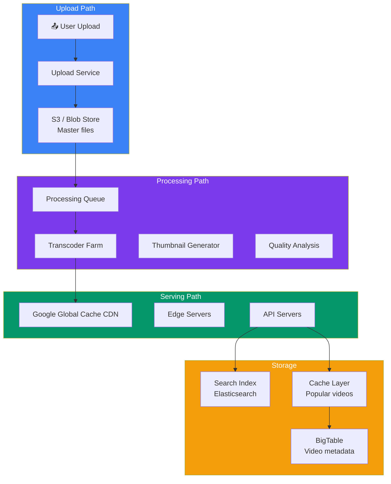
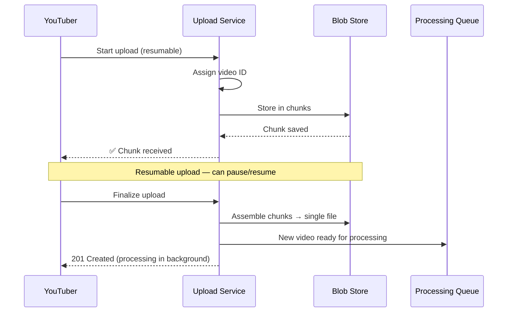

## Case Study 4 — Design YouTube

**Problem:** Design a video-sharing platform like YouTube supporting 2B+ users, 500+ hours of video uploaded per minute, and global streaming with search and recommendations.

---

### Requirements

| Type | Requirement |
|------|-------------|
| **Functional** | Upload video, transcode, stream, search, comment, like/dislike, subscribe, channel, playlists |
| **Non-Functional** | < 2s playback startup, 99.99% availability, 500+ hours/min upload, 1B+ hours watched daily |

---

### Capacity Estimation

| Metric | Value |
|--------|-------|
| **Monthly active users** | 2B+ |
| **Video upload per minute** | 500+ hours |
| **Total video catalog** | 1B+ videos |
| **Daily watch time** | 1B+ hours |
| **Storage per day** | 500 hr/min × 60 × 24 = 720K hours/day × ~500 MB/hour (compressed) |

---

### Architecture Overview

---

### Key Design Decisions

**1. Upload Service**

**2. Transcoding Pipeline**

| Step | Purpose |
|------|---------|
| **Demux** | Split video, audio, subtitles from container |
| **Decode** | Decode video to raw frames |
| **Transcode** | Encode to H.264, VP9, AV1 at various resolutions |
| **Thumbnails** | Extract thumbnails at key points |
| **Quality analysis** | Check for issues (blurry, audio sync) |
| **Package** | Segment into DASH/HLS chunks |

---

### Comparison: YouTube vs Netflix

| Aspect | YouTube | Netflix |
|--------|---------|---------|
| **Content** | User-generated | Professional (studio) |
| **Upload volume** | 500 hr/min | New titles weekly |
| **Processing** | Must process instantly | Can batch process |
| **Recommendation** | Based on watch history + trends | Based on viewing history + ratings |
| **Monetization** | Ads + Premium + Memberships | Subscription only |

---

### Scaling & Trade-offs

| Aspect | Approach | Trade-off |
|--------|----------|-----------|
| **Video processing** | Async (enqueue, process, notify) | Delay from upload to publish |
| **CDN** | Google Global Cache | Massive infrastructure cost |
| **Search** | Elasticsearch + custom ranking | Complex indexing pipeline |
| **Comments** | Separate service, paginated | Hard to moderate at scale |

---

### In Simple Words

- **Upload** = resumable chunked uploads to blob store, then async processing
- **Transcoding** = convert to multiple formats/resolutions (H.264, VP9, AV1)
- **CDN** = Google's global cache network — videos served from nearest edge
- **Search** = Elasticsearch with custom ranking signals (views, engagement, freshness)
- **Recommendation** = deep neural network trained on watch history
- **Comments** = separate service with pagination and moderation pipeline
- **Ad insertion** = server-side ad insertion during streaming (can't be skipped)
