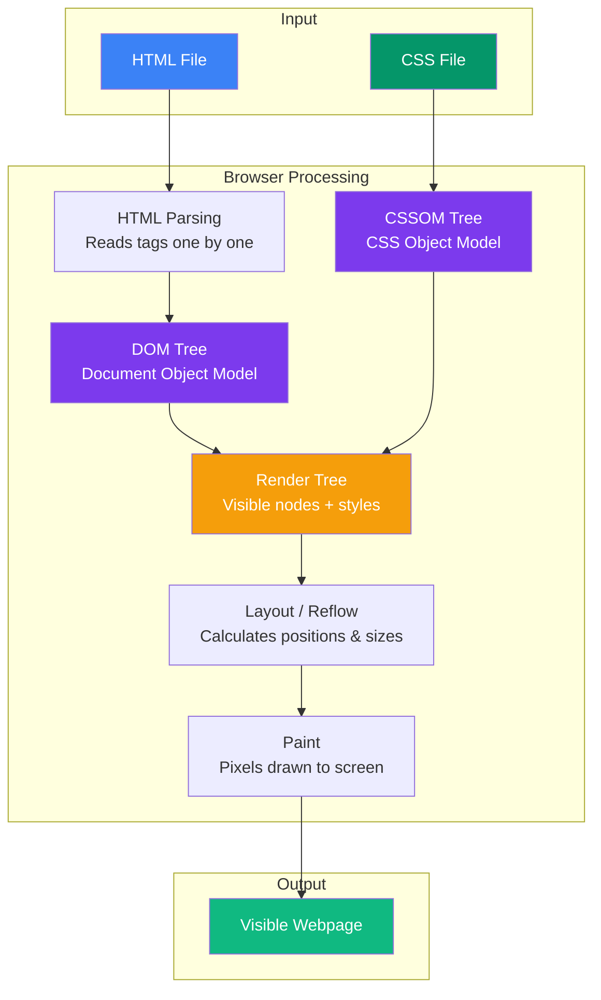

## What is HTML?

### 🤔 What is HTML?

HTML stands for **HyperText Markup Language**. It's not a programming language — it's a **markup language** that tells the browser what to show.

Think of HTML like the **skeleton of a house**:
- The skeleton determines the structure (walls, rooms, doors)
- CSS (paint, wallpaper) makes it look good later
- JavaScript (electricity, plumbing) makes it interactive

HTML uses **tags** to label content. A tag tells the browser: "This is a heading", "This is a paragraph", "This is an image".

---

### 🏷️ Tags, Elements & Attributes

**Tag** — A keyword wrapped in angle brackets:
```html
<h1>
```

**Element** — An opening tag + content + closing tag:
```html
<h1>Hello World</h1>
```

**Attribute** — Extra information inside the opening tag:
```html
<a href="https://example.com">Click me</a>
```

Here `href` is an attribute that tells the browser where the link goes.

Common element structure:
```html
<tagname attribute="value">Content goes here</tagname>
```

Some elements are **self-closing** (no content, no closing tag):
```html

<br>
<hr>
```

> **Result:** The browser renders the content styled by the tag — headings are big and bold, links are blue and underlined, images appear as pictures.

---

### 🦴 The Basic Page Skeleton

Every HTML page follows this structure:

```html
<!DOCTYPE html>
<html lang="en">
<head>
  <meta charset="UTF-8">
  <meta name="viewport" content="width=device-width, initial-scale=1.0">
  <title>My First Page</title>
</head>
<body>
  <h1>Hello World!</h1>
  <p>This is my first webpage.</p>
</body>
</html>
```

| Part | What it does |
|------|-------------|
| `<!DOCTYPE html>` | Tells the browser this is HTML5 |
| `<html>` | The root element — everything goes inside |
| `<head>` | Metadata (title, styles, character set) — not visible on the page |
| `<body>` | Everything the user sees — text, images, buttons |
| `<title>` | The text shown in the browser tab |

---

### 🗺️ How the Browser Builds a Page



**Step by step:**
1. Browser downloads the HTML file
2. It parses the HTML and builds the **DOM** (a tree of all elements)
3. It finds linked CSS and builds the **CSSOM** (a tree of all styles)
4. It combines DOM + CSSOM into the **Render Tree** (only visible content)
5. It **lays out** every element (calculates position and size)
6. It **paints** pixels to the screen

---

### 📝 Your First HTML Page

Create a file called `index.html` and open it in any browser:

```html
<!DOCTYPE html>
<html>
<head>
  <title>My Page</title>
</head>
<body>
  <h1>Welcome!</h1>
  <p>This is a paragraph of text.</p>
  <p>This is <strong>bold text</strong> and this is <em>italic text</em>.</p>
</body>
</html>
```

> **Result:** A page with a large heading, two paragraphs, and some bold/italic inline text.

---

### In Simple Words

- HTML is the **structure** of a webpage — like the skeleton of a house
- **Tags** label content (`<h1>`, `<p>`, ``), **attributes** give extra info (`href`, `src`, `alt`)
- Every page has `<!DOCTYPE html>`, `<html>`, `<head>`, and `<body>`
- The browser builds a **DOM Tree** from HTML and combines it with CSS to render the page
- Save a `.html` file and double-click it to see your first webpage
