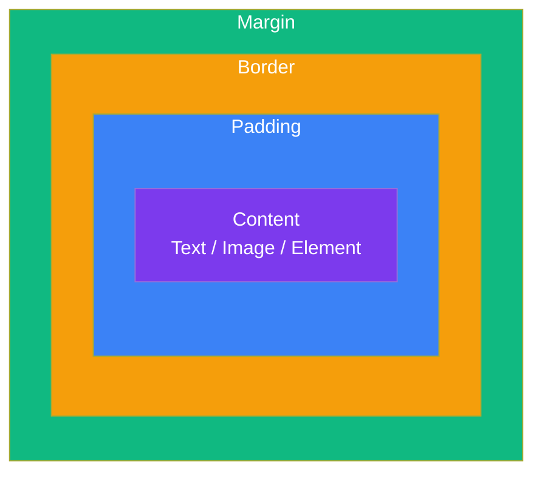

## The Box Model

### 🤔 What is the Box Model?

Every HTML element on a page is a rectangular box. The **box model** describes how that box is built, from the inside out.

Think of it like a **picture in a frame**:
- **Content** = the picture itself
- **Padding** = the matting (space between picture and frame)
- **Border** = the frame
- **Margin** = the space between the frame and the wall

---

### 🧱 The Four Layers



| Layer | CSS property | What it does |
|-------|-------------|-------------|
| **Content** | `width`, `height` | The actual content (text, image) |
| **Padding** | `padding` | Space inside the border, around the content |
| **Border** | `border` | The edge around the element |
| **Margin** | `margin` | Space outside the border, between elements |

---

### 📐 Box Model in Code

```css
.box {
  width: 200px;          /* content width */
  padding: 20px;         /* space inside border */
  border: 5px solid black; /* visible edge */
  margin: 30px;          /* space outside border */
}
```

**Total width calculation:**
```
Total width = content + left padding + right padding + left border + right border + left margin + right margin
            = 200px + 20px + 20px + 5px + 5px + 30px + 30px
            = 310px
```

> **Result:** The element has 200px of content, surrounded by 20px of padding (inside the border), a 5px solid black border, and 30px of margin outside it.

---

### 🧮 The Problem with `width`

Without `box-sizing`, `width: 200px` only sets the content width. Padding and border are **added on top**.

```css
.box {
  width: 200px;
  padding: 20px;
  border: 10px solid black;
  /* Actual visual width: 200 + 20 + 20 + 10 + 10 = 260px */
}
```

### ✅ The Fix: `box-sizing: border-box`

```css
.box {
  box-sizing: border-box;   /* <-- Magic! */
  width: 200px;
  padding: 20px;
  border: 10px solid black;
  /* Actual visual width: 200px (padding and border are INSIDE) */
}
```

With `border-box`, the `width` includes **content + padding + border**. The browser shrinks the content area automatically.

**Best practice — set it on everything:**
```css
*, *::before, *::after {
  box-sizing: border-box;
}
```

> **Result:** `border-box` makes layout predictable. `width: 200px` means the element is exactly 200px wide, no matter the padding or border.

---

### 🗺️ Visual Comparison

```
Without border-box (content-box):
┌─────────────────────────────────────────────┐
│                  Margin                      │
│   ┌─────────────────────────────────────┐    │
│   │              Border                 │    │
│   │   ┌───────────────────────────┐     │    │
│   │   │         Padding           │     │    │
│   │   │   ┌─────────────────┐     │     │    │
│   │   │   │                 │     │     │    │
│   │   │   │    Content      │     │     │    │
│   │   │   │    (200px)      │     │     │    │
│   │   │   │                 │     │     │    │
│   │   │   └─────────────────┘     │     │    │
│   │   └───────────────────────────┘     │    │
│   └─────────────────────────────────────┘    │
└─────────────────────────────────────────────┘
Width = content(200) + padding(40) + border(20) = 260px

With border-box:
┌─────────────────────────────────────────────┐
│                   Margin                     │
│   ┌─────────────────────────────────────┐    │
│   │              Border (10px each)     │    │
│   │   ┌───────────────────────────┐     │    │
│   │   │   Padding (20px each)     │     │    │
│   │   │   ┌─────────────────┐     │     │    │
│   │   │   │   Content       │     │     │    │
│   │   │   │   (140px)       │     │     │    │
│   │   │   └─────────────────┘     │     │    │
│   │   └───────────────────────────┘     │    │
│   └─────────────────────────────────────┘    │
└─────────────────────────────────────────────┘
Width = 200px (padding and border are included)
```

---

### 🎯 Shorthand Properties

```css
/* All four sides same */
padding: 20px;
margin: 20px;

/* Top/Bottom | Left/Right */
padding: 10px 20px;    /* top/bottom: 10px, left/right: 20px */

/* Top | Right | Bottom | Left (clockwise) */
margin: 10px 20px 30px 40px;

/* Individual sides */
padding-top: 10px;
padding-right: 20px;
padding-bottom: 30px;
padding-left: 40px;
```

**Border shorthand:**
```css
border: 2px dashed blue;
/* border-width | border-style | border-color */

/* Or individual properties */
border-style: solid;
border-width: 2px;
border-color: red;
border-radius: 8px;  /* rounded corners! */
```

> **Result:** `border-radius: 8px` gives slightly rounded corners. `border-radius: 50%` makes a circle.

---

### In Simple Words

- Every element is a box: **content → padding → border → margin** (inside out)
- **Padding** = space inside the border; **margin** = space outside the border
- **`box-sizing: border-box`** makes width include padding and border — use it everywhere!
- Use shorthand (`padding: 10px 20px`) to write less code
- **`border-radius`** rounds corners — use `50%` for circles
