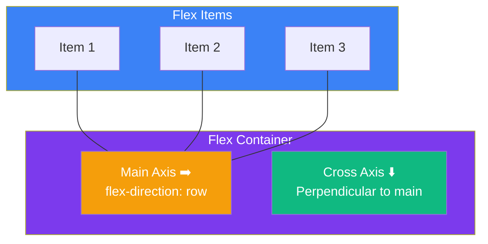

## Flexbox

### 🤔 What is Flexbox?

Flexbox (Flexible Box) is a CSS layout mode that arranges items in a **row or column** and distributes space between them.

Think of it like a **toolbar full of buttons**:
- Items line up horizontally or vertically
- They can grow, shrink, or be centered
- Space between them adjusts automatically

```css
.container {
  display: flex;        /* activates flexbox */
}
```

> **Result:** Children of `.container` line up horizontally by default, instead of stacking vertically.

---

### 📐 Main Axis vs Cross Axis



| Property | What it controls |
|----------|-----------------|
| `flex-direction: row` | Items left to right (default) |
| `flex-direction: column` | Items top to bottom |
| `justify-content` | Alignment along the **main axis** |
| `align-items` | Alignment along the **cross axis** |

---

### 🎯 Container Properties

```css
.container {
  display: flex;
  
  /* Direction */
  flex-direction: row;       /* row | row-reverse | column | column-reverse */
  
  /* Main axis alignment */
  justify-content: center;   /* flex-start | center | flex-end | space-between | space-around | space-evenly */
  
  /* Cross axis alignment */
  align-items: center;       /* flex-start | center | flex-end | stretch | baseline */
  
  /* Wrapping */
  flex-wrap: wrap;           /* nowrap | wrap | wrap-reverse */
  
  /* Gap between items */
  gap: 16px;                 /* replaces margin hacks */
}
```

**justify-content values visualized:**
```
flex-start:    [Item1][Item2][Item3]░░░░░░░░░░░░
center:        ░░░░[Item1][Item2][Item3]░░░░░
flex-end:      ░░░░░░░░░░[Item1][Item2][Item3]
space-between: [Item1]░░░░░░[Item2]░░░░░░[Item3]
space-around:  ░[Item1]░░░░[Item2]░░░░[Item3]░
space-evenly:  ░░[Item1]░░░[Item2]░░░[Item3]░░░
```

**align-items values visualized:**
```
stretch:    ┌────────┐ ┌────────┐ ┌────────┐
            │ Item 1 │ │ Item 2 │ │ Item 3 │
            └────────┘ └────────┘ └────────┘
center:     ░░░░░░░░░░ ┌────────┐ ░░░░░░░░░░
                        │ center │
                        └────────┘
flex-start: ┌────────┐ ┌────────┐ ┌────────┐
            ░░░░░░░░░░░░░░░░░░░░░░░░░░░░░░░░
```

---

### 📦 Item Properties

```css
.item {
  /* Growth & shrink */
  flex-grow: 1;       /* 0 = don't grow, 1 = grow to fill space */
  flex-shrink: 1;     /* 0 = don't shrink, 1 = shrink if needed */
  flex-basis: auto;   /* starting size before grow/shrink */
  
  /* Shorthand */
  flex: 1;            /* flex-grow: 1, flex-shrink: 1, flex-basis: 0 */
  
  /* Individual alignment (overrides container) */
  align-self: center; /* flex-start | center | flex-end | stretch */
  
  /* Order (rearrange visually) */
  order: 2;           /* default: 0, lower = first */
}
```

**Common flex patterns:**
```css
/* Equal-width columns */
.column { flex: 1; }

/* Fixed sidebar + flexible content */
.sidebar { width: 250px; }
.content { flex: 1; }

/* Three equal cards */
.card { flex: 1; }
```

> **Result:** Items with `flex: 1` share available space equally. A fixed-width sidebar keeps its size while content fills the rest.

---

### 🧩 Common Layout Examples

**Centering (the holy grail):**
```css
.container {
  display: flex;
  justify-content: center;
  align-items: center;
  height: 400px;
}
```

> **Result:** Content is perfectly centered both horizontally and vertically, with no margin hacks.

---

**Navigation bar:**
```css
.nav {
  display: flex;
  justify-content: space-between;
  align-items: center;
  padding: 16px;
}

.nav-links {
  display: flex;
  gap: 20px;
}
```

```html
<nav class="nav">
  <div class="logo">Logo</div>
  <div class="nav-links">
    <a href="#">Home</a>
    <a href="#">About</a>
    <a href="#">Contact</a>
  </div>
</nav>
```

> **Result:** Logo on the left, links on the right, vertically centered.

---

**Responsive card grid with wrapping:**
```css
.card-grid {
  display: flex;
  flex-wrap: wrap;
  gap: 20px;
}

.card {
  flex: 1 1 250px; /* grow, shrink, min-width 250px */
}
```

> **Result:** Cards sit in a row on wide screens and wrap to the next line when there isn't enough room.

---

### In Simple Words

- `display: flex` turns a container into a flexbox layout
- **Main axis** = direction of items; **cross axis** = perpendicular
- `justify-content` aligns along the main axis; `align-items` aligns along the cross axis
- `flex: 1` makes items grow to fill available space equally
- `flex-wrap: wrap` lets items flow to the next row when they don't fit
- Use `gap` for spacing instead of margins on individual items
