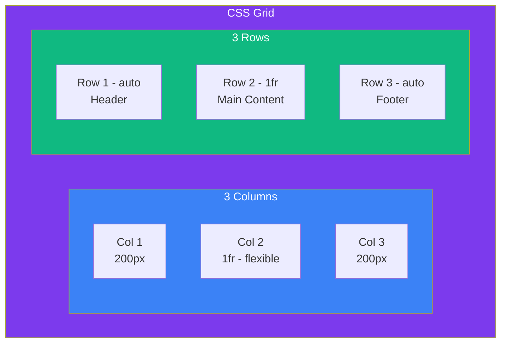

## CSS Grid

### 🤔 What is CSS Grid?

CSS Grid is a **two-dimensional** layout system. Unlike Flexbox (which works in one direction at a time), Grid handles **rows and columns simultaneously**.

Think of it like a **spreadsheet**:
- You define columns and rows
- Each cell can hold content
- Cells can span multiple columns or rows

```css
.container {
  display: grid;
  grid-template-columns: 200px 1fr 200px;
  grid-template-rows: auto 1fr auto;
  gap: 16px;
}
```

> **Result:** A 3-column, 3-row layout with a 16px gap between all cells.

---

### 📐 Grid Rows × Columns



**Key differences from Flexbox:**

| Feature | Flexbox | Grid |
|---------|---------|------|
| Dimensions | 1D (row OR column) | 2D (rows AND columns) |
| Best for | Small-scale layouts | Full-page layouts |
| Content-driven | Items control size | Container controls size |

---

### 📝 Defining Grids

```css
.container {
  display: grid;
  
  /* Fixed + flexible columns */
  grid-template-columns: 200px 1fr 200px;       /* 3 columns */
  grid-template-columns: repeat(3, 1fr);         /* 3 equal columns */
  grid-template-columns: 250px 1fr;              /* sidebar + content */
  
  /* Rows */
  grid-template-rows: auto 1fr auto;             /* header + content + footer */
  
  /* Gap (shorthand for row-gap + column-gap) */
  gap: 16px;
}
```

**The `fr` unit** — fractional unit. `1fr` = one share of the available space:
```css
grid-template-columns: 2fr 1fr 1fr;
/* 2 + 1 + 1 = 4 total fractions */
/* Column 1 gets 2/4 space, columns 2 & 3 get 1/4 each */
```

> **Result:** Three columns — the first is twice as wide as the other two.

---

### 🎯 Placing Items

Grid items automatically fill cells in order, but you can place them explicitly:

```css
.header {
  grid-column: 1 / 3;   /* start at col 1, end before col 3 = spans 2 columns */
  grid-row: 1;           /* stays in row 1 */
}

.sidebar {
  grid-column: 1;
  grid-row: 2 / 4;       /* spans rows 2-3 */
}

.main {
  grid-column: 2 / 4;    /* spans columns 2-3 */
  grid-row: 2;
}

.footer {
  grid-column: 1 / 4;    /* spans all columns */
  grid-row: 3;
}
```

**Or use the shorthand:**
```css
.header {
  grid-area: 1 / 1 / 2 / 4; /* row-start / col-start / row-end / col-end */
}
```

> **Result:** Header spans the top, sidebar on left spans full height, main content fills the rest, footer spans the bottom.

---

### 🔲 Grid Template Areas

The most intuitive way to define layouts — name your areas:

```css
.layout {
  display: grid;
  grid-template-columns: 250px 1fr;
  grid-template-rows: auto 1fr auto;
  grid-template-areas:
    "header  header"
    "sidebar main"
    "footer  footer";
  gap: 16px;
  min-height: 100vh;
}

.header  { grid-area: header; }
.sidebar { grid-area: sidebar; }
.main    { grid-area: main; }
.footer  { grid-area: footer; }
```

```html
<div class="layout">
  <header class="header">Header</header>
  <aside class="sidebar">Sidebar</aside>
  <main class="main">Main Content</main>
  <footer class="footer">Footer</footer>
</div>
```

> **Result:** A complete page layout using named grid areas. Easy to read and rearrange.

---

### 🧩 Grid vs Flexbox — When to Use What

| Use **Flexbox** when... | Use **Grid** when... |
|------------------------|---------------------|
| Items in a single row or column | Full-page layouts |
| Navigation bars | Dashboard layouts |
| Centering content | Card grids |
| Small components (buttons, toolbars) | Magazine-style layouts |
| Content dictates layout size | Container dictates layout size |

**They work great together:**
```css
/* Grid for the page layout */
.page {
  display: grid;
  grid-template-columns: 250px 1fr;
}

/* Flexbox inside a grid cell for the toolbar */
.toolbar {
  display: flex;
  justify-content: space-between;
  align-items: center;
}
```

---

### In Simple Words

- CSS Grid is **2D** — rows AND columns at the same time
- Use `grid-template-columns` and `grid-template-rows` to define the structure
- The **`fr` unit** shares space proportionally (like flex-grow)
- **`grid-template-areas`** is the most readable way to design page layouts
- Use **Grid for page layout**, **Flexbox for components** — they work best together
- `gap` replaces margin hacks for spacing between cells
