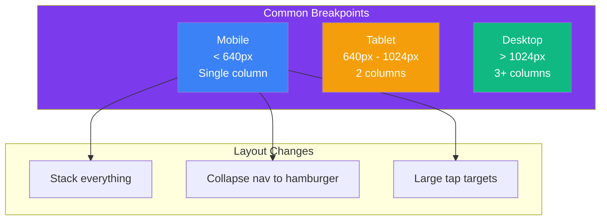

## Responsive Design

### 🤔 What is Responsive Design?

Responsive design means a website **adapts** to the screen size it's viewed on — mobile, tablet, laptop, or desktop.

Think of it like **water in a container**:
- Pour water into a cup — it takes that shape
- Pour it into a bowl — it adapts
- The content (water) stays the same, but the layout flows to fit

Without responsive design, mobile users have to pinch-and-zoom to read text. With it, the layout **reflows** naturally.

---

### 📱 Responsive Breakpoints



**Standard breakpoints:**
| Device | Width | Layout |
|--------|-------|--------|
| Mobile | < 640px | Single column |
| Tablet | 640px - 1024px | 2 columns |
| Desktop | > 1024px | 3+ columns |

---

### 📐 Media Queries

Media queries apply CSS only when certain conditions are met:

```css
/* Base styles — applies everywhere */
.card-grid {
  display: grid;
  grid-template-columns: 1fr;    /* 1 column by default */
  gap: 16px;
}

/* Tablet — 2 columns */
@media (min-width: 640px) {
  .card-grid {
    grid-template-columns: repeat(2, 1fr);
  }
}

/* Desktop — 3 columns */
@media (min-width: 1024px) {
  .card-grid {
    grid-template-columns: repeat(3, 1fr);
  }
}
```

> **Result:** On mobile, cards stack vertically. On tablet, they become 2 columns. On desktop, 3 columns.

---

### 📱 Mobile-First Approach

Write the **mobile layout first**, then add breakpoints for larger screens:

```css
/* 🟢 Mobile first — default is single column */
.page {
  display: grid;
  grid-template-columns: 1fr;
  gap: 16px;
  padding: 16px;
}

/* 🟡 Tablet — sidebar appears */
@media (min-width: 640px) {
  .page {
    grid-template-columns: 200px 1fr;
  }
}

/* 🔵 Desktop — wider content */
@media (min-width: 1024px) {
  .page {
    grid-template-columns: 250px 1fr;
    max-width: 1200px;
    margin: 0 auto;
  }
}
```

**Why mobile-first?**
- Easier to add complexity than remove it
- Mobile users get optimized CSS without downloading desktop styles
- It's the standard recommended by CSS experts

---

### 🧪 Fluid Units (No Media Queries Needed!)

Some properties adapt automatically with the right units:

```css
/* Fluid typography */
body {
  font-size: clamp(16px, 2vw, 24px);
  /* min: 16px | preferred: 2vw | max: 24px */
}

/* Fluid images */
img {
  max-width: 100%;   /* never bigger than its container */
  height: auto;      /* maintain aspect ratio */
}

/* Fluid container */
.container {
  width: min(90%, 1200px);
  /* 90% on small screens, max 1200px on large */
}

/* Responsive padding */
.card {
  padding: clamp(12px, 3vw, 24px);
}
```

| Unit/Function | What it does |
|---------------|-------------|
| `vw` / `vh` | % of viewport width/height |
| `%` | % of parent element |
| `clamp(min, preferred, max)` | Sizes between min and max |
| `min(a, b)` | Uses the smaller value |
| `max(a, b)` | Uses the larger value |
| `max-width: 100%` | Image never overflows |

> **Result:** Text scales smoothly between 16px and 24px. Images resize without cropping. Containers fill the screen but stop at 1200px.

---

### 🧩 Common Responsive Patterns

**Responsive nav (collapses to hamburger on mobile):**
```css
.nav-links {
  display: flex;
  gap: 20px;
}

/* On mobile, stack vertically */
@media (max-width: 640px) {
  .nav-links {
    flex-direction: column;
    display: none; /* hidden until hamburger is clicked */
  }
}
```

**Responsive images (art direction with `<picture>`):**
```html
<picture>
  <source media="(min-width: 1024px)" srcset="hero-large.jpg">
  <source media="(min-width: 640px)" srcset="hero-medium.jpg">
  
</picture>
```

> **Result:** The browser downloads only the image that matches the screen size — saves bandwidth on mobile.

---

### 🛠️ Viewport Meta Tag

This tag in `<head>` tells mobile browsers not to zoom out:

```html
<meta name="viewport" content="width=device-width, initial-scale=1.0">
```

**Without it:** Mobile browsers render the page at a virtual 980px width, then zoom out. Text is tiny.

**With it:** The browser matches the actual device width. Your media queries work correctly.

---

### In Simple Words

- Responsive design = the layout **adapts** to every screen size
- **Media queries** (`@media (min-width: 640px)`) apply styles at different breakpoints
- Write **mobile-first** — base styles for mobile, then add complexity for larger screens
- Use **fluid units** (`%`, `vw`, `clamp()`, `max-width: 100%`) for automatic adaptation
- Always include `<meta name="viewport" content="width=device-width">` in the `<head>`
