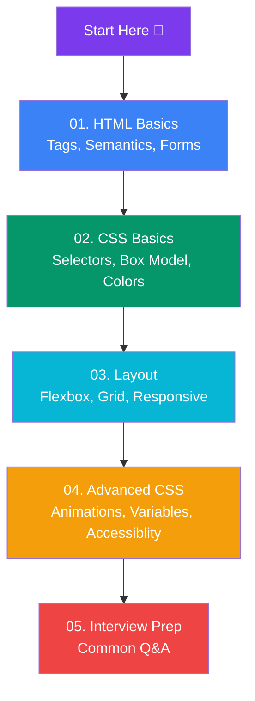

# HTML & CSS

Complete beginner-friendly guide to HTML and CSS — from tags and selectors to layouts, animations, and interview prep.

## Learning Path

## Sections

### 📄 01. HTML Basics
- [What is HTML?](/DSA-Notes-Problems/html-css/01-html/what-is-html) — Tags, elements, attributes, page skeleton
- [Semantic HTML](/DSA-Notes-Problems/html-css/01-html/semantic-html) — Header, nav, main, article, footer
- [Text & Links](/DSA-Notes-Problems/html-css/01-html/text-and-links) — Headings, paragraphs, lists, anchors, images
- [Forms & Inputs](/DSA-Notes-Problems/html-css/01-html/forms-and-inputs) — Inputs, labels, validation, buttons
- [Tables & Media](/DSA-Notes-Problems/html-css/01-html/tables-and-media) — Tables, audio/video, iframes

### 🎨 02. CSS Basics
- [CSS Syntax & Selectors](/DSA-Notes-Problems/html-css/02-css-basics/css-syntax-and-selectors) — Rules, selectors, specificity, cascade
- [Colors, Units & Typography](/DSA-Notes-Problems/html-css/02-css-basics/colors-units-typography) — px/em/rem/%, fonts, text styling
- [The Box Model](/DSA-Notes-Problems/html-css/02-css-basics/the-box-model) — Content, padding, border, margin
- [Display & Positioning](/DSA-Notes-Problems/html-css/02-css-basics/display-and-positioning) — Block/inline, position, z-index

### 📐 03. Layout
- [Flexbox](/DSA-Notes-Problems/html-css/03-layout/flexbox) — Axes, justify/align, wrapping
- [Grid](/DSA-Notes-Problems/html-css/03-layout/grid) — Rows, columns, areas
- [Responsive Design](/DSA-Notes-Problems/html-css/03-layout/responsive-design) — Media queries, mobile-first, fluid units

### 🚀 04. Advanced
- [Transitions & Animations](/DSA-Notes-Problems/html-css/04-advanced/transitions-and-animations) — CSS transitions, keyframes
- [Variables & Modern CSS](/DSA-Notes-Problems/html-css/04-advanced/variables-and-modern-css) — Custom properties, clamp(), container queries
- [Accessibility](/DSA-Notes-Problems/html-css/04-advanced/accessibility) — Alt text, ARIA, keyboard nav, contrast
- [Best Practices](/DSA-Notes-Problems/html-css/04-advanced/best-practices) — BEM naming, organization, common mistakes

### 💬 05. Interview
- [Interview Questions](/DSA-Notes-Problems/html-css/05-interview/interview-questions) — Common HTML/CSS questions with answers
