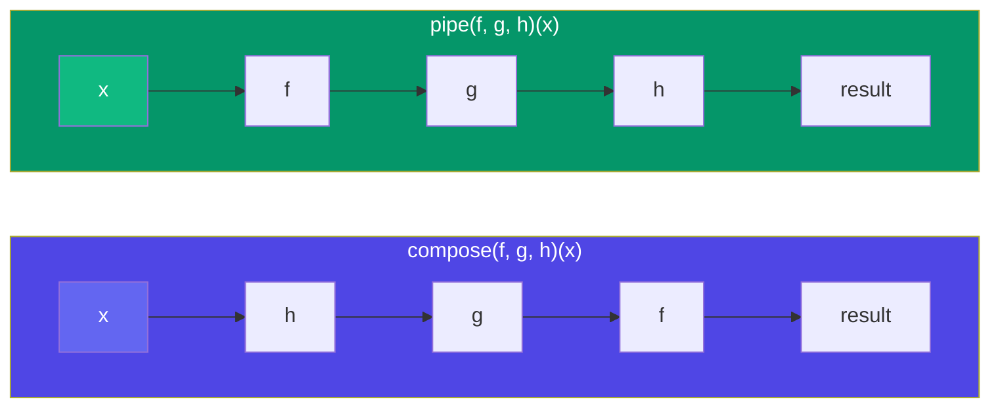

## Functional Programming

Functional programming is a **paradigm** that treats computation as the evaluation of mathematical functions, avoiding mutable state and side effects. JavaScript supports many FP patterns natively.

### Pure Functions

A pure function returns the same output for the same input and has **no side effects** (no DOM changes, no network calls, no mutations).

```javascript
// ❌ Impure — depends on external state, mutates input
let taxRate = 0.1;
function applyTax(price) {
  return price + price * taxRate;
}

// ❌ Impure — mutates the input array
function addItem(cart, item) {
  cart.push(item); // mutation!
  return cart;
}

// ✅ Pure — same input always gives same output
function calculateTotal(price, taxRate) {
  return price + price * taxRate;
}

// ✅ Pure — returns a new array instead of mutating
function addItemPure(cart, item) {
  return [...cart, item];
}

console.log(calculateTotal(100, 0.1)); // 110
console.log(calculateTotal(100, 0.1)); // 110 — always deterministic
```

### Immutability

Don't change data in place — create **copies** with the changes applied.

```javascript
const user = { name: "Alice", age: 30 };

// ❌ Mutation
user.age = 31;

// ✅ Immutable update
const updatedUser = { ...user, age: 31 };
// original user is unchanged

// Arrays
const numbers = [1, 2, 3];

// ❌ Mutating
numbers.push(4);

// ✅ Immutable
const added = [...numbers, 4];    // [1, 2, 3, 4]
const removed = numbers.filter(n => n !== 2); // [1, 3]
const mapped = numbers.map(n => n * 2);       // [2, 4, 6]
```

### First-Class Functions

In JavaScript, functions are **first-class citizens** — they can be assigned to variables, passed as arguments, and returned from other functions.

```javascript
// Assigned to a variable
const greet = function(name) {
  return `Hello, ${name}!`;
};

// Passed as an argument
function operate(a, b, fn) {
  return fn(a, b);
}

const result = operate(10, 5, (x, y) => x / y);
console.log(result); // 2

// Returned from a function
function createMultiplier(factor) {
  return function(value) {
    return value * factor;
  };
}

const double = createMultiplier(2);
console.log(double(5)); // 10
```

### Higher-Order Functions

A **higher-order function** either takes a function as an argument or returns a function — or both.

```javascript
// Array methods are classic HOFs
const numbers = [1, 2, 3, 4, 5];

const doubled = numbers.map(n => n * 2);     // [2, 4, 6, 8, 10]
const evens = numbers.filter(n => n % 2 === 0); // [2, 4]
const sum = numbers.reduce((acc, n) => acc + n, 0); // 15

// Custom HOF
function withLogging(fn) {
  return function(...args) {
    console.log(`Calling with:`, args);
    const result = fn(...args);
    console.log(`Result:`, result);
    return result;
  };
}

const addWithLog = withLogging((a, b) => a + b);
addWithLog(3, 4);
// Output: Calling with: [3, 4]
// Output: Result: 7
```

### Currying

**Currying** transforms a function that takes multiple arguments into a sequence of functions, each taking a single argument.

```javascript
// Normal function
function add(a, b, c) {
  return a + b + c;
}

// Curried version
function curriedAdd(a) {
  return function(b) {
    return function(c) {
      return a + b + c;
    };
  };
}

// Using arrow functions
const curriedAddArrow = a => b => c => a + b + c;

console.log(curriedAdd(1)(2)(3));    // 6
console.log(curriedAddArrow(1)(2)(3)); // 6

// Practical: create specialised functions
const addTax = rate => price => price + price * rate;
const addVAT = addTax(0.2);   // 20% VAT
const addSalesTax = addTax(0.08); // 8% sales tax

console.log(addVAT(100));      // 120
console.log(addSalesTax(100)); // 108
```

### Partial Application

**Partial application** fixes a few arguments of a function, producing a function with fewer arguments. It's related to currying but not the same.

```javascript
// Generic partial application helper
function partial(fn, ...presetArgs) {
  return function(...laterArgs) {
    return fn(...presetArgs, ...laterArgs);
  };
}

function greet(greeting, name, punctuation) {
  return `${greeting}, ${name}${punctuation}`;
}

const sayHello = partial(greet, "Hello");
const sayHiExclaim = partial(greet, "Hi", "there", "!");

console.log(sayHello("Alice", "!"));   // "Hello, Alice!"
console.log(sayHiExclaim);             // "Hi, there!"

// Using .bind() for partial application
const sayHowdy = greet.bind(null, "Howdy");
console.log(sayHowdy("Bob", "?"));     // "Howdy, Bob?"
```

### Currying vs Partial Application

```mermaid
flowchart TB
    subgraph Currying["Currying"]
        C["fn(a, b, c) → a => b => c => result"]
        C1["fn(1) → (b, c) => result"]
        C2["fn(1)(2) → (c) => result"]
        C3["fn(1)(2)(3) → result"]
    end
    
    subgraph Partial["Partial Application"]
        P["fn(a, b, c) → fn(1, ·, ·)"]
        P1["partial(fn, 1) → (b, c) => result"]
        P2["partial(fn, 1, 2) → (c) => result"]
        P3["partial(fn, 1, 2, 3) → result"]
    end
    
    C -->|"each call = 1 arg"| C1
    C1 -->|"each call = 1 arg"| C2
    C2 -->|"each call = 1 arg"| C3
    
    P -->|"fix any number of args"| P1
    P1 -->|"fix any number of args"| P2
    P2 -->|"fix any number of args"| P3
    
    style Currying fill:#4f46e5,color:#fff
    style Partial fill:#059669,color:#fff
    style C fill:#6366f1,color:#fff
    style P fill:#10b981,color:#fff
```



### Function Composition

Composing functions means **chaining** them: the output of one becomes the input of the next.

```javascript
// Compose — right to left
function compose(...fns) {
  return function(initialValue) {
    return fns.reduceRight((value, fn) => fn(value), initialValue);
  };
}

// Pipe — left to right (more intuitive)
function pipe(...fns) {
  return function(initialValue) {
    return fns.reduce((value, fn) => fn(value), initialValue);
  };
}

// Example: process a string
const trim = str => str.trim();
const capitalize = str => str[0].toUpperCase() + str.slice(1);
const exclaim = str => `${str}!`;

const enhance = pipe(trim, capitalize, exclaim);
console.log(enhance("  hello world  ")); // "Hello world!"

const enhanceCompose = compose(exclaim, capitalize, trim);
console.log(enhanceCompose("  hello world  ")); // "Hello world!"
```

### Compose (`compose`) vs Pipe (`pipe`)



### Point-Free Style

Point-free (or tacit) programming avoids naming arguments explicitly, using composition and higher-order functions instead.

```javascript
const numbers = [1, 2, 3, 4, 5];

// ❌ Not point-free — names the parameter
const doubled = numbers.map(n => n * 2);

// ✅ Point-free — no parameter named
const double = n => n * 2;
const doubledPF = numbers.map(double);

// More practical example
const isEven = n => n % 2 === 0;

// ❌
const evens1 = numbers.filter(n => n % 2 === 0);

// ✅ Point-free
const evens2 = numbers.filter(isEven);

// Combining
const sumEvens = pipe(
  (arr) => arr.filter(isEven),
  (arr) => arr.reduce((a, b) => a + b, 0),
);

console.log(sumEvens([1, 2, 3, 4, 5, 6])); // 12
```

### Practical: Data Pipeline

```javascript
const users = [
  { name: "Alice", age: 25, active: true },
  { name: "Bob", age: 17, active: true },
  { name: "Carol", age: 30, active: false },
  { name: "Dave", age: 22, active: true },
];

const processUsers = pipe(
  (users) => users.filter(u => u.active),
  (users) => users.filter(u => u.age >= 18),
  (users) => users.map(u => u.name),
  (names) => names.sort(),
  (names) => names.join(", "),
);

console.log(processUsers(users));
// "Alice, Dave"
```

### 🚨 Common Gotchas

```javascript
// Arity matters in currying — functions with variable args are tricky
function log(...args) {
  console.log(...args);
}
// curriedLog(1)(2)(3) won't work as expected

// .map(parseInt) is a classic bug
["1", "2", "3"].map(parseInt);
// [1, NaN, NaN] — parseInt takes (value, radix)!

// Fix: wrap or use a point-free helper
["1", "2", "3"].map(s => parseInt(s, 10)); // [1, 2, 3]

// Mutation leaks break pure functions
function addItemBad(cart, item) {
  cart.push(item); // ❌ mutates the original!
  return cart;
}
```

### Key Takeaways

- **Pure functions** are deterministic and have no side effects — testable and predictable
- **Immutability** prevents bugs from accidental mutation — create new copies with spread, map, filter, reduce
- **Higher-order functions** (map, filter, reduce) are the bread and butter of FP in JS
- **Currying** transforms multi-argument functions into chained single-argument functions
- **Partial application** fixes some arguments; **currying** returns one-arg-at-a-time
- **Compose** (right-to-left) and **pipe** (left-to-right) chain functions elegantly
- **Point-free** style avoids naming intermediate values — use it when it improves readability
