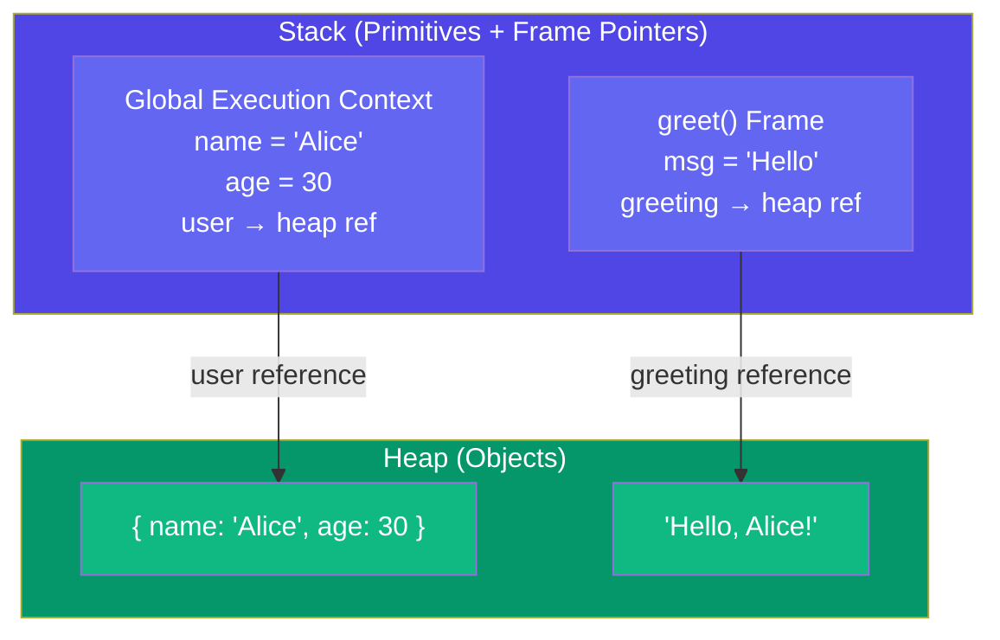
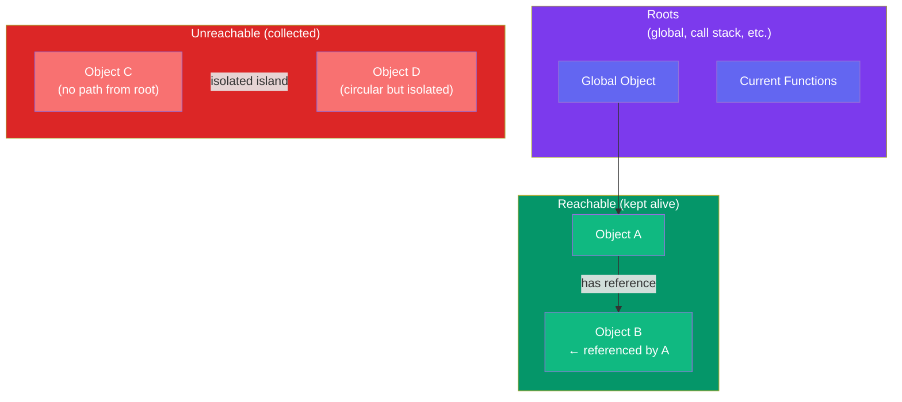

## Memory & Garbage Collection

JavaScript automatically manages memory through **garbage collection**. Understanding how it works — and what can go wrong — helps you write faster, leak-free applications.

### Stack vs Heap

JavaScript uses two memory regions:

| | **Stack** | **Heap** |
|---|---|---|
| Stores | Primitives, function call frames, pointers to heap objects | Objects, arrays, closures, functions |
| Size | Small, fixed per thread | Large, dynamic |
| Speed | Fast (LIFO) | Slower (allocation + GC) |
| Lifetime | Scope-based (cleared when function returns) | Until unreachable (GC collects) |



```javascript
function greet(name) {
  const msg = "Hello";        // msg → stack (primitive)
  const greeting = `${msg}, ${name}!`; // greeting → heap (string object)
  return greeting;
}

const user = { name: "Alice", age: 30 };
// user variable → stack, { name, age } object → heap
// When greet() finishes, its stack frame is popped
// The greeting string remains reachable via the return value
```

### Reference Counting (Old Algorithm)

The simplest GC strategy: count how many references point to an object. When the count reaches 0, collect it.

```javascript
let a = { name: "Alice" };  // ref count: 1
let b = a;                  // ref count: 2

a = null;                   // ref count: 1
b = null;                   // ref count: 0 → collected!
```

**Problem: Circular references** — two objects referencing each other but unreachable from the root.

```javascript
function problem() {
  let a = {};
  let b = {};
  a.ref = b;
  b.ref = a;
  // After the function returns, a and b are unreachable
  // but their ref counts are 1 each (a→b, b→a)
  // Reference counting never collects them!
}
```

### Mark-and-Sweep (Modern Algorithm)

All modern JS engines (V8, SpiderMonkey, JavaScriptCore) use **mark-and-sweep**. It solves circular references by tracing reachability from **roots** (global object, current call stack, etc.).



**The algorithm in 3 phases:**

1. **Mark** — Start from roots, traverse all reachable objects, mark them
2. **Sweep** — Iterate the heap, collect unmarked objects
3. **Compact** (optional, V8 does this) — Defragment remaining objects

```javascript
// After the function below runs, neither 'a' nor 'b'
// can be reached from any root — mark-and-sweep collects both
function demo() {
  const a = { data: "hello" };
  const b = { ref: a };
  a.ref = b;  // circular, but both unreachable after return
}
demo();
// ✅ Both collected by mark-and-sweep (no root path)
```

### Common Memory Leaks

#### 1. Accidental Globals

```javascript
// ❌ Leak: undeclared variable becomes global
function leak() {
  leaked = "I'm global now!"; // no let/const/var
}
leak();
// leaked persists in global scope forever

// ✅ Fix: always declare with let/const
function noLeak() {
  const safe = "scoped to function";
}

// ❌ Leak: leaking via global this
function Leak2() {
  this.leaked = true; // 'this' is global in non-strict mode
}
Leak2(); // called without 'new' — leaks to global

// ✅ Fix: use strict mode or 'new'
```

#### 2. Forgotten Timers & Intervals

```javascript
// ❌ Leak: interval keeps reference to DOM element
const element = document.getElementById("status");
const intervalId = setInterval(() => {
  element.textContent = Date.now();
}, 1000);

// Even if element is removed from DOM, the interval holds a
// reference — element can't be GC'd until interval is cleared

// ✅ Fix: always clean up
clearInterval(intervalId);
```

#### 3. Closures Holding Large Data

```javascript
// ❌ Leak: closure retains entire outer scope
function createLeak() {
  const hugeArray = new Array(1000000).fill("data");

  return function() {
    console.log("hello"); // doesn't use hugeArray!
  };
}
const leakFn = createLeak();
// hugeArray is kept alive because it's in the closure scope
// even though the returned function never uses it

// ✅ Fix: only reference what you need
function createNoLeak() {
  const hugeArray = new Array(1000000).fill("data");
  const smallResult = hugeArray.length; // extract what you need
  hugeArray = null; // explicitly release

  return function() {
    console.log(`Length was ${smallResult}`);
  };
}
```

#### 4. Detached DOM Nodes

```javascript
// ❌ Leak: JavaScript holds a reference to a removed DOM node
const button = document.getElementById("myButton");
const parent = button.parentNode;

parent.removeChild(button);
// button still exists in memory — referenced by the JS variable

// The DOM node and its event listeners can't be GC'd

// ✅ Fix: release the reference
button = null;

// Or use WeakRef/WeakMap for optional references
const cache = new WeakMap();
// WeakMap keys don't prevent GC of the referenced object
```

#### 5. Event Listeners Not Removed

```javascript
class PageComponent {
  constructor() {
    this.handleClick = () => {
      console.log("clicked");
    };
    document.addEventListener("click", this.handleClick);
  }

  destroy() {
    // ❌ If destroy is never called, the listener persists
    // and keeps 'this' (the entire component) alive
    document.removeEventListener("click", this.handleClick);
  }
}
```

### How to Avoid Leaks

| Strategy | Example |
|---|---|
| Declare variables properly | Always use `let`/`const` |
| Clean up timers | `clearInterval(id)` / `clearTimeout(id)` |
| Remove event listeners | `element.removeEventListener(...)` |
| Null out references | `largeData = null` when done |
| Use `WeakMap`/`WeakSet` | For caches and optional metadata |
| Avoid retaining unused data in closures | Only capture what you need |
| Use `AbortController` for fetch | Cancel in-flight requests on unmount |

### 🚨 Common Gotchas

```javascript
// console.log can create unexpected references
const data = { huge: "payload" };
console.log(data); // DevTools may keep a reference — avoid logging large objects in prod

// Closures in loops with var
for (var i = 0; i < 3; i++) {
  setTimeout(() => console.log(i), 100);
  // All three closures share the same `i` — but it's a memory/scope issue, not a leak
}

// Object pools and caches that grow unboundedly
const cache = {};
function memoize(key, fn) {
  if (!cache[key]) cache[key] = fn();
  return cache[key];
  // If keys are user-generated, cache grows forever — add a size limit or use LRU
}
```

### Key Takeaways

- **Stack** stores primitives and call frames (fast, auto-cleared); **heap** stores objects (managed by GC)
- Modern engines use **mark-and-sweep** — it traces reachability from roots, solving circular references
- Common leaks: accidental globals, forgotten timers, closures holding large data, detached DOM, unremoved listeners
- Use `WeakMap`/`WeakSet` for caches that shouldn't prevent GC
- Clean up: clear intervals, remove listeners, null out large references when done
- Chrome DevTools **Memory** tab and Node.js `--inspect` are your best tools for finding leaks
