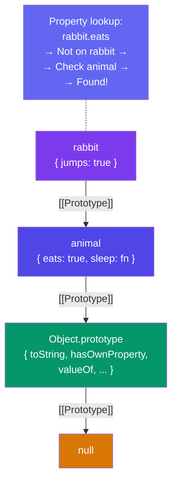

## Prototypes & Inheritance

Every JavaScript object has a hidden `[[Prototype]]` link to another object. When you access a property, JS walks up this **prototype chain** until it finds the property or reaches `null`.

### The Prototype Chain

```javascript
const animal = {
  eats: true,
  sleep() { return "zzz"; }
};

const rabbit = Object.create(animal);
rabbit.jumps = true;

console.log(rabbit.jumps); // true (own property)
console.log(rabbit.eats);  // true (inherited from animal)
console.log(rabbit.sleep()); // "zzz" (inherited method)
```



### `__proto__` vs `prototype`

```javascript
// __proto__ — the actual prototype link on an instance (deprecated but common)
const obj = {};
obj.__proto__; // Object.prototype

// prototype — property on CONSTRUCTOR functions, sets __proto__ of instances
function Animal(name) {
  this.name = name;
}
Animal.prototype.speak = function() {
  return `${this.name} speaks`;
};

const dog = new Animal("Rex");
dog.__proto__ === Animal.prototype; // true
dog.speak(); // "Rex speaks"
```

> **Modern alternative:** Use `Object.getPrototypeOf(obj)` instead of `obj.__proto__`.

### `Object.create`

Creates a new object with the specified prototype.

```javascript
const proto = { greet() { return `Hi, ${this.name}`; } };
const user = Object.create(proto);
user.name = "Alice";
user.greet(); // "Hi, Alice"

// Object.create(null) creates an object with NO prototype
const dict = Object.create(null);
dict.toString; // undefined (no Object.prototype pollution)
```

### Constructor Functions & `new`

```javascript
function Animal(name) {
  this.name = name;
}

Animal.prototype.speak = function() {
  return `${this.name} makes a sound`;
};

function Dog(name, breed) {
  Animal.call(this, name); // call parent constructor
  this.breed = breed;
}

// Set up inheritance
Dog.prototype = Object.create(Animal.prototype);
Dog.prototype.constructor = Dog;

Dog.prototype.bark = function() {
  return `${this.name} barks!`;
};

const rex = new Dog("Rex", "Golden Retriever");
rex.bark();  // "Rex barks!"
rex.speak(); // "Rex makes a sound" (inherited)
```

### `hasOwnProperty`

```javascript
const animal = { eats: true };
const rabbit = Object.create(animal);
rabbit.jumps = true;

rabbit.hasOwnProperty("jumps"); // true (own)
rabbit.hasOwnProperty("eats");  // false (inherited)

// More reliable: Object.hasOwn() (ES2022+)
Object.hasOwn(rabbit, "jumps"); // true
Object.hasOwn(rabbit, "eats");  // false
```

### Key Takeaways

- Every object has a `[[Prototype]]` chain ending at `null`
- `Object.create(proto)` creates an object linked to `proto`
- `Constructor.prototype` sets the `[[Prototype]]` of instances created with `new`
- Property lookup walks the chain: own → prototype → prototype → ... → `null`
- Use `Object.hasOwn()` or `.hasOwnProperty()` to check for own properties
- The prototype chain is the foundation of JavaScript's inheritance model
