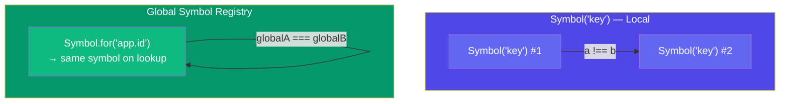
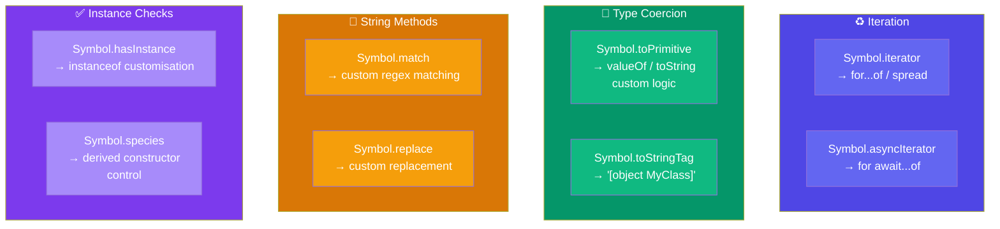

## Symbols

A **Symbol** is a primitive type introduced in ES6 that creates a guaranteed-unique identifier. Unlike strings or numbers, every Symbol is distinct — even if they share the same description.

### Creating Symbols

```javascript
const id1 = Symbol("id");
const id2 = Symbol("id");

console.log(id1 === id2); // false — always unique!
console.log(typeof id1);  // "symbol"

const noDesc = Symbol();
console.log(noDesc); // Symbol()
```

Symbols are **not** automatically converted to strings:

```javascript
const sym = Symbol("hello");
console.log(sym);             // Symbol(hello)
console.log(sym.toString());  // "Symbol(hello)"
console.log(String(sym));     // "Symbol(hello)"

try {
  sym + " world";             // ❌ TypeError!
} catch (e) {
  console.log(e.message);
  // "Cannot convert a Symbol value to a string"
}
```

### `Symbol()` vs `Symbol.for()`

`Symbol()` creates a unique symbol every time. `Symbol.for()` creates or retrieves a symbol from a **global symbol registry** — sharing by key.

```javascript
// Unique every time
const a = Symbol("key");
const b = Symbol("key");
a === b; // false

// Global registry — shared across realms
const globalA = Symbol.for("app.id");
const globalB = Symbol.for("app.id");
globalA === globalB; // true — retrieved from registry

Symbol.keyFor(globalA); // "app.id" — reverse lookup
Symbol.keyFor(a);       // undefined — not in registry
```



### Symbols as Object Keys

Symbols make perfect object keys — they're guaranteed not to collide with string keys or other symbols. This makes them ideal for **hidden properties** or **metadata**.

```javascript
const secret = Symbol("secret");
const user = {
  name: "Alice",
  age: 30,
  [secret]: "hidden-value",
};

console.log(user.name);           // "Alice"
console.log(user[secret]);        // "hidden-value"

// Symbols are hidden from normal iteration
console.log(Object.keys(user));    // ["name", "age"]
console.log(Object.getOwnPropertyNames(user)); // ["name", "age"]

// But visible with specific methods
console.log(Object.getOwnPropertySymbols(user)); // [Symbol(secret)]
console.log(Reflect.ownKeys(user)); // ["name", "age", Symbol(secret)]
```

### Enum-Like Pattern with Symbols

```javascript
const Colors = {
  RED: Symbol("red"),
  GREEN: Symbol("green"),
  BLUE: Symbol("blue"),
};

function getColorName(color) {
  switch (color) {
    case Colors.RED:   return "Red";
    case Colors.GREEN: return "Green";
    case Colors.BLUE:  return "Blue";
    default:           return "Unknown";
  }
}

console.log(getColorName(Colors.RED)); // "Red"

// Guaranteed unique — no accidental string matching
Colors.RED === Colors.RED;   // true
Colors.RED === "red";        // false — protected!
```

### Well-Known Symbols

JavaScript uses built-in symbols to customize core behaviour. These are properties on the `Symbol` object.

```javascript
Symbol.iterator;       // Makes objects iterable (for...of, spread)
Symbol.asyncIterator;  // Makes objects async-iterable (for await...of)
Symbol.hasInstance;    // Customizes instanceof checks
Symbol.toPrimitive;    // Customizes type coercion
Symbol.toStringTag;    // Customizes Object.prototype.toString
Symbol.species;        // Controls which constructor is used in derived objects
Symbol.match;          // Customizes String.prototype.match
Symbol.replace;        // Customizes String.prototype.replace
```



### Practical Example: `Symbol.iterator`

```javascript
class Range {
  constructor(from, to) {
    this.from = from;
    this.to = to;
  }

  [Symbol.iterator]() {
    let current = this.from;
    const last = this.to;
    return {
      next() {
        return current <= last
          ? { value: current++, done: false }
          : { value: undefined, done: true };
      },
    };
  }
}

const r = new Range(1, 5);
console.log([...r]); // [1, 2, 3, 4, 5]

for (const n of r) {
  console.log(n); // 1, 2, 3, 4, 5
}
```

### Practical Example: `Symbol.toPrimitive`

```javascript
class Money {
  constructor(amount, currency) {
    this.amount = amount;
    this.currency = currency;
  }

  [Symbol.toPrimitive](hint) {
    if (hint === "string") {
      return `${this.amount} ${this.currency}`;
    }
    if (hint === "number") {
      return this.amount;
    }
    return this.amount; // default
  }
}

const price = new Money(99, "USD");

console.log(String(price));  // "99 USD"
console.log(+price);         // 99
console.log(`${price}`);     // "99 USD"
```

### 🚨 Common Gotchas

```javascript
// Symbols are NOT auto-converted to strings
const sym = Symbol("test");
// `${sym}` works, but sym + "" throws TypeError

// Symbol descriptions are for debugging only — not the value
Symbol("id") !== Symbol("id"); // always true

// JSON.stringify ignores symbol-keyed properties
const obj = { [Symbol("secret")]: 42 };
JSON.stringify(obj); // "{}"

// Symbols from Symbol.for are shared globally — name collisions possible
// Use scoped prefixes: Symbol.for("myapp.db.connection")
```

### Key Takeaways

- `Symbol()` creates a **unique** identifier every time; `Symbol.for()` shares via a global registry
- Symbols make excellent object keys for **hidden/metadata** properties
- Well-known symbols (`Symbol.iterator`, `Symbol.toPrimitive`, etc.) let you hook into JavaScript's internal behaviours
- Symbols are invisible to `for...in`, `Object.keys()`, and `JSON.stringify` — use `Object.getOwnPropertySymbols()` to find them
- Use symbols to create safe enum-like constants and avoid property name collisions
