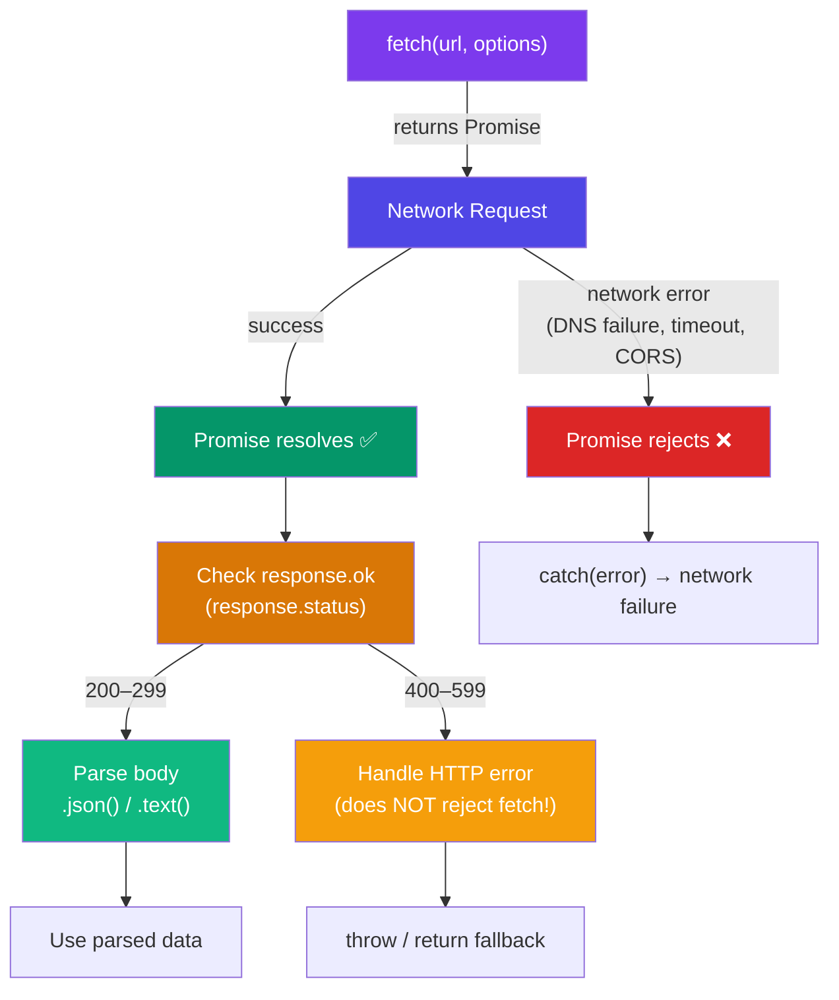

## Fetch & AJAX

The **Fetch API** is the modern way to make HTTP requests in JavaScript. It replaces the older `XMLHttpRequest` (XHR) and is built into all modern browsers and Node.js (since v18).

### Basic Fetch

`fetch()` returns a **Promise** that resolves to the `Response` object.

```javascript
fetch("https://api.example.com/users")
  .then((response) => {
    console.log(response.status); // 200
    console.log(response.ok);     // true (status 200–299)
    return response.json();       // parse JSON body
  })
  .then((data) => {
    console.log(data); // the parsed JSON
  })
  .catch((error) => {
    console.error("Fetch failed:", error);
  });
```

### Using `async/await`

```javascript
async function getUsers() {
  try {
    const response = await fetch("https://api.example.com/users");

    if (!response.ok) {
      throw new Error(`HTTP ${response.status}: ${response.statusText}`);
    }

    const data = await response.json();
    return data;
  } catch (error) {
    console.error("Failed to fetch users:", error.message);
    return [];
  }
}

const users = await getUsers();
```

> For a deep dive into Promises and async/await, see the [Async JavaScript](/DSA-Notes-Problems/javascript/async/async-javascript) page and the [Namaste JavaScript async/await notes](/DSA-Notes-Problems/namaste-js/season-2/async-await).

### Request & Response

```javascript
// POST with JSON body
async function createUser(userData) {
  const response = await fetch("https://api.example.com/users", {
    method: "POST",
    headers: {
      "Content-Type": "application/json",
      "Authorization": "Bearer your-token",
    },
    body: JSON.stringify(userData),
  });

  return response.json();
}

// Other HTTP methods
await fetch("/api/update", { method: "PUT", body: JSON.stringify(data) });
await fetch("/api/delete/1", { method: "DELETE" });
await fetch("/api/patch", { method: "PATCH", body: JSON.stringify(partial) });
```

### The `Response` Object

```javascript
async function inspectResponse() {
  const response = await fetch("https://api.example.com/data");

  console.log(response.status);      // 200, 404, 500, etc.
  console.log(response.statusText);  // "OK", "Not Found", etc.
  console.log(response.ok);          // true if status 200–299
  console.log(response.headers.get("content-type")); // "application/json"
  console.log(response.url);         // final URL (after redirects)
  console.log(response.redirected);  // true if followed a redirect

  // Different ways to read the body
  const text = await response.text();     // as string
  const json = await response.json();     // as parsed JSON
  const blob = await response.blob();     // as binary blob
  const form = await response.formData(); // as FormData
  const buffer = await response.arrayBuffer(); // as ArrayBuffer
}
```

### Fetch Lifecycle



### ⚠️ Key Gotcha: HTTP Errors Don't Reject

`fetch()` only rejects on **network errors** (DNS failure, timeout, CORS). HTTP 404/500 responses still resolve successfully — you must check `response.ok`.

```javascript
async function safeFetch(url) {
  const response = await fetch(url);

  // ❌ Common mistake: assuming non-2xx rejects
  // fetch doesn't throw on 404 or 500!

  // ✅ Always check
  if (!response.ok) {
    throw new Error(`Request failed: ${response.status}`);
  }

  return response.json();
}
```

### Cancelling Requests with `AbortController`

```javascript
async function searchUsers(query) {
  const controller = new AbortController();
  const signal = controller.signal;

  // Cancel if the user types again within 300ms
  const timeoutId = setTimeout(() => controller.abort(), 300);

  try {
    const response = await fetch(`/api/search?q=${query}`, { signal });
    clearTimeout(timeoutId);
    return await response.json();
  } catch (error) {
    if (error.name === "AbortError") {
      console.log("Request was cancelled (user typed faster)");
      return null;
    }
    throw error; // re-throw real errors
  }
}
```

### AbortController with Timeout

```javascript
async function fetchWithTimeout(url, timeoutMs = 5000) {
  const controller = new AbortController();
  const timeout = setTimeout(() => controller.abort(), timeoutMs);

  try {
    const response = await fetch(url, { signal: controller.signal });
    return response.json();
  } finally {
    clearTimeout(timeout);
  }
}

// Usage
try {
  const data = await fetchWithTimeout("https://api.example.com/slow", 3000);
  console.log(data);
} catch (error) {
  console.error("Request timed out or failed:", error.message);
}
```

### Headers & Custom Requests

```javascript
// Using the Headers API
const headers = new Headers();
headers.set("Content-Type", "application/json");
headers.set("Authorization", `Bearer ${token}`);
headers.set("X-Custom-Header", "custom-value");

// Check headers
headers.has("Content-Type"); // true
headers.get("Content-Type"); // "application/json"

// Delete a header
headers.delete("X-Custom-Header");

const response = await fetch("/api/data", {
  method: "POST",
  headers,
  body: JSON.stringify({ key: "value" }),
});
```

### Form Data & File Upload

```javascript
async function uploadFile(file) {
  const formData = new FormData();
  formData.append("avatar", file);
  formData.append("userId", "123");

  const response = await fetch("/api/upload", {
    method: "POST",
    body: formData, // Do NOT set Content-Type — browser sets it with boundary
  });

  return response.json();
}

// Upload multiple files
async function uploadMultiple(files) {
  const formData = new FormData();
  files.forEach((file, i) => formData.append(`file_${i}`, file));

  const response = await fetch("/api/uploads", {
    method: "POST",
    body: formData,
  });

  return response.json();
}
```

### Handling JSON Errors

```javascript
async function robustFetch(url) {
  const response = await fetch(url);

  let body;
  try {
    body = await response.json();
  } catch {
    body = await response.text(); // fallback if body isn't JSON
  }

  if (!response.ok) {
    const error = new Error(`HTTP ${response.status}`);
    error.status = response.status;
    error.body = body;
    throw error;
  }

  return body;
}

// Usage
try {
  const data = await robustFetch("/api/users");
} catch (error) {
  console.error(error.status, error.body);
}
```

### Brief History: `XMLHttpRequest` (XHR)

Before `fetch()`, the only way to make HTTP requests in the browser was `XMLHttpRequest`:

```javascript
// Legacy XHR pattern
function loadData(url, callback) {
  const xhr = new XMLHttpRequest();
  xhr.open("GET", url);
  xhr.onload = () => {
    if (xhr.status >= 200 && xhr.status < 300) {
      callback(null, JSON.parse(xhr.responseText));
    } else {
      callback(new Error(`HTTP ${xhr.status}`));
    }
  };
  xhr.onerror = () => callback(new Error("Network error"));
  xhr.send();
}
```

| | `fetch()` | `XMLHttpRequest` |
|---|---|---|
| Promise-based | ✅ Yes | ❌ Callback-based |
| Streamable | ✅ Yes (Response.body) | ❌ No |
| Abortable | ✅ AbortController | ✅ xhr.abort() |
| Upload progress | ❌ No native | ✅ xhr.upload.onprogress |
| Request/Response API | ✅ Modern, clean | ❌ Verbose |

> **Use `fetch()` for all new code.** Only fall back to XHR if you need upload progress tracking.

### 🚨 Common Gotchas

```javascript
// fetch() follows redirects by default — change with redirect: "manual"
const response = await fetch("/api/old-path", { redirect: "manual" });
// response.status will be 30x, response.headers.get("location") for the redirect URL

// CORS: fetch() blocks cross-origin requests unless the server allows it
// Server must include: Access-Control-Allow-Origin: *

// Credentials: cookies are NOT sent cross-origin by default
fetch("/api/data", { credentials: "include" }); // send cookies

// Response body can only be consumed ONCE
const res = await fetch("/api/data");
const text = await res.text(); // ✅ works
const json = await res.json(); // ❌ TypeError: Already read!

// Clone response to read multiple times
const clone = res.clone();
const text2 = await clone.text(); // ✅ works
```

### Key Takeaways

- `fetch()` returns a Promise — use `async/await` for cleaner code
- **HTTP errors (404, 500) do NOT reject** — always check `response.ok`
- Use `AbortController` to cancel in-flight requests (cleanup on unmount, debounce, timeouts)
- The response body can only be consumed once — clone if you need multiple reads
- `fetch()` sends credentials only with `credentials: "include"`
- CORS errors happen when the server doesn't allow cross-origin requests — check server headers
- Prefer `fetch()` over XHR for all new code; XHR is only needed for upload progress
