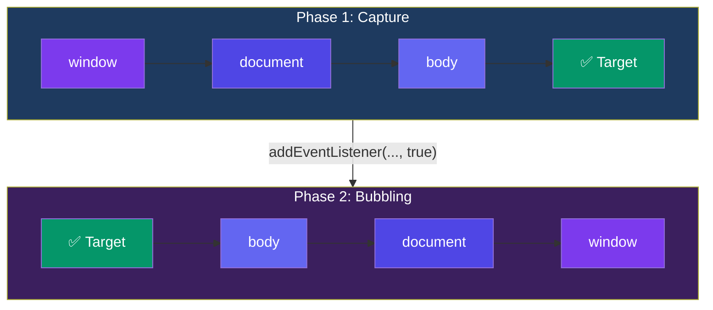

## Events & Event Handling

Events signal that something has happened — a click, a keypress, a form submission. JavaScript listens and responds.

### `addEventListener`

```javascript
const button = document.querySelector("#submit");

button.addEventListener("click", (event) => {
  console.log("Button clicked!", event);
});

// Remove listener (must reference the same function)
function handleClick(e) { console.log("clicked"); }
button.addEventListener("click", handleClick);
button.removeEventListener("click", handleClick);
```

### The Event Object

The event object contains information about the event.

```javascript
element.addEventListener("click", (e) => {
  e.target;        // the element that triggered the event
  e.currentTarget; // the element the listener is attached to
  e.type;          // "click"
  e.clientX, e.clientY; // mouse coordinates
  e.key;           // keyboard key (for keydown/keyup)
  e.code;          // physical key code
});
```

### Bubbling vs Capturing



```javascript
// Bubbling (default) — event travels up from target to document
document.querySelector(".child").addEventListener("click", () => {
  console.log("child"); // fires first
});
document.querySelector(".parent").addEventListener("click", () => {
  console.log("parent"); // fires second (bubbled up)
});

// Capturing — event travels down from document to target
// Pass true as third argument
document.querySelector(".parent").addEventListener("click", () => {
  console.log("parent capturing"); // fires first
}, true);
```

### Event Delegation

Instead of adding a listener to every child, add one to the parent and use `event.target`.

```javascript
// ❌ Inefficient — listener on every item
document.querySelectorAll("li").forEach(li => {
  li.addEventListener("click", handleClick);
});

// ✅ Event delegation — one listener on parent
document.querySelector("ul").addEventListener("click", (e) => {
  if (e.target.tagName === "LI") {
    console.log("Clicked:", e.target.textContent);
  }
});

// Also works for dynamically added elements!
const list = document.querySelector("ul");
list.addEventListener("click", (e) => {
  const item = e.target.closest("li[data-id]");
  if (item) console.log(item.dataset.id);
});
```

### `preventDefault` & `stopPropagation`

```javascript
// preventDefault — stops the browser's default behavior
document.querySelector("a").addEventListener("click", (e) => {
  e.preventDefault(); // stop navigation
  console.log("Link clicked but no navigation");
});

// stopPropagation — stops event from bubbling/capturing further
document.querySelector(".child").addEventListener("click", (e) => {
  e.stopPropagation(); // parent won't fire
  console.log("Only child fires");
});
```

### Key Takeaways

- Use `addEventListener` instead of inline `onclick` attributes (separation of concerns)
- Events bubble by default — from target up to `document`
- Capture phase (third argument `true`) travels down from `document` to target
- Event delegation uses a single parent listener to handle many children
- `e.preventDefault()` stops default browser behavior
- `e.stopPropagation()` stops the event from traveling further
- `e.target` is the original element; `e.currentTarget` is where the listener is attached
