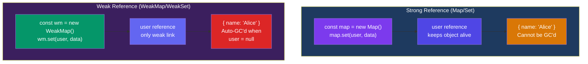

## Map & Set

ES6 introduced `Map` and `Set` — two collection types that fill gaps in what plain objects and arrays can do.

---

### Map

A `Map` holds key-value pairs where **keys can be any type** (objects, functions, primitives). It remembers insertion order and has a `size` property.

```javascript
const map = new Map();

map.set("name", "Alice");
map.set(42, "a number key");
map.set({ id: 1 }, "an object key");

map.size;              // 3
map.get("name");       // "Alice"
map.has(42);           // true
map.delete(42);        // true
map.size;              // 2
map.clear();           // removes all
```

### Map vs Object

```javascript
// Object — string/symbol keys only, prototype chain
const obj = { name: "Alice" };
obj[42] = "coerced to string";
Object.keys(obj);      // ["name", "42"]

// Map — any key type, no prototype chain
const map = new Map();
map.set("name", "Alice");
map.set(42, "real number key"); // no coercion!
map.set(document.getElementById("btn"), "element key");

map.size;              // 3 (Objects don't have .size)
```

| Feature | Object | Map |
|---|---|---|
| Key types | String / Symbol | Any type |
| Iteration | `Object.keys/values/entries` | Directly iterable |
| Size | Manual (`Object.keys().length`) | `.size` property |
| Order | Integer keys first, then insertion | Insertion order |
| Prototype | Has `Object.prototype` | None |
| JSON | `JSON.stringify()` works | No native serialization |
| Performance | Good for small static keys | Better for frequent add/delete |

```javascript
// When to use Map ✅
const userRoles = new Map();
userRoles.set(alice, "admin");
userRoles.set(bob, "user");
userRoles.get(alice); // "admin"

// When to use Object ✅
const config = { theme: "dark", lang: "en" };
JSON.stringify(config); // easy serialization
```

### Iterating a Map

```javascript
const map = new Map([
  ["a", 1],
  ["b", 2],
  ["c", 3],
]);

// for...of gives [key, value] entries
for (const [key, value] of map) {
  console.log(key, value);
}

// Dedicated methods
map.forEach((value, key) => console.log(key, value));
[...map.keys()];       // ["a", "b", "c"]
[...map.values()];     // [1, 2, 3]
[...map.entries()];    // [["a",1], ["b",2], ["c",3]]
```

### Converting Map ↔ Object

```javascript
const map = new Map([["name", "Alice"], ["age", 30]]);

// Map → Object
const obj = Object.fromEntries(map);
// { name: "Alice", age: 30 }

// Object → Map
const map2 = new Map(Object.entries(obj));
```

---

### Set

A `Set` stores **unique values** of any type. It's like an array with automatic deduplication.

```javascript
const set = new Set([1, 2, 3, 2, 1]);
// Set(3) { 1, 2, 3 } — duplicates removed

set.add(4);
set.has(2);          // true
set.size;            // 4
set.delete(1);       // true
set.clear();         // removes all
```

### Common Set Patterns

```javascript
// 1. Remove duplicates from array
const arr = [1, 2, 2, 3, 3, 4];
const unique = [...new Set(arr)];
// [1, 2, 3, 4]

// 2. Check for duplicates
function hasDuplicates(arr) {
  return new Set(arr).size !== arr.length;
}
hasDuplicates([1, 2, 3]);    // false
hasDuplicates([1, 2, 2]);    // true

// 3. Set operations
const setA = new Set([1, 2, 3]);
const setB = new Set([2, 3, 4]);

// Union
const union = new Set([...setA, ...setB]);
// Set { 1, 2, 3, 4 }

// Intersection
const intersection = new Set(
  [...setA].filter((x) => setB.has(x))
);
// Set { 2, 3 }

// Difference
const difference = new Set(
  [...setA].filter((x) => !setB.has(x))
);
// Set { 1 }

// 4. Iterate
setA.forEach((val) => console.log(val));
for (const val of setA) console.log(val);
[...setA]; // [1, 2, 3]
```

---

### WeakMap & WeakSet

`WeakMap` and `WeakSet` are **garbage-collectable** versions. Keys must be objects, and if no other references exist, the entry is automatically cleaned up.

```javascript
// WeakMap — keys must be objects, entries auto-GC'd
const wm = new WeakMap();
let user = { name: "Alice" };
wm.set(user, { role: "admin" });
wm.get(user);     // { role: "admin" }
user = null;      // entry is garbage collected! 🗑️

// WeakSet — objects only, auto-GC'd
const ws = new WeakSet();
let item = { id: 1 };
ws.add(item);
ws.has(item);     // true
item = null;      // auto-removed
```



### Practical Use Cases

```javascript
// 1. Private data with WeakMap
const _private = new WeakMap();
class Person {
  constructor(name, ssn) {
    _private.set(this, { ssn }); // truly private
    this.name = name;
  }
  getSSN() {
    return _private.get(this).ssn;
  }
}

// 2. Tracking visited nodes (Set)
function hasCycle(graph) {
  const visited = new Set();
  function dfs(node) {
    if (visited.has(node)) return true;
    visited.add(node);
    return node.neighbors.some(dfs);
  }
  return dfs(graph.root);
}

// 3. DOM element metadata (WeakMap — auto-cleaned)
const elementData = new WeakMap();
const btn = document.querySelector("#submit");
elementData.set(btn, { clicks: 0 });
btn.addEventListener("click", () => {
  const data = elementData.get(btn);
  data.clicks++;
});
// When btn is removed from DOM, entry auto-GC'd
```

### Key Takeaways

- `Map` accepts **any key type** and has `.size` — use over Object for dynamic key-value data
- `Set` stores **unique values** — ideal for deduplication and membership checks
- `WeakMap` and `WeakSet` prevent memory leaks by allowing garbage collection
- `WeakMap` keys must be objects; they're invisible to iteration
- Use `Object.fromEntries()` and `new Map(Object.entries(obj))` to convert between Map and Object
- Common Set operations (union, intersection, difference) are easy with spread + filter
