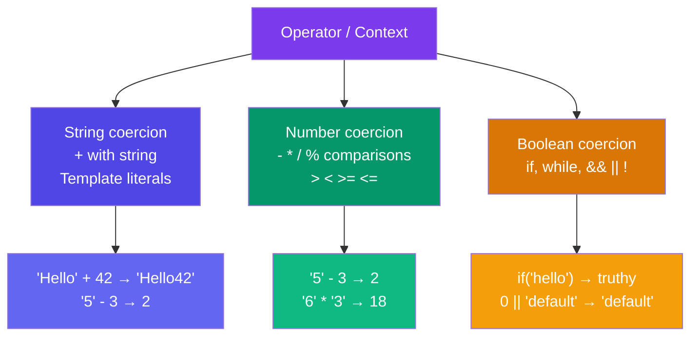

## Data Types & Type Conversion

JavaScript has **7 primitive types** and **objects** (non-primitive). Understanding the difference — and how JS coerces values between types — is foundational.

### 7 Primitive Types

```javascript
// string, number, bigint, boolean, undefined, null, symbol

const name = "Alice";          // string
const age = 30;                // number
const big = 9007199254740991n; // bigint
const isActive = true;         // boolean
let notAssigned;               // undefined
const empty = null;            // null
const sym = Symbol("id");      // symbol
```

### Objects (Non-Primitive)

```javascript
const obj = { key: "value" };     // object
const arr = [1, 2, 3];            // array (is an object)
const fn = () => {};              // function (callable object)
```

### `typeof` Quirks

```javascript
typeof 42          // "number"
typeof "hello"     // "string"
typeof true        // "boolean"
typeof undefined   // "undefined"
typeof null        // "object" ← THE quirk (not a real object)
typeof []          // "object" → use Array.isArray()
typeof {}          // "object"
typeof function(){} // "function"
typeof Symbol()    // "symbol"
typeof 42n         // "bigint"
```

> **Gotcha:** `typeof null === "object"` is a historic bug in JavaScript that can't be fixed without breaking existing code.

### 🚨 Floating-Point Gotcha

```javascript
0.1 + 0.2 === 0.3;  // false! ← IEEE 754 floating-point
0.1 + 0.2;           // 0.30000000000000004

// Workaround: round or use a small epsilon
Math.abs((0.1 + 0.2) - 0.3) < Number.EPSILON; // true
```

### `NaN` (Not-a-Number)

```javascript
0 / 0;           // NaN
"abc" * 2;       // NaN

NaN === NaN;     // false ← NaN is not equal to itself!
Number.isNaN(NaN); // true ✅
```

### Implicit Coercion (Type Coercion)

JavaScript automatically converts types when operators don't match.



```javascript
"5" - 2;            // 3 (string coerced to number)
"5" + 2;            // "52" (+ triggers string concatenation)
+"3";               // 3 (unary plus coerces to number)
!!"hello";          // true (!! coerces to boolean)
```

### Explicit Conversion

```javascript
Number("123");      // 123
Number("abc");      // NaN
String(123);        // "123"
Boolean(0);         // false
Boolean("hello");   // true
parseInt("42px");   // 42
parseFloat("3.14"); // 3.14
```

### Truthy & Falsy Values

**Falsy (only 8 values):** `false`, `0`, `-0`, `0n`, `""`, `''`, `` ``, `null`, `undefined`, `NaN`

**Everything else is truthy.**

```javascript
if ([]) console.log("truthy");  // ✅ runs (empty array is truthy)
if ({}) console.log("truthy");  // ✅ runs (empty object is truthy)
if ("false") console.log("truthy"); // ✅ runs (non-empty string)
if (0) console.log("runs?");    // ❌ does NOT run
```

### Key Takeaways

- JavaScript has 7 primitive types: `string`, `number`, `bigint`, `boolean`, `undefined`, `null`, `symbol`
- `typeof null === "object"` is a historic bug
- `NaN` is the only value not equal to itself
- Floating-point arithmetic is imprecise — never compare with `===` directly
- Use explicit conversion (`Number()`, `String()`, `Boolean()`) for clarity
- Only 8 falsy values; everything else is truthy
