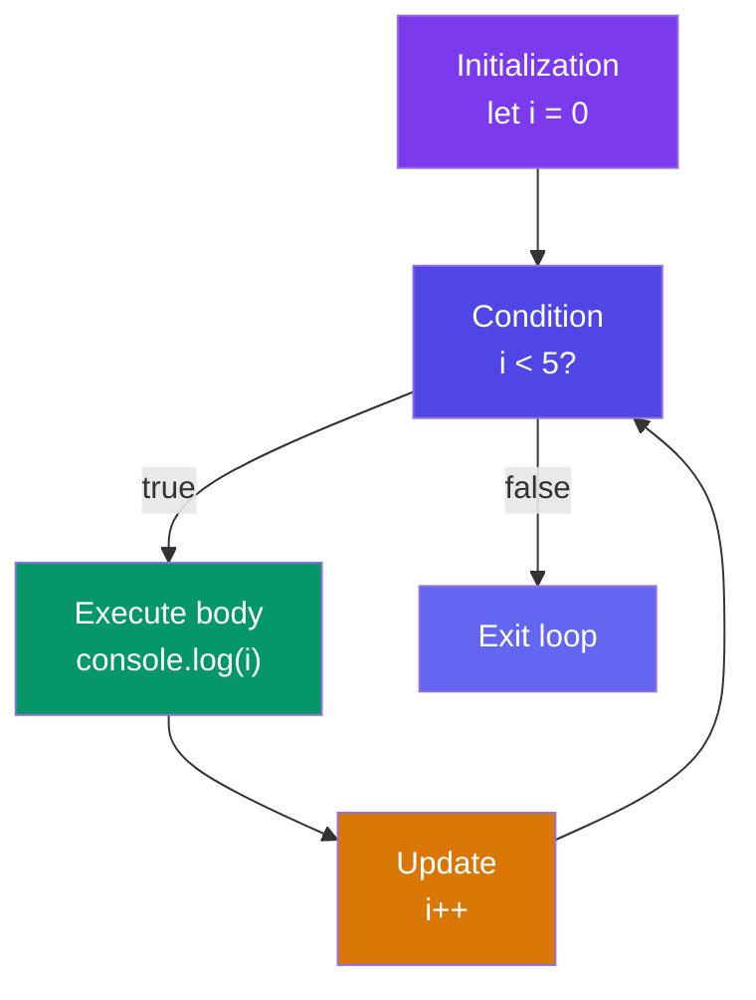

## Loops & Iteration

Loops let you repeat a block of code. JavaScript gives you several flavors — each suited to a different scenario.

### `for` Loop

Classic loop with counter. Best when you know the number of iterations.

```javascript
for (let i = 0; i < 5; i++) {
  console.log(i);
}
// Output: 0 1 2 3 4
```

**Loop control flow:**



### `while` Loop

Repeats while a condition is true. Use when the number of iterations isn't known upfront.

```javascript
let i = 0;
while (i < 5) {
  console.log(i);
  i++;
}
// Output: 0 1 2 3 4
```

### `do...while` Loop

**Always runs at least once** — the condition is checked after the body.

```javascript
let i = 0;
do {
  console.log(i);
  i++;
} while (i < 5);
// Output: 0 1 2 3 4
```

### `for...of` (Iterate Values)

Use for iterating over **values** of arrays, strings, Maps, Sets, and other iterables.

```javascript
const fruits = ["apple", "banana", "cherry"];
for (const fruit of fruits) {
  console.log(fruit);
}
// Output: apple banana cherry

const str = "hello";
for (const char of str) {
  console.log(char);
}
// Output: h e l l o
```

### `for...in` (Iterate Keys)

Use for iterating over **enumerable keys** of objects. **Not recommended for arrays.**

```javascript
const obj = { a: 1, b: 2, c: 3 };
for (const key in obj) {
  console.log(key, obj[key]);
}
// Output: a 1 b 2 c 3
```

> **⚠️ Why not `for...in` for arrays?** It iterates **keys as strings** (`"0"`, `"1"`, `"2"`) and includes inherited enumerable properties. Use `for...of` or `.forEach()` for arrays.

### `break` & `continue`

```javascript
for (let i = 0; i < 10; i++) {
  if (i === 3) continue;  // skip this iteration
  if (i === 7) break;     // exit loop entirely
  console.log(i);
}
// Output: 0 1 2 4 5 6
```

### Labeled Loops

Break out of nested loops by labeling the outer loop.

```javascript
outer: for (let i = 0; i < 3; i++) {
  for (let j = 0; j < 3; j++) {
    if (i === 1 && j === 1) break outer;
    console.log(i, j);
  }
}
// Output: 0 0  0 1  0 2  1 0
```

### `.forEach()` vs `for...of`

```javascript
const nums = [10, 20, 30];

// forEach — can't break/continue, no await support
nums.forEach(n => console.log(n));

// for...of — can break, continue, use await
for (const n of nums) {
  if (n === 20) continue;
  console.log(n);
}
// Output: 10 30
```

### Key Takeaways

- `for` — use with a counter and known iteration count
- `while` — use when iterations depend on a condition that may change
- `do...while` — guarantees at least one execution
- `for...of` — preferred for iterable values (arrays, strings, Maps, Sets)
- `for...in` — for object keys only; avoid on arrays
- `break` exits the loop, `continue` skips to the next iteration
- `.forEach()` cannot `break` or `continue` — use `for...of` when you need control flow
