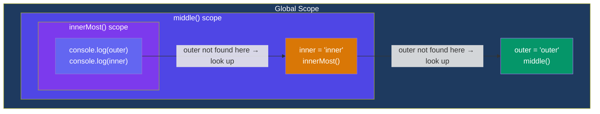

## Scope & Closures

Scope determines where variables are accessible. JavaScript uses **lexical scoping** — the scope is determined by where the code is written, not where it's called.

### Global Scope

Variables declared outside any function or block are globally accessible.

```javascript
const globalVar = "I'm everywhere";

function readGlobal() {
  console.log(globalVar); // "I'm everywhere"
}
```

### Function Scope

`var`-declared variables are scoped to the nearest function.

```javascript
function example() {
  var x = 10;
  console.log(x); // 10
}
console.log(x); // ❌ ReferenceError
```

### Block Scope

`let` and `const` are scoped to the nearest block `{}`.

```javascript
if (true) {
  let y = 20;
  const z = 30;
  var w = 40; // NOT block-scoped — leaks out!
}
console.log(w); // 40
console.log(y); // ❌ ReferenceError
console.log(z); // ❌ ReferenceError
```

### Lexical Scope & Scope Chain

When a variable is referenced, JavaScript walks **up** the scope chain until it finds it.

```javascript
const outer = "outer";

function middle() {
  const inner = "inner";

  function innerMost() {
    console.log(outer); // "outer" (from global scope)
    console.log(inner); // "inner" (from parent scope)
  }

  innerMost();
}

middle();
```



### Closures

A **closure** is a function that retains access to its outer scope even after the outer function has returned.

```javascript
function counter() {
  let count = 0;
  return function() {
    count++;
    return count;
  };
}

const increment = counter();
console.log(increment()); // 1
console.log(increment()); // 2
console.log(increment()); // 3
```

The inner function "closes over" the `count` variable — it remains accessible even though `counter()` has finished executing.

### Common Closure Gotcha

```javascript
for (var i = 0; i < 3; i++) {
  setTimeout(() => console.log(i), 100);
}
// Output: 3 3 3 (all share the same `i`)

// Fix with let (block scope):
for (let i = 0; i < 3; i++) {
  setTimeout(() => console.log(i), 100);
}
// Output: 0 1 2
```

> 💡 For an in-depth exploration of closures with diagrams and interview questions, see the [Namaste JavaScript Closures notes](/DSA-Notes-Problems/namaste-js/season-1/closures-in-js).

### Key Takeaways

- Lexical scope means where you **write** the code determines variable access
- `let`/`const` are block-scoped; `var` is function-scoped
- The scope chain walks up through nested scopes to resolve variables
- A closure remembers its lexical scope even after the outer function returns
- Use `let` in loops with closures to capture the correct value per iteration
- Closures power data encapsulation, currying, and memoization patterns
