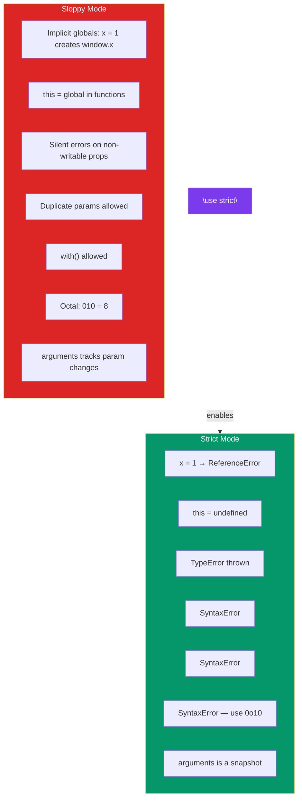

## Strict Mode

Strict mode is a **restricted variant** of JavaScript that catches common mistakes and prevents unsafe actions. You opt-in with `"use strict"` — either globally or inside a function.

### Enabling Strict Mode

```javascript
// Global strict mode (at the top of a file)
"use strict";
// All code in this file runs in strict mode

// Function-level strict mode
function strictFn() {
  "use strict";
  // Only code inside this function runs in strict mode
}

function sloppyFn() {
  // This function runs in sloppy (non-strict) mode
}
```

> **Modules and classes are strict by default** — no need for the directive.

### What Strict Mode Changes

#### 1. No Implicit Globals

Without strict mode, assigning to an undeclared variable creates a global.

```javascript
"use strict";

function setValue() {
  x = 10; // ❌ ReferenceError: x is not defined
}

setValue();
```

```javascript
// Without strict mode — silently creates a global
function setValue() {
  x = 10; // x becomes a global variable (leak!)
}
setValue();
console.log(x); // 10 — leaked!
```

#### 2. `this` in Functions

In strict mode, `this` is `undefined` in regular function calls — it doesn't default to the global object.

```javascript
"use strict";

function showThis() {
  console.log(this);
}

showThis(); // undefined (not Window/global)

// Still works as expected on objects
const obj = {
  method() {
    console.log(this); // obj
  },
};
obj.method(); // { method: [Function] }
```

```javascript
// Without strict mode
function sloppyShow() {
  console.log(this); // Window (global object)
}
sloppyShow();
```

#### 3. Silent Errors → Throw

Many silent failures in sloppy mode become explicit errors in strict mode.

```javascript
"use strict";

// Assigning to a non-writable property
const obj = Object.freeze({ x: 1 });
obj.x = 2; // ❌ TypeError: Cannot assign to read only property

// Deleting undeletable properties
delete Object.prototype; // ❌ TypeError

// Duplicate parameter names
function duplicate(a, a) { // ❌ SyntaxError
  return a;
}
```

```javascript
// Sloppy mode — fails silently
const obj = Object.freeze({ x: 1 });
obj.x = 2; // silently ignored (no error)
console.log(obj.x); // 1
```

#### 4. `with` is Banned

```javascript
"use strict";

with (Math) { // ❌ SyntaxError: Strict mode code may not include a with statement
  console.log(PI);
}
```

#### 5. Octal Literals Are Banned

```javascript
"use strict";

const x = 010; // ❌ SyntaxError: Octal literals not allowed
// Use 0o10 instead (ES6+ octal prefix)
```

#### 6. `arguments` Behaviour

```javascript
"use strict";

function show(a) {
  a = 2;
  console.log(a);          // 2
  console.log(arguments[0]); // 1 (unchanged!)
}

show(1);
```

```javascript
// Sloppy mode — arguments[0] tracks parameter changes
function show(a) {
  a = 2;
  console.log(a);          // 2
  console.log(arguments[0]); // 2 (tracks change)
}

show(1);
```

### Full Reference Table



### When to Use Strict Mode

| Scenario | Recommendation |
|---|---|
| New projects | **Always** — use modules (strict by default) |
| Legacy code | Add function-level strict mode gradually |
| Browser scripts (non-module) | Add global `"use strict"` at the top |
| Node.js CommonJS files | `"use strict"` or `"type": "module"` in package.json |
| Third-party libraries | Check if they use strict mode; modern ones do |

### Detecting Strict Mode

```javascript
function isStrictMode() {
  return !this; // In strict mode, this is undefined
  // In sloppy mode, this is the global object (truthy)
}

console.log(isStrictMode()); // true if file/module uses strict mode
```

### 🚨 Common Gotchas

```javascript
// Strict mode applies to the entire script — concatenation can break!
// file1.js (no strict) → file2.js ("use strict") — the directive applies globally

// Classes are strict by default — even in sloppy mode
class Example {
  constructor() {
    this.x = 1;
  }
  method() {
    // runs in strict mode
  }
}

// 'this' in event handlers
button.addEventListener("click", function() {
  "use strict";
  console.log(this); // the button element (event handlers still bind this to the element)
});
```

### Key Takeaways

- `"use strict"` enables a safer, more predictable JavaScript variant
- **Implicit globals become errors** — catches accidental leaks
- `this` is `undefined` in regular function calls (not the global object)
- **Silent failures throw** — non-writable property assignments, undeletable deletions
- `with` and octal literals are banned
- Modules (`type="module"`) and ES6 classes are **strict by default**
- Enable strict mode in all new code — it prevents real bugs and is required for modern JS features
